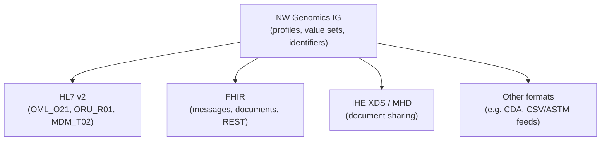
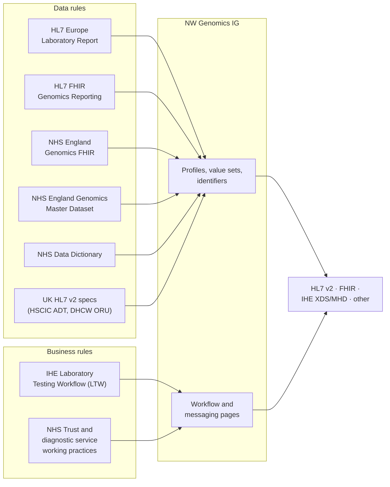
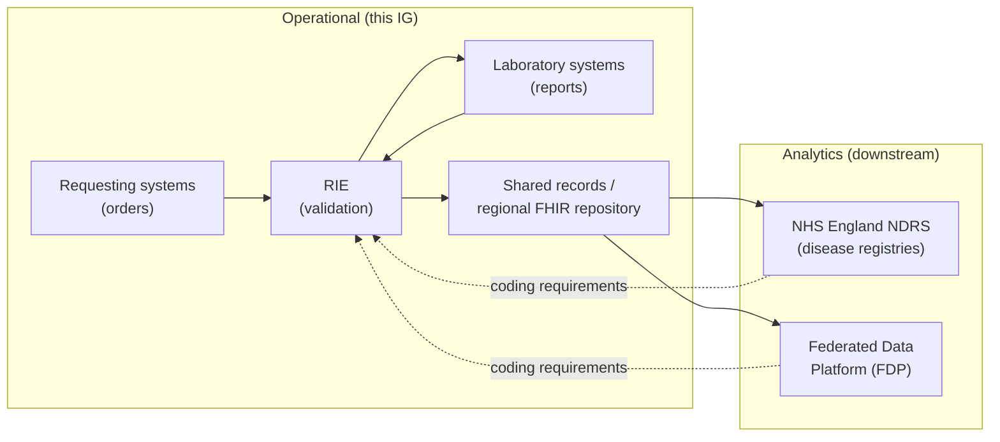
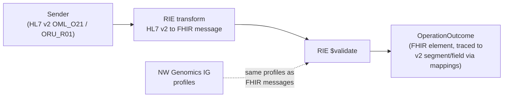

This page describes how this guide is used to keep genomic data **correct,
consistent and usable** as it moves between systems - data security in the
sense of data quality and integrity - and how that operational data relates
to the registries and data platforms downstream of it.

For running the FHIR Validator against these profiles, see
[FHIR Validation](testing-resources.html). How the validator is installed and
configured in the Regional Integration Engine (RIE) is described in the use
case [Data Security - FHIR Validator Setup](https://github.com/nw-gmsa/nw-gmsa-use-cases/blob/main/DataSecurity.md).

### Define once, apply to many formats

FHIR is used here to **document data requirements**, not only as a
transmission format. Each requirement - what an order, specimen, report or
variant must contain, and how it is coded and identified - is written once,
mostly as a FHIR profile in this guide, and then applied to every format the
data travels in:

- **HL7 v2** - the profiles carry HL7 v2 mappings (segment and field for each
  element), so the same requirement says which v2 field holds the value. See
  [HL7 v2 Standards](hl7v2.html).
- **FHIR** - messages, documents and RESTful resources are validated directly
  against the profiles.
- **IHE XDS / MHD** - XDS document metadata corresponds to the FHIR
  [Document Entry](StructureDefinition-DocumentReference.html) profile through
  IHE MHD, see [Document Exchange [MHD]](MHD.html).
- **Other formats** - some profiles also map to CDA, the Genomics Master
  Dataset and COSD pathology, for example.

Defining the requirements once means there is only one place to agree and
change them, the formats can't drift apart, and the FHIR Validator becomes a
single test for conformance whatever format a supplier actually sends. It
also means the profiles are the data contract (see
[Diagnostic Model Overview](diagnostic-core.html)): when a v2 or XDS interface
is designed, its content requirements come from this guide rather than being
re-specified for that interface.

### Where the rules come from

The rules in this guide are not invented locally - they are drawn from
existing standards and guidance, and fall into two groups:

- **Data rules** - what each item of data means, how it is coded and
  identified, and which elements are required. These come mostly from the
  **HL7 Europe Laboratory Report** (EU Laboratory Report) IG, the
  **HL7 FHIR Genomics Reporting** IG, the **NHS England Genomics FHIR**
  implementation guide, the **NHS England Genomics Master Dataset**, the
  **NHS Data Dictionary**, and UK national implementation guides such as the
  **HSCIC HL7 v2 ADT** specification and the **DHCW (Digital Health and Care
  Wales) ORU** message specification.
- **Business rules** - how orders, specimens and reports flow between
  systems, who sends what to whom and when, and how each step is
  acknowledged. These come from **IHE Laboratory Testing Workflow (LTW)**,
  together with the working practices of the NHS Trusts and diagnostic
  services that place and fulfil the orders. IHE LTW was written for HL7 v2
  (OML^O21 orders, ORU^R01 results, ...); the same rules have been carried
  forward into FHIR (`ServiceRequest`, `Task`, `DiagnosticReport` messages,
  using the same O21/R01 events), so a workflow behaves the same way whichever
  format carries it. See [Laboratory Testing Workflow (LTW)](LTW.html).

So, like the data rules, the business rules are defined once and applied to
several standards: data rules through the profiles' mappings, business rules
through the same events and roles in HL7 v2 and FHIR messaging.

Data rules are what the FHIR Validator checks against the profiles. Business
rules are mostly about the sequence and roles of messages, so they are
described in this guide's workflow pages and tested in integration testing
rather than by validating a single resource.

#### European Health Data Space (EHDS)

The data model's core is the **HL7 Europe Laboratory Report** IG and the
**HL7 Europe Core** IG it builds on, rather than **HL7 UK Core**. UK Core is
still in draft for diagnostic services (orders, specimens and reports), while
the HL7 Europe guides are published and stable for laboratory reporting, and
NHS England has expressed a view that it will also follow the EU Laboratory
Report. UK Core is still used where it is settled, for example for NHS
identifiers.

Building on the HL7 Europe guides also brings conformance with the
[European Health Data Space (EHDS)](https://health.ec.europa.eu/ehealth-digital-health-and-care/european-health-data-space-regulation-ehds_en)
regulation, which uses them as the basis of its laboratory results data
category. Data conforming to this guide's profiles is therefore already
shaped for EHDS exchange, as well as for NHS systems.

#### Why follow international and NHS data models

Interfaces have often been specified **point to point**: each LIMS or Trust
EPR connection gets its own message specification, written around that pair
of systems. This was common with HL7 v2, and is becoming more common with
HL7 FHIR in the NHS, as each project profiles FHIR for its own interface.
The result is many similar but incompatible specifications, each of which has
to be agreed, built, tested and maintained separately.

Following international (HL7 Europe, HL7 Genomics Reporting, IHE) and NHS
(NHS England, NHS Data Dictionary) data models avoids this:

- **The standard is reusable.** The same profiles serve many use cases -
  orders, reports, document sharing, registries and analytics - rather than
  one interface.
- **One standard, not one per system.** Previously each LIMS or Trust EPR was
  integrated one by one. Now every system is connected to the same standard,
  and each new connection reuses work already done.
- **Local needs don't change the model.** Local modifications are still
  needed (for example local codes, identifiers or ask-at-order-entry
  questions), but they are added as extensions to the primary model rather
  than altering it, so data stays exchangeable beyond the region.

This keeps the focus on the big picture - a shared data model for genomic and
laboratory data - rather than on the requirements of any single interface.

### Upstream of registries and data lakes

The data security described here is **operational**: it applies to the
orders, specimens and reports moving between the systems that request, test
and report on patients, at the time the care happens. Registries and data
lakes, such as NHS England's **National Disease Registration Service (NDRS)**
and the **Federated Data Platform (FDP)**, sit **downstream** of this. They
collect the same data later, often from many sources, for analysis, audit,
planning and research.

Because the operational data model is upstream, getting it right helps every
system that uses the data afterwards:

- **Coding requirements can be taken in from downstream systems.** Where a
  registry or data platform needs an item coded in a particular way (a SNOMED
  CT concept, a test directory code, an ODS code, an NHS Number), that
  requirement can be added to this guide's profiles and checked when the
  message is sent, rather than worked out afterwards.
- **Problems are fixed at source.** A missing code or wrong identifier caught
  by validation is corrected by the system that sent it, while the
  information is still to hand. Found later in a registry or data lake, the
  same problem has to be cleaned up, mapped or inferred, often for many
  records at once, and sometimes can't be fixed at all.
- **Downstream systems get consistent data.** Every sender is held to the same
  profiles, so registries and data platforms receive the same coding and
  structure whichever trust or laboratory the data came from.

The operational model does not try to be the analytics model. Some of what
registries and data lakes model is not relevant at the point of care, and
is deliberately left out:

- **Statistical and derived data** - counts, rates, cohorts, outcomes and
  other aggregated or calculated values. These are produced by the analytics
  systems from the operational records; operational messages carry the
  individual order, specimen and result, not statistics about them.
- **Items only known later, or collected only for registration** - for
  example staging or follow-up details that are assembled after the report
  has been issued. These belong to the registry's own data collection.

So this guide adopts downstream coding requirements where they apply to the
data operational systems actually exchange, and leaves the rest to the
analytics systems.

### FHIR Validation

A FHIR resource can be valid FHIR and still be of no use to the system
receiving it. Base FHIR R4 is deliberately permissive: almost every element is
optional, most codes can be replaced with free text, and an identifier can
come from any system. The data contract between a sender and a receiver is set
by this guide, which builds on HL7 Europe Laboratory Report and HL7
Europe Core, HL7 Genomics Reporting and, for NHS identifiers, UK Core. Its **profiles** say which elements must be present, which code
systems and value sets must be used (SNOMED CT, LOINC, the National Genomic
Test Directory, ...), which identifiers are expected (NHS Number, ODS codes,
placer order numbers), and how the resources in a message or document Bundle
fit together.

Validation checks a resource against those profiles automatically. We use it
because:

- **It tests conformance, not just syntax.** It finds missing mandatory
  elements, wrong or uncoded values, and identifiers or references the
  receiver can't use - problems that would otherwise only surface when a
  receiving system rejects a message, or worse, accepts it and stores data it
  cannot act on.
- **It is objective and repeatable.** Every supplier and system is tested
  against the same published rules, using the same HL7 tool, so "conformant"
  means the same thing for everyone, and any test can be re-run after a change.
- **It moves testing earlier.** Suppliers can check their messages during
  development, before integration testing, rather than finding problems in
  end-to-end testing or in live service.
- **It protects the data downstream.** Validating messages on the way in
  (RIE) stops non-conformant data reaching shared records, the regional FHIR
  repository and the registries and data platforms beyond them, where it would
  be hard to find and correct later.
- **It explains what is wrong.** The result is a FHIR `OperationOutcome`
  listing each issue, its severity and its location in the resource - see
  [FHIR Validation](testing-resources.html) for a worked example of using it
  to build up a conformant resource step by step.

#### Validating HL7 v2 messages

Not yet in use - this may be tackled later. RIE already transforms HL7 v2
messages to FHIR messages, so an incoming v2 message can be validated by
transforming it and validating the resulting FHIR message against the same
profiles. The OperationOutcome then reports issues against FHIR elements,
which the profiles' HL7 v2 mappings trace back to the v2 segment and field.

A validation issue may come from the transform rather than the v2 message
itself (e.g. a field the transform doesn't map), so issues need checking
against the original v2 message before being reported to the sender.

#### Ignored validation issues

Some validator issues are expected for every message and say nothing about
its conformance. They are removed from validation results, the same way in
every component, so that results are comparable and the issues that matter
aren't lost among them. An issue is ignored when its message contains one of
these (case-insensitive):

| Ignored issue | Severity | Reason |
|---------------|----------|--------|
| `Constraint failed: dom-6` | warning | "A resource should have narrative for robust management" - a best-practice recommendation. Laboratory messages carry coded data, not narrative (`text`), so this would otherwise appear on every resource |
{: .grid}

This list is a shared requirement, not a per-component choice: no other issue
should be ignored without being added here.

### Data security considerations

- **Messages are validated locally.** Messages contain patient-identifiable
  data, so they are validated by a validator running on the same server as
  the application calling it. They are not sent to a public validation
  service.
- **Terminology checks send coded values to an external server.** With a
  terminology server enabled, the validator sends the codes found in the
  message (SNOMED CT, LOINC, test directory codes, ...) to tx.fhir.org for
  checking. These are not patient identifiers, but tx.fhir.org is a public HL7
  test service, so terminology checks should only be used on test data. The
  NHS England Terminology Server cannot be used by the validator, as its API
  security is not supported.
- **Temporary files contain patient data.** Where the validator works from
  files, the message is written to local disk and deleted after validation,
  including when validation fails part way. Restrict that directory to the
  service account and administrators.
- **The validator and package downloads are third-party code.** Download
  `validator_cli.jar` only from the HL7 `hapifhir/org.hl7.fhir.core` GitHub
  releases, and this guide's package only from `nw-gmsa.github.io`.
