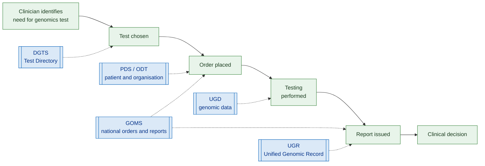

### Introduction

This scenario follows a ctDNA test from the order to the FHIR Document in the central registry. It shows the regional exchanges: HL7 v2 and HL7 FHIR Messaging through the Regional Integration Engine (RIE), with copies kept in a FHIR Repository. Several steps can also use, or are linked to, NHS England national genomics services. This section shows where those services fit before the detailed steps below.

#### Where the NHS England services fit on the clinical pathway

Green boxes are steps in the clinical pathway; blue boxes are NHS England services.

- **DGTS** - Digital Genomics Test Directory Service: the National Genomic Test Directory, the source of the test code (M4.14).
- **PDS / ODT** - Personal Demographics Service and Organisation Data Terminology: patient and organisation reference information checked for every order and report.
- **GOMS** - [Genomic Order Management Service (FHIR) API](https://digital.nhs.uk/developer/api-catalogue/genomic-order-management-service-fhir): NHS England's national service for genomic orders and reports.
- **UGD** - [Upload Genomic Data API](https://digital.nhs.uk/developer/api-catalogue/upload-genomic-data): uploads genomic data files, registering them as [GA4GH Data Repository Service (DRS)](https://ga4gh.github.io/data-repository-service-schemas/) objects.
- **UGR** - Unified Genomic Record: NHS England's national store of genomic reports, the central registry in this scenario.

#### The NHS England services in this scenario

| Scenario step | NHS England service | Relationship |
|---------------|---------------------|--------------|
| 1. Laboratory Order (LAB-1) - Send Laboratory Order O21 | GOMS | An alternative to the HL7 v2 and HL7 FHIR Messaging shown |
| 3. Analytics Processing - Retrieve Work Order | UGD | Related: UGD adds GA4GH DRS references for the uploaded genomic data to the work order (`ServiceRequest`) |
| 5. Laboratory Report (LAB-3) - Send Laboratory Report R01 | GOMS | An alternative to the HL7 v2 and HL7 FHIR Messaging shown |
| 5. Laboratory Report (LAB-3) - Send Laboratory Report document to the Central Registry | UGR Phase 1 | The Laboratory Report as a PDF |
| 6. Send FHIR Document to the Central Registry | UGR Phase 2 | The FHIR Document with the discrete results |
{:.grid}

Sending a report to the UGR is nearer IHE `ITI-105` (Simplified Publish) than `LAB-3`, as the UGR is a central repository - see [Sharing Laboratory Reports (Document)](HIE.html#sharing-laboratory-reports-document-iti-105-and-mdm_t02).
