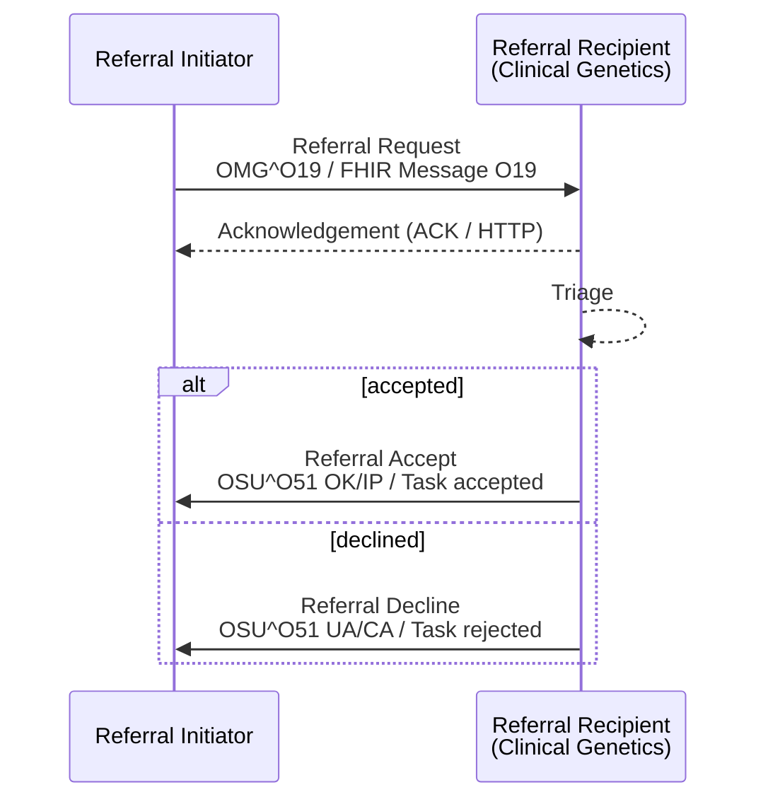
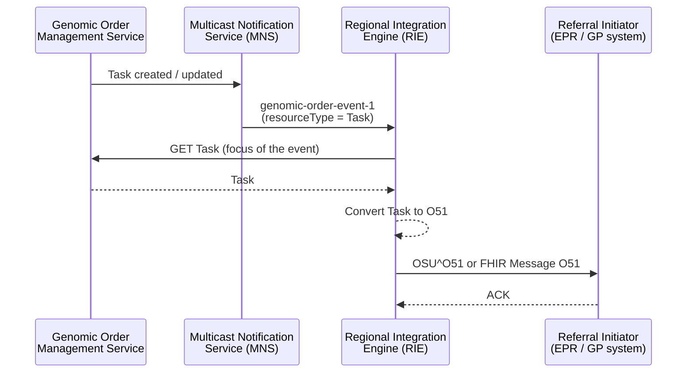

<div class="alert alert-warning" role="alert">
<b>For future use.</b> This transaction is not used by any interface in this guide
today. A <a href="StructureDefinition-GeneticClinicalReferral.html">Genetic Clinical
Referral</a> is expected to be implemented via a Genomics England Limited application,
NHS England BaRS/eRS or the NHS England Genomic Order Management Service (GOMS) - this
page describes how it maps onto IHE 360X HL7 v2 and FHIR Messaging.
</div>

**Referral Request [PCC-55]** - the Referral Initiator sends a request to the Referral
Recipient, which replies with an **accept** or a **decline**. The request is either:

- a [Genetic Clinical Referral](StructureDefinition-GeneticClinicalReferral.html) to a
  clinical genetics service - `ServiceRequest.code` / OBR-4 SNOMED CT `306119003`; or
- a laboratory order ([Genomic Test Order](StructureDefinition-GenomicTestOrder.html)) to a
  genomic laboratory - OBR-4 a Genomic Test Directory code, with specimens in `SPM`. Here
  the Referral Initiator is the Order Placer and the Referral Recipient the Order Filler.

The [examples](#examples) are for a laboratory order.

### References

- [IHE PCC 360X Closed Loop Referral](https://www.ihe.net/uploadedFiles/Documents/PCC/IHE_PCC_Suppl_360X.pdf) PCC TF-2 3.55
- [Care Coordination and 360 Referrals (proof of concept) - Referral Request [PCC-55]](https://kevinmayfield.github.io/PatientCareCoordination/en/PCC-55.html) - the general (non-genomic) version of this page
- [NHS England Multicast Notification Service - Genomic Order Event](https://digital.nhs.uk/developer/api-catalogue/multicast-notification-service/genomic-order-event)
- [eRS FHIR API](https://digital.nhs.uk/developer/api-catalogue/e-referral-service-fhir), [BaRS FHIR API](https://digital.nhs.uk/developer/api-catalogue/booking-and-referral-fhir)
- [HL7 v2 OMG_O19](hl7v2.html#omg_o19-general-clinical-order) and [OSU_O51](hl7v2.html#osu_o51-order-status-update)

### Interaction



| Message | Trigger | HL7 v2 | FHIR |
|---|---|---|---|
| Referral Request | The clinician decides to refer | [`OMG^O19^OMG_O19`](hl7v2.html#omg_o19-general-clinical-order) (ORC-1 `NW`) | [Referral Order (O19)](MessageDefinition-referral-order.html) - focus `ServiceRequest` |
| Referral Accept | The Referral Recipient accepts the referral | [`OSU^O51^OSU_O51`](hl7v2.html#osu_o51-order-status-update) (ORC-1 `OK`, ORC-5 `IP`) | [Referral Order Status (O51)](MessageDefinition-referral-order-status.html) - `Task` `status` `accepted`, `businessStatus` `accepted` |
| Referral Decline | The Referral Recipient cannot accept the referral | `OSU^O51^OSU_O51` (ORC-1 `UA`, ORC-5 `CA`, ORC-16 reason) | Referral Order Status (O51) - `Task` `status` `rejected`, `businessStatus` `declined`, `statusReason` |
{:.grid}

### Referral Request

#### Content

For a Genetic Clinical Referral, each data item is an element of the [Genetic Clinical
Referral](StructureDefinition-GeneticClinicalReferral.html) logical model - see its
**Mappings** tab. For a laboratory order the content is the [Genomic Test
Order](StructureDefinition-GenomicTestOrder.html) logical model instead.

| Data item | Logical model | HL7 v2 (OMG^O19) | FHIR (`ServiceRequest`) |
|---|---|---|---|
| Order control | status | ORC-1 `NW` | `status` `active`, `intent` `order` |
| Referral ID | referralIdentifier | ORC-2 and OBR-2 (namespace = referrer's ODS code) | `identifier` (type `PLAC`) |
| Patient | patient | PID-3, PID-5, PID-7, PID-8, PID-11 | `subject` ([Patient](StructureDefinition-Patient.html)) |
| Ordering provider | referrer | ORC-12 and OBR-16 (GMC / GMP) | `requester` (PractitionerRole - practitioner) |
| Ordering facility | referrer.organisation | ORC-21 (ODS code) | `requester` (PractitionerRole - organization) |
| Service referred to | serviceRequested | OBR-4 (`306119003^^SCT`) | `code` (SNOMED CT `306119003`) |
| Referred-to service | recipient | MSH-5 / MSH-6 | `performer` |
| Reason for referral | reasonForReferral | OBR-31, DG1 | `reasonCode` |
| Referral question | clinicalInformation | OBX (OBX-11 `O`, OBX-29 `QST`), NTE | `note` |
| Priority | priority | TQ1-9 | `priority` |
| Date of referral | dateOfReferral | ORC-9 | `authoredOn` |
| Forms | forms | OBX | `supportingInfo` (`QuestionnaireResponse`) |
| Pathology report | pathologyReport | OBX `RP` (reference) or `ED` (attached PDF) | `supportingInfo` (`DocumentReference` or FHIR Document `Bundle`) |
| Patient summary | patientSummary | OBX `RP` or `ED` | `supportingInfo` (`DocumentReference` or FHIR Document `Bundle`) |
| Family history | familyHistory | OBX `RP` or `ED` (family letter) | `supportingInfo` (`FamilyMemberHistory` or `DocumentReference`) |
| Consultand | consultand | NK1 | `supportingInfo` (`RelatedPerson`) |
{:.grid}

The referral carries only what the Referral Recipient cannot read for itself and
references the rest - in particular the pathology report and patient summary are
referenced as clinical documents (ideally shared via the NHS England Single Patient
Record), not copied into the referral. See [Genetic Clinical Referral - Clinical
Documents](StructureDefinition-GeneticClinicalReferral.html#clinical-documents).

#### Expected Actions

The Referral Recipient **SHALL** respond with an accept or a decline. It **SHALL** use the
patient identifier and Referral ID from the request in every later message.

### Referral Accept

| Data item | HL7 v2 (OSU^O51) | FHIR ([Task](StructureDefinition-Task.html)) |
|---|---|---|
| Order control | ORC-1 `OK` | `status` `accepted` |
| Referral ID | ORC-2 | `basedOn.identifier`, `focus` |
| Order status | ORC-5 `IP` | `businessStatus` `accepted` |
| Referrer | ORC-12 and ORC-21 - **required** in this guide | `requester` (unchanged) |
| Responsible service | MSH-3 / MSH-4 | `owner` |
{:.grid}

**Expected actions.** The Referral Initiator's system **SHALL** show that the Referral
Recipient has taken responsibility for the referral.

### Referral Decline

| Data item | HL7 v2 (OSU^O51) | FHIR ([Task](StructureDefinition-Task.html)) |
|---|---|---|
| Order control | ORC-1 `UA` | `status` `rejected` |
| Referral ID | ORC-2 | `basedOn.identifier`, `focus` |
| Order status | ORC-5 `CA` | `businessStatus` `declined` |
| Referrer | ORC-12 and ORC-21 - **required** in this guide | `requester` (unchanged) |
| Reason | ORC-16 (at least text in ORC-16.2) | `statusReason` ([Referral Status Reason](ValueSet-referral-status-reason-vs.html), example) |
{:.grid}

**Expected actions.** The Referral Initiator's system **SHALL** show the decline and its
reason. A new referral needs a **new** Referral ID (`ServiceRequest.replaces` may point to
the declined one).

### Status Updates from GOMS via MNS

Where the referral (or a resulting genomic test order) is managed by the NHS England
Genomic Order Management Service (GOMS), status changes are published as **events**, not
messages. The Regional Integration Engine (RIE) turns them into the status messages on
this page:



1. GOMS creates or updates a `Task` (accept, decline, completion, reassignment).
2. MNS sends the RIE a `genomic-order-event-1` notification. The notification is
   **event-only** - its `focus` references the changed resource, it does not carry it.
3. The RIE retrieves the `Task` from the GOMS FHIR API. For an outcome, `Task.output`
   references the reports in the NHS England Unified Genomic Record (UGR) - they are not
   retrieved or forwarded by the RIE.
4. The RIE converts the `Task` to a [Referral Order Status
   (O51)](MessageDefinition-referral-order-status.html) FHIR Message or an HL7 v2
   [`OSU^O51`](hl7v2.html#osu_o51-order-status-update) - `Task.status` and
   `Task.businessStatus` map to ORC-1 / ORC-5 per the [Order Control and
   Status](hl7v2.html#order-control-and-status) table, `Task.statusReason` to ORC-16 -
   and sends it to the Referral Initiator's system.

The RIE subscribes to MNS only for the Tasks it needs, using the MNS filtering attributes,
for example:

```
eventType='genomic-order-event-1' AND resourceType='Task' AND requester='R0A'
```

<div class="alert alert-info" role="alert">
<b>To confirm:</b> MNS genomic order events are in private beta. GOMS's own
<code>Task.businessStatus</code> values (e.g. <code>sample-received</code>,
<code>interpretation</code>, <code>produce-final-report</code>) describe laboratory
workflow steps; how these map onto the referral status values on this page (or are
passed through as an in-progress ORC-5 <code>IP</code>) is still to be agreed.
</div>

### Examples

The existing laboratory order [ServiceRequest Coded Entries
Example](ServiceRequest-ServiceRequestGenomicsOrderCodedEntries.html): Dr Samuel Darwin at
Manchester University NHS Foundation Trust (R0A) orders R240.1 (diagnostic testing for
known mutation(s)) for Octavia CHISLETT from the North West GLH (699X0). In every `ORC`,
**ORC-12** (the ordering clinician) and **ORC-21** (the ordering organisation's ODS code)
are **mandatory**, including in the status updates, as in the NW GMSA [ORC](hl7v2.html#orc).

#### Laboratory Order - OMG^O19

[OMG_O19](hl7v2.html#omg_o19-general-clinical-order) used instead of OML_O21, with the
specimen in `SPM`.

```
MSH|^~\&|EPIC|R0A|RIE|699X0|20250129103726+0000||OMG^O19^OMG_O19|MSG001601737|P|2.5.1|||AL|NE
PID|1||633^^^R0A^MR~9449305552^^^^NH||CHISLETT^Octavia||20080920|F|||1 RAVENSFIELD GARDENS^^EPSOM^SURREY^KT19 0ST
PV1|1|I|^^^R0A09^^^^^^^R0A||||C3456789^Darwin^Samuel^^^Dr^^^GMC|||892761000000102^Clinical haematology service^SNM3|||||||||1001166717^^^R0A^AN
ORC|NW|1601737^R0A|||||||20250129103726+0000|||C3456789^Darwin^Samuel^^^Dr^^^GMC|||||||||MANCHESTER UNIVERSITY NHS FOUNDATION TRUST^^R0A^^^ODS
OBR|1|1601737^R0A||R240.1^^England-GenomicTestDirectory||20250129||||||||||C3456789^Darwin^Samuel^^^Dr^^^GMC
SPM|1|25GEN-029GN00001&R0A||258580003^Whole blood specimen^SNM3|||||||||||||20250129103726+0000|||Y
```

FHIR Message: [Bundle 'Message' - Genomics Order with Coded
Entries](Bundle-GenomicsOrderMessageCodedEntries.html) ([Laboratory
Order](MessageDefinition-laboratory-order.html), focus [ServiceRequest Coded Entries
Example](ServiceRequest-ServiceRequestGenomicsOrderCodedEntries.html)).

#### Accept - OSU^O51

ORC-1 `OK`, ORC-5 `IP`; the laboratory's Filler Order Number in ORC-3.

```
MSH|^~\&|RIE|699X0|EPIC|R0A|20250130093000+0000||OSU^O51^OSU_O51|GLH-MSG-250130001|P|2.5.1|||AL|NE
PID|1||633^^^R0A^MR~9449305552^^^^NH||CHISLETT^Octavia||20080920|F|||1 RAVENSFIELD GARDENS^^EPSOM^SURREY^KT19 0ST
ORC|OK|1601737^R0A|R25012345^699X0||IP||||20250130093000+0000|||C3456789^Darwin^Samuel^^^Dr^^^GMC|||||||||MANCHESTER UNIVERSITY NHS FOUNDATION TRUST^^R0A^^^ODS
```

FHIR Message: [Bundle Message - Order Status (O51), accepted](Bundle-GenomicOrderStatusAcceptMessage.html)
(focus [Task Genomic Test Accepted](Task-TaskGenomicOrderAccepted.html)).

#### Decline - OSU^O51

The alternative first response: the patient does not meet the test directory eligibility
criteria.

```
MSH|^~\&|RIE|699X0|EPIC|R0A|20250130093000+0000||OSU^O51^OSU_O51|GLH-MSG-250130002|P|2.5.1|||AL|NE
PID|1||633^^^R0A^MR~9449305552^^^^NH||CHISLETT^Octavia||20080920|F|||1 RAVENSFIELD GARDENS^^EPSOM^SURREY^KT19 0ST
ORC|UA|1601737^R0A|||CA||||20250130093000+0000|||C3456789^Darwin^Samuel^^^Dr^^^GMC||||not-eligible^Does not meet the R240 eligibility criteria - no known familial variant provided. Please contact the laboratory.^L|||||MANCHESTER UNIVERSITY NHS FOUNDATION TRUST^^R0A^^^ODS
```

FHIR Message: [Bundle Message - Order Status (O51), declined](Bundle-GenomicOrderStatusDeclineMessage.html)
(focus [Task Genomic Test Declined](Task-TaskGenomicOrderDeclined.html)).

### More Information Requested

eRS allows a provider to return a referral to the referrer for more information; 360X has
no such step. This guide uses `businessStatus` `information-requested` with `Task.status`
`on-hold`, and the question in `Task.note`; the Referral Initiator updates
`ServiceRequest.supportingInfo` and the Task returns to `requested`. HL7 v2 equivalent -
**Open**.

### NHS Implementations

| | eRS | BaRS | GOMS | HL7 v2 (trust / region) |
|---|---|---|---|---|
| Referral | eRS referral with attachments (UBRN) | `ServiceRequest` in a FHIR Message | Genomic order (`ServiceRequest`) | `OMG^O19` (360X) |
| Accept / decline | eRS triage outcome | Interim validation response | `Task` update, notified via MNS `genomic-order-event-1` | `OSU^O51` |
| Mapping to this guide | UBRN as an additional `identifier` | Map to the referral `ServiceRequest` and `Task` | RIE retrieves the `Task` and converts it to O51 - see [Status Updates from GOMS via MNS](#status-updates-from-goms-via-mns) | As above |
{:.grid}
