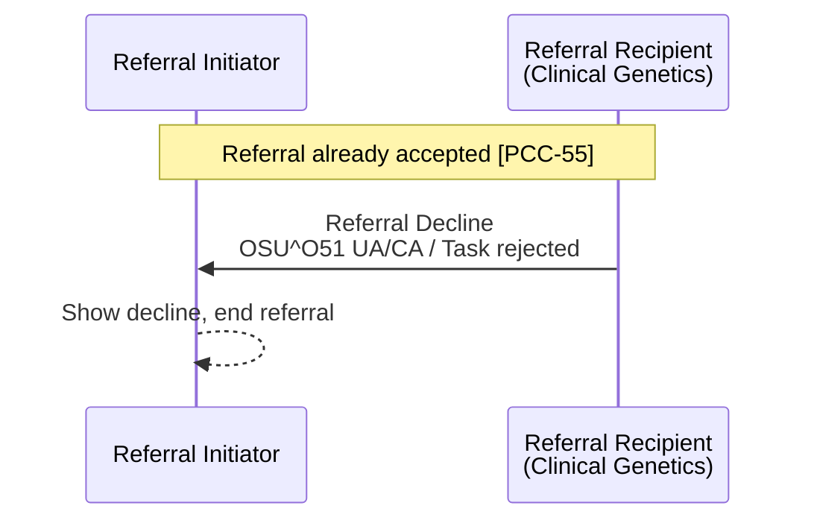

<div class="alert alert-warning" role="alert">
<b>For future use.</b> This transaction is not used by any interface in this guide
today - see <a href="PCC-55.html">Referral Request [PCC-55]</a>.
</div>

**Referral Decline [PCC-56]** - the Referral Recipient declines a [Genetic Clinical
Referral](StructureDefinition-GeneticClinicalReferral.html) or a laboratory order
([Genomic Test Order](StructureDefinition-GenomicTestOrder.html)) **after** it has
accepted it (for example when the patient declines genetic counselling, or the sample
turns out to be unsuitable). It ends the referral or order. The [example](#example) is
for a laboratory order.

### References

- [IHE PCC 360X Closed Loop Referral](https://www.ihe.net/uploadedFiles/Documents/PCC/IHE_PCC_Suppl_360X.pdf) PCC TF-2 3.56
- [Care Coordination and 360 Referrals (proof of concept) - Referral Decline [PCC-56]](https://kevinmayfield.github.io/PatientCareCoordination/en/PCC-56.html)
- Equivalent IHE transactions for a laboratory or imaging order (the Order Filler cancels an order it has already accepted, ORC-1 `OC` rather than `UA`):
  - [IHE PaLM Laboratory Testing Workflow (LTW)](https://www.ihe.net/uploadedFiles/Documents/PaLM/IHE_PaLM_TF_Vol2a.pdf) Placer Order Management [LAB-1] - order cancelled by the Order Filler; see [Laboratory Order (LAB-1)](LTW.html#laboratory-order-lab-1)
  - [IHE RAD Scheduled Workflow](https://www.ihe.net/uploadedFiles/Documents/Radiology/IHE_RAD_TF_Vol2.pdf) Filler Order Management [RAD-3] - order cancelled by the Order Filler

<div class="alert alert-info" role="alert">
<b>Note:</b> none of these IHE transactions use <code>OSU^O51</code>, which was added in
HL7 v2.8. An Order Placer built to IHE LTW receives the cancellation as
<code>OML^O21</code> (ORC-1 <code>OC</code>), and one built to IHE RAD as
<code>ORM^O01</code> (ORC-1 <code>OC</code>).
</div>

### Interaction



| Actor | Optionality |
|---|---|
| Referral Initiator | R - must handle a decline at any point of the workflow |
| Referral Recipient | O - but must send a decline as the first response if it cannot accept ([PCC-55](PCC-55.html)) |
{:.grid}

Where the referral is managed by GOMS, the decline is a `Task` update that the RIE
receives via MNS and converts to `OSU^O51` - see [Status Updates from GOMS via
MNS](PCC-55.html#status-updates-from-goms-via-mns).

### Content

The message is the same as the Referral Decline in [PCC-55](PCC-55.html#referral-decline):

| Data item | HL7 v2 (OSU^O51) | FHIR ([Task](StructureDefinition-Task.html)) |
|---|---|---|
| Order control | ORC-1 `UA` | `status` `rejected` (Task was `accepted` or `in-progress`) |
| Referral ID | ORC-2 | `basedOn.identifier`, `focus` |
| Order status | ORC-5 `CA` | `businessStatus` `declined` |
| Reason | ORC-16 (at least text) | `statusReason`, e.g. `sample-unsuitable`, `patient-declined`, `not-eligible` |
{:.grid}

A clinical document is not required. If the patient was seen before the decline, the
Referral Recipient **SHOULD** send what it found as an interim consultation note, or use
a [Referral Outcome [PCC-57]](PCC-57.html) instead.

### Example

The North West GLH accepted Octavia CHISLETT's R240.1 order
([ServiceRequest Coded Entries Example](ServiceRequest-ServiceRequestGenomicsOrderCodedEntries.html))
[PCC-55]. DNA extraction then failed, so the laboratory declines the order and asks for a
new sample.

```
MSH|^~\&|RIE|699X0|EPIC|R0A|20250205100000+0000||OSU^O51^OSU_O51|GLH-MSG-250205001|P|2.8|||AL|NE
PID|1||633^^^R0A^MR~9449305552^^^^NH||CHISLETT^Octavia||20080920|F|||1 RAVENSFIELD GARDENS^^EPSOM^SURREY^KT19 0ST
ORC|UA|1601737^R0A|R25012345^699X0||CA||||20250205100000+0000|||C3456789^Darwin^Samuel^^^Dr^^^GMC||||sample-unsuitable^Insufficient DNA extracted from the sample. Please send a new blood sample with a new order.^L|||||MANCHESTER UNIVERSITY NHS FOUNDATION TRUST^^R0A^^^ODS
```

FHIR Message: [Bundle Message - Order Status (O51), declined after acceptance](Bundle-GenomicOrderStatusLaterDeclineMessage.html)
(focus [Task Genomic Test Declined after acceptance](Task-TaskGenomicOrderDeclinedAfterAcceptance.html):
`status` `rejected`, `businessStatus` `declined`, `statusReason` `sample-unsuitable` with
the text).

### Expected Actions

- The Referral Initiator **SHALL** record that the referral has ended without being
  completed and show the reason, so the clinician can decide whether to refer again
  (with a new Referral ID).
