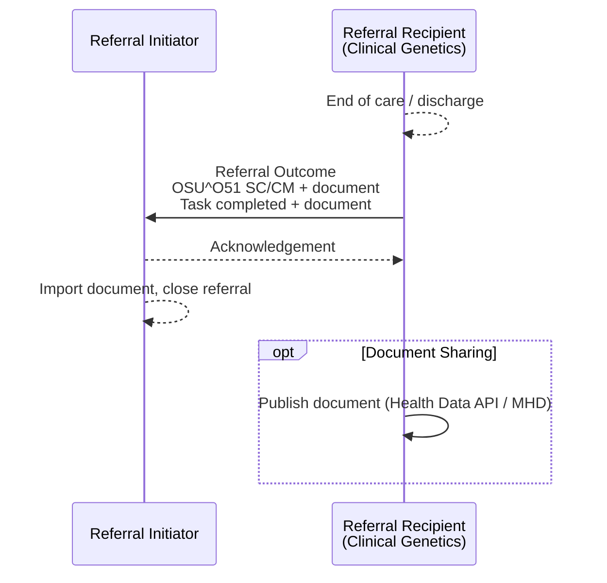

<div class="alert alert-warning" role="alert">
<b>For future use.</b> This transaction is not used by any interface in this guide
today - see <a href="PCC-55.html">Referral Request [PCC-55]</a>.
</div>

**Referral Outcome [PCC-57]** - the Referral Recipient sends the result of a [Genetic
Clinical Referral](StructureDefinition-GeneticClinicalReferral.html) at the end of care,
or of a laboratory order ([Genomic Test Order](StructureDefinition-GenomicTestOrder.html))
when the report is issued. It closes the loop. The [example](#example) is for a
laboratory order.

### References

- [IHE PCC 360X Closed Loop Referral](https://www.ihe.net/uploadedFiles/Documents/PCC/IHE_PCC_Suppl_360X.pdf) PCC TF-2 3.57
- [Care Coordination and 360 Referrals (proof of concept) - Referral Outcome [PCC-57]](https://kevinmayfield.github.io/PatientCareCoordination/en/PCC-57.html)
- [HL7 v2 MDM_T02](hl7v2.html#mdm_t02-original-document-notification-and-content)

### Interaction



| Actor | Optionality |
|---|---|
| Referral Initiator | R (receive) |
| Referral Recipient | R (send) |
{:.grid}

Where the referral is managed by GOMS, the outcome is a `Task` update (with the
document in `Task.output`) that the RIE receives via MNS, retrieves from GOMS and
converts to `OSU^O51` plus the document - see [Status Updates from GOMS via
MNS](PCC-55.html#status-updates-from-goms-via-mns).

### Content

The outcome is a status update and a clinical document.

#### Status Update

| Data item | HL7 v2 (OSU^O51) | FHIR ([Task](StructureDefinition-Task.html)) |
|---|---|---|
| Order control | ORC-1 `SC` | `status` `completed` |
| Referral ID | ORC-2 | `basedOn.identifier`, `focus` |
| Order status | ORC-5 `CM` | `businessStatus` `completed` |
| Referrer | ORC-12 and ORC-21 - **required** in this guide | `requester` (unchanged) |
| Document | [`MDM^T02`](hl7v2.html#mdm_t02-original-document-notification-and-content) or OBX `ED` / `RP` | `output` - the document |
{:.grid}

The referral `ServiceRequest.status` becomes `completed`.

#### Clinical Document

| Care delivered | Document | Profile |
|---|---|---|
| Laboratory order | Genomic test report | [Genomic Test Report](StructureDefinition-GenomicTestReport.html) - `DiagnosticReport`, HL7 v2 [ORU_R01](hl7v2.html#oru_r01-unsolicited-transmission-of-an-observation-message) |
| Clinical genetics referral | Consultation note (clinic letter), LOINC 11488-4 | `Composition` - **To confirm** |
{:.grid}

Whatever the type, the document **SHALL**:

- be linked to the referral by the workflow that carries it (`Task.output`, `MDM^T02`
  TXA-14, `DocumentReference.context.related`);
- identify the patient with the same identifier as the referral;
- answer the referral question or report the test result - for a referral, give the plan
  of care, including any cascade (family) testing offered;
- name the Referral Initiator as a recipient, and the patient's GP if different.

### Example

The North West GLH has issued the report for Octavia CHISLETT's R240.1 order
([ServiceRequest Coded Entries Example](ServiceRequest-ServiceRequestGenomicsOrderCodedEntries.html)).
It sends the outcome status update and the report (`ORU_R01`, Placer Order Number in
ORC-2 / OBR-2).

```
MSH|^~\&|RIE|699X0|EPIC|R0A|20250220110000+0000||OSU^O51^OSU_O51|GLH-MSG-250220001|P|2.5.1|||AL|NE
PID|1||633^^^R0A^MR~9449305552^^^^NH||CHISLETT^Octavia||20080920|F|||1 RAVENSFIELD GARDENS^^EPSOM^SURREY^KT19 0ST
ORC|SC|1601737^R0A|R25012345^699X0||CM||||20250220110000+0000|||C3456789^Darwin^Samuel^^^Dr^^^GMC|||||||||MANCHESTER UNIVERSITY NHS FOUNDATION TRUST^^R0A^^^ODS
```

The report itself follows as an [ORU_R01](hl7v2.html#oru_r01-unsolicited-transmission-of-an-observation-message) -
see the [HL7 v2 example instances](hl7v2.html#example-example-instances).

FHIR Message: [Bundle Message - Order Status (O51), outcome](Bundle-GenomicOrderStatusOutcomeMessage.html)
(the [completed Task](Task-TaskGenomicOrderCompleted.html) and the [genomic test
report](DiagnosticReport-DiagnosticReportGenomicsReport.html)).

### Expected Actions

- The Referral Initiator **SHALL** store the document, make it available to users with
  access to the patient record, and show that the referral has ended.
- It **MAY** import discrete data from the document or report (e.g. reportable variants).
