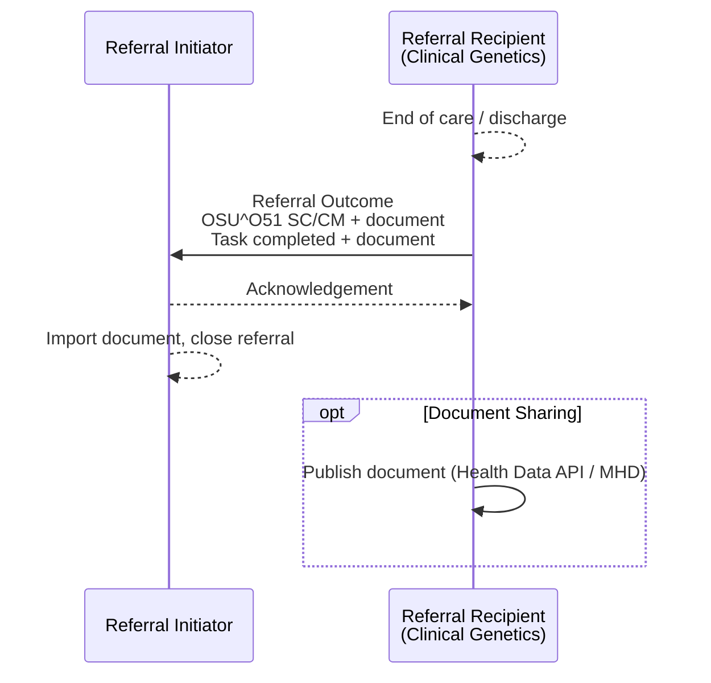
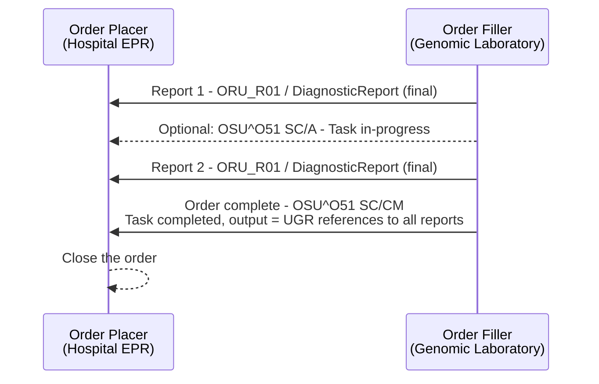

<div class="alert alert-warning" role="alert">
<b>For future use.</b> This transaction is not used by any interface in this guide
today - see <a href="PCC-55.html">Referral Request [PCC-55]</a>.
</div>

**Referral Outcome [PCC-57]** - the Referral Recipient sends the result of a [Genetic
Clinical Referral](StructureDefinition-GeneticClinicalReferral.html) at the end of care,
or of a laboratory order ([Genomic Test Order](StructureDefinition-GenomicTestOrder.html))
when the report is issued. It closes the loop. The [example](#example) is for a
laboratory order.

### References

- [IHE PCC 360X Closed Loop Referral](https://www.ihe.net/uploadedFiles/Documents/PCC/IHE_PCC_Suppl_360X.pdf) PCC TF-2 3.57
- [Care Coordination and 360 Referrals (proof of concept) - Referral Outcome [PCC-57]](https://kevinmayfield.github.io/PatientCareCoordination/en/PCC-57.html)
- [HL7 v2 MDM_T02](hl7v2.html#mdm_t02-original-document-notification-and-content)

### Interaction



| Actor | Optionality |
|---|---|
| Referral Initiator | R (receive) |
| Referral Recipient | R (send) |
{:.grid}

Where the referral or order is managed by GOMS, the outcome is a `Task` update that the
RIE receives via MNS, retrieves from GOMS and converts to `OSU^O51` or the O51 FHIR
Message - see [Status Updates from GOMS via
MNS](PCC-55.html#status-updates-from-goms-via-mns). `Task.output` references the reports
in the NHS England Unified Genomic Record (UGR); they are not carried in the message.

### Content

The outcome is a status update and a clinical document.

#### Status Update

| Data item | HL7 v2 (OSU^O51) | FHIR ([Task](StructureDefinition-Task.html)) |
|---|---|---|
| Order control | ORC-1 `SC` | `status` `completed` |
| Referral ID | ORC-2 | `basedOn.identifier`, `focus` |
| Order status | ORC-5 `CM` | `businessStatus` `completed` |
| Referrer | ORC-12 and ORC-21 - **required** in this guide | `requester` (unchanged) |
| Document | [`MDM^T02`](hl7v2.html#mdm_t02-original-document-notification-and-content) or OBX `ED` / `RP` | `output` - an external reference to the document; for a laboratory order, every report issued, in the NHS England Unified Genomic Record (UGR), with its Report Identifier (see [Genomic Orders with Multiple Reports](#genomic-orders-with-multiple-reports)) |
{:.grid}

The referral `ServiceRequest.status` becomes `completed`.

#### Clinical Document

| Care delivered | Document | Profile |
|---|---|---|
| Laboratory order | Genomic test report | [Genomic Test Report](StructureDefinition-GenomicTestReport.html) - `DiagnosticReport`, HL7 v2 [ORU_R01](hl7v2.html#oru_r01-unsolicited-transmission-of-an-observation-message) |
| Clinical genetics referral | Consultation note (clinic letter), LOINC 11488-4 | `Composition` - **To confirm** |
{:.grid}

Whatever the type, the document **SHALL**:

- be linked to the referral by the workflow that carries it (`Task.output`, `MDM^T02`
  TXA-14, `DocumentReference.context.related`);
- identify the patient with the same identifier as the referral;
- answer the referral question or report the test result - for a referral, give the plan
  of care, including any cascade (family) testing offered;
- name the Referral Initiator as a recipient, and the patient's GP if different.

#### Genomic Orders with Multiple Reports

A single genomic laboratory order may result in **more than one report**, for example:

- several tests on the same order (more than one `OBR` / Genomic Test Directory code);
- staged testing, where a later test depends on an earlier result (e.g. `R210.2` small
  panel followed by `R210.6` MLPA);
- work, subcontracted or reflex orders the laboratory creates to fulfil the order - see
  [Original Order, Instance and Filler
  Orders](StructureDefinition-GenomicTestOrder.html#original-order-instance-and-filler-orders);
- preliminary reports followed by a final report.

Each report is sent as it is issued ([ORU_R01](hl7v2.html#oru_r01-unsolicited-transmission-of-an-observation-message)
/ `DiagnosticReport`), linked to the order by the Placer Order Number (ORC-2 / OBR-2,
`DiagnosticReport.basedOn`). A report's own status (OBR-25 `F`,
`DiagnosticReport.status` `final`) only says that **report** is final - it does not say
the **order** is complete, because further reports may follow.

Hospitals need to know when the **entire order** is complete - for example to close the
order in the EPR, stop chasing outstanding results, and know that the set of reports
they hold is the full answer to the request. This guide uses the order status update for
that:



| Event | HL7 v2 | FHIR ([Task](StructureDefinition-Task.html)) |
|---|---|---|
| A report is issued, more to follow | `ORU_R01`; optionally `OSU^O51` ORC-1 `SC`, ORC-5 `A` (some, but not all, results available) | `DiagnosticReport`; `Task.status` `in-progress`, `businessStatus` `interim-report` - **To confirm** |
| The whole order is complete | `OSU^O51` ORC-1 `SC`, ORC-5 `CM` | `Task.status` `completed`, `businessStatus` `completed`; `Task.output` references **every** report issued for the order - see [Report References](#report-references) |
{:.grid}

- The Order Filler **SHALL** send the order outcome (ORC-5 `CM` / `Task` `completed`)
  only once all reports for the order - including those from any filler orders - have
  been issued.
- The Order Placer **SHALL NOT** treat a final report as completion of the order; it
  **SHOULD** use the order outcome to close the order.
- An amended or corrected report issued after completion (OBR-25 `C`,
  `DiagnosticReport.status` `amended` / `corrected`) is sent as a further report; whether
  it also changes the order status is **To confirm**.

##### Report References

The O51 FHIR Message contains only the `MessageHeader` and the `Task` - the reports are
**not** carried in it. Each `Task.output` is an **external reference** to a genomic test
report held in the NHS England **Unified Genomic Record (UGR)**:

| `Task.output.valueReference` | Content |
|---|---|
| `reference` | Absolute URL of the `DiagnosticReport` in the UGR |
| `type` | `DiagnosticReport` |
| `identifier` | The [Report Identifier](StructureDefinition-ReportIdentifier.html) (type `FILL`, assigned by the laboratory) - the same value as OBR-3 on the report's `ORU_R01` and `DiagnosticReport.identifier[ReportIdentifier]` |
{:.grid}

The Report Identifier lets the Order Placer match each reference to a report it has
already received (e.g. as `ORU_R01`), and retrieve any it has not from the UGR.

Where the order is managed by GOMS, MNS raises a `genomic-order-event-1` for each
`DiagnosticReport` and for the `Task` (and `ServiceRequest`) status change. The RIE
converts report events to `ORU_R01` (or the FHIR equivalent) and the order completion
`Task` to `OSU^O51` - see [Status Updates from GOMS via
MNS](PCC-55.html#status-updates-from-goms-via-mns).

### Example

The North West GLH has issued the report for Octavia CHISLETT's R240.1 order
([ServiceRequest Coded Entries Example](ServiceRequest-ServiceRequestGenomicsOrderCodedEntries.html)).
It sends the outcome status update and the report (`ORU_R01`, Placer Order Number in
ORC-2 / OBR-2).

```
MSH|^~\&|RIE|699X0|EPIC|R0A|20250220110000+0000||OSU^O51^OSU_O51|GLH-MSG-250220001|P|2.5.1|||AL|NE
PID|1||633^^^R0A^MR~9449305552^^^^NH||CHISLETT^Octavia||20080920|F|||1 RAVENSFIELD GARDENS^^EPSOM^SURREY^KT19 0ST
ORC|SC|1601737^R0A|R25012345^699X0||CM||||20250220110000+0000|||C3456789^Darwin^Samuel^^^Dr^^^GMC|||||||||MANCHESTER UNIVERSITY NHS FOUNDATION TRUST^^R0A^^^ODS
```

`OSU^O51` has no segment for the reports. They are held in the UGR, and each is also sent
separately as an [ORU_R01](hl7v2.html#oru_r01-unsolicited-transmission-of-an-observation-message)
(Report Identifier in OBR-3) - see the [HL7 v2 example instances](hl7v2.html#example-example-instances).

FHIR Message: [Bundle Message - Order Status (O51), outcome](Bundle-GenomicOrderStatusOutcomeMessage.html)
- the `MessageHeader` and the [completed Task](Task-TaskGenomicOrderCompleted.html) only.
`Task.output` is an external reference to the genomic test report in the UGR, with its
Report Identifier (`25edee2b-add8-4522-9fa2-1ee8f229bd75`, assigned by 699X0) - the
same report as [Diagnostic Report Example](DiagnosticReport-DiagnosticReportGenomicsReport.html).

### Expected Actions

- The Referral Initiator **SHALL** store the document, make it available to users with
  access to the patient record, and show that the referral has ended.
- It **MAY** import discrete data from the document or report (e.g. reportable variants).
