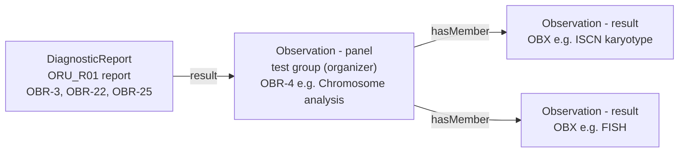
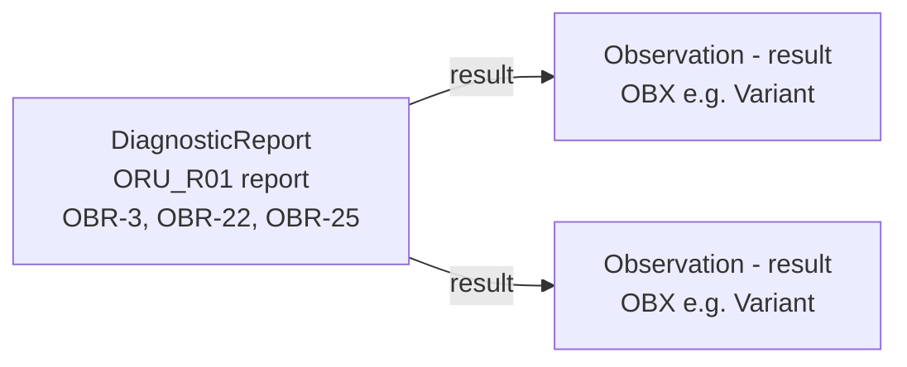
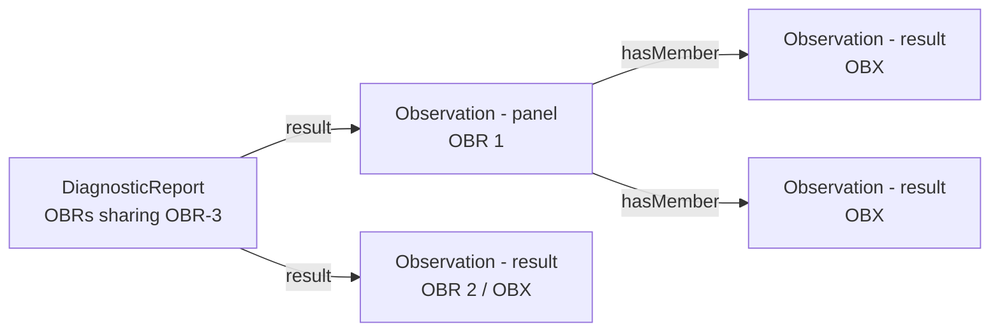
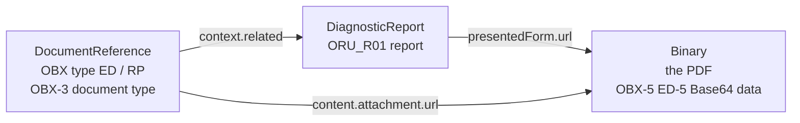
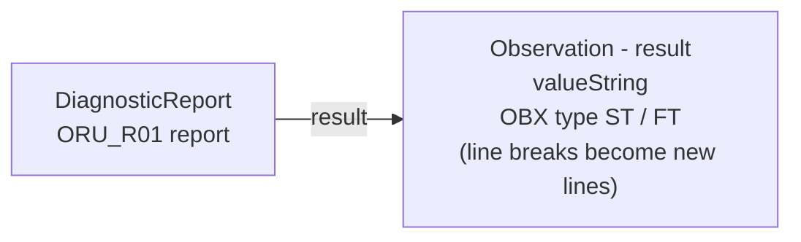
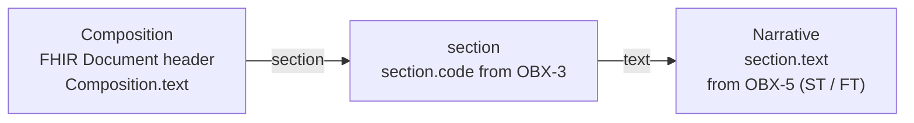
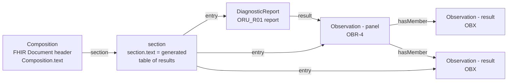

Laboratory reports come in two broad kinds. Which kind a report is decides how easily it fits
a FHIR Document. A FHIR Document requires a `Composition` with human-readable narrative,
so the kind that fits worst is the discrete result (for example a list of reportable variants) -
the opposite of what is often assumed.

This page is adapted from <a href="https://kevinmayfield.github.io/PathologyAndLaboratory/en/ReportTypes.html">Pathology and Laboratory - Report Types</a>,
with the examples replaced by those in this guide.

### Terms

| Term used in this guide | Also called | Meaning |
|---|---|---|
| **Narrative (interpretive) report** | unstructured / semi-structured report, opinion-based or consultative report, document-based report | The result *is* the opinion of a clinical scientist or pathologist, written as text - often under headings, sometimes as a PDF |
| **Discrete (numeric) result** | structured / coded result, analytical result, observation-based result, atomic data | The result is a set of values produced by an analyser or pipeline - a code, a value, units, a reference range and a flag for each test |
| **Synoptic report** | structured report, dataset report | A narrative report whose key items are recorded as discrete data from a defined dataset (for example the RCPath cancer datasets, or the variants in a genomic report) |
{:.grid}

Where a single word is wanted on each side, this guide uses **report** for the narrative kind
and **result** for the discrete kind.

In messaging the difference shows as:

| | Narrative report | Discrete result |
|---|---|---|
| HL7 v2 | `OBX` of type `FT` / `TX` (often many lines with `\.br\`), `NTE`, or `ED` (an embedded PDF) | `OBX` of type `NM`, `CWE` / `CE`, `SN`, with `OBX-6` units, `OBX-7` range, `OBX-8` flag |
| FHIR | `DiagnosticReport.conclusion` / `presentedForm`, `Observation.valueString`, `Composition.section.text` | `Observation.valueQuantity` / `valueCodeableConcept`, `referenceRange`, `interpretation` |
{:.grid}

### Which Reports Are Usually Narrative

Usually narrative (text with headings, or PDF):

- **Genomic and molecular pathology** - Genomic Laboratory Hub reports, NGS panels,
  whole genome sequencing and variant interpretation are today mostly sent as a PDF. The
  reportable variants can be sent as discrete data alongside it (for example the
  [ctDNA](#discrete-results) examples), but the PDF remains the authorised report
- **Cytogenetics** - karyotype (ISCN string) and FISH, with interpretation
- **Haematology interpretation** - blood film comments, bone marrow aspirate and trephine,
  flow cytometry immunophenotyping
- **Histopathology / surgical pathology** - clinical details, macroscopic, microscopic,
  conclusion. Cancer resections follow the RCPath datasets (synoptic), but are often still sent
  as text with a table inside it
- **Specialist and referral tests** - results from reference laboratories, often PDFs
  attached by the local LIMS rather than re-keyed (see [Inter Laboratory Workflow](ILW.html))
- **Interpretive comments** on discrete results

Usually discrete:

- quantitative molecular monitoring (for example [BCR-ABL1](Observation-BCRABL-Valid.html))
- routine clinical biochemistry and haematology
- most immunoassays and serology with numeric or qualitative results

### Report Patterns

Each diagram shows the FHIR resources, the HL7 v2 segment each one comes from, and the
element that links them.

<b>General rule.</b> The patterns follow the split in the
<a href="https://hl7.eu/fhir/health-data-api/1.0.0-ballot/en/">HL7 Europe Health Data API</a> (see <a href="HIE.html">Health Data API</a>) between
<a href="https://hl7.eu/fhir/health-data-api/1.0.0-ballot/en/document-exchange.html">Document Exchange</a> and
<a href="https://hl7.eu/fhir/health-data-api/1.0.0-ballot/en/resource-access.html">Resource Access</a> (see also its
<a href="https://hl7.eu/fhir/health-data-api/1.0.0-ballot/en/fhir-documents-vs-resources.html">FHIR Documents and Resources</a> and
<a href="https://hl7.eu/fhir/health-data-api/1.0.0-ballot/en/resourceExchange.html">Resource Exchange Patterns</a>):
<ul>
<li>where the <b>DiagnosticReport</b> is at the top, the pattern applies to <b>FHIR Messages</b>
(the <code>ORU^R01</code> equivalent, see <a href="MQ.html">Message Exchange</a>) and to FHIR RESTful
<b>Resource Access</b> (<a href="QEDm.html">IPA / QEDm</a>)</li>
<li>where the <b>Composition</b> is at the top, the pattern is a <b>FHIR Document</b> - FHIR
RESTful <b>Document Exchange</b> (<a href="MHD.html">IHE MHD</a>), for example the NHS England Unified Genomic Record (UGR)</li>
</ul>

<b>"FHIR Message" here includes FHIR transactions and other Bundles.</b> Wherever these patterns say
<i>FHIR Message</i> (or <i>message</i>), the same content can be sent as a FHIR
<a href="https://hl7.org/fhir/R4/http.html#transaction">transaction</a> (or batch) Bundle, or another
Bundle exchanged between systems - <b>provided the Bundle content follows a set pattern</b>: the same
resources, linked in the same way (DiagnosticReport → panel Observation → result Observations,
ServiceRequest, Specimen, Patient), as the <a href="MessageDefinition-unsolicited-observation.html">Unsolicited
Observation (R01)</a> message, without the MessageHeader. A Bundle whose content is not agreed in this way is
not an interoperable report.

#### Discrete Results

For FHIR Messages and Resource Access. A report is one [DiagnosticReport](StructureDefinition-DiagnosticReport.html)
(the OBRs sharing OBR-3). Each `DiagnosticReport.result` is either a **panel** - a test group,
one OBR with several OBX, as an organizer [Observation Panel](StructureDefinition-Observation-Panel.html)
whose `hasMember` are the results - or a **single result** (an OBR with one OBX).

**Panel** - for example a chromosome analysis (karyotype and FISH):

**Single results** - for example the reportable variants of a ctDNA panel, each linked directly
from the report:

**Both patterns can be mixed** in one report - for example a panel (one OBR) and a single result
(a second OBR) from one request:

Examples: [Shire cytogenetics](Bundle-Shire1StructuredR01.html) (panel, karyotype),
[Shire cytogenetics with FISH](Bundle-Shire2StructuredR01.html) (panel with two results) and
[OMICS DSS ctDNA test results](Bundle-ctdna9737383222-testresults.html) (single results) - all FHIR Messages.

#### Narrative Reports

**Rendered report (PDF)** - an OBX of type `ED` (Base64 PDF) or `RP` (a link) becomes a
[DocumentReference](StructureDefinition-DocumentReference.html) and a Binary. The DiagnosticReport
stays the parent: `presentedForm.url` gives the PDF directly, and the DocumentReference points to
the same PDF and back to the report:

In FHIR R4 <code>DiagnosticReport.result</code> can only reference an Observation, so the report cannot
list the DocumentReference among its results. HL7 Europe defines a <code>DiagnosticReport.media.link</code>
extension (which references a DocumentReference) for this; the examples in this guide use
<code>presentedForm.url</code> and <code>DocumentReference.context.related</code> instead.

A rendered report is normally exchanged in one of two ways (see the general rule above):

- **[Document Exchange](MHD.html)** (IHE MHD / XDS) - focused on the **DocumentReference**: the PDF is
  published and found as a document, through its metadata (type, date, author, patient), and the
  DiagnosticReport is optional context - for example the
  [Document and Document Notification (MDM_T02)](Bundle-OriginalDocumentMessage.html) message and the
  NRL pointers ([Tommen BIRMINGHAM](DocumentReference-Y05868-d783361d-83fa-438f-977c-601f30ef5ceb.html),
  [Cersei LONDON](DocumentReference-Y05868-75c254c0-d2cf-43ee-8a83-926af3f302bb.html))
- **[Resource Access](QEDm.html)** (IPA / QEDm), or a FHIR Message - focused on the **DiagnosticReport**:
  the report is queried or sent as a result, and the PDF is reached from it (`presentedForm` / the
  DocumentReference) - for example the [Genomics Report](Bundle-GenomicsReportMessage.html) message

**Text report in a FHIR Message or Resource Access** - the text is in OBX of type `ST` / `FT` (or `TX`
lines), and becomes a result whose value is the text - for example the ISCN karyotype and FISH results
in the [Shire cytogenetics](Bundle-Shire2StructuredR01.html) example:

**Text report in a FHIR Document (Document Exchange)** - the link is simply Composition to section to narrative.
The OBX of type `ST` / `FT` is used to create the section: OBX-3 gives `section.code` (and
title), and OBX-5 (with `\.br\` as line breaks) gives `section.text`:

Where the narrative is only available as a PDF, the section entry is the DocumentReference (and
Binary) - for example the *Presented Format* section of the
[ctDNA FHIR Document](Bundle-FHIRDocumentGeneticReportBundle-ctDNA.html), and the
[Genomics Report Targeted Variant](Bundle-FHIRDocumentGeneticReportBundle.html) document.

#### Discrete Results in a FHIR Document (Document Exchange)

A [Composition](StructureDefinition-Composition-GenomicReport.html) can also carry discrete results.
The Composition is the parent: the DiagnosticReport is an entry in a section, and links on to its
panels and results as in the FHIR Message. The Observations are also entries in the sections: a
section entry can be the panel Observation or an individual result directly (for example each
reportable variant in a *Findings* section). The section's narrative is generated from those
results - see
[Why Discrete Results Are Harder to Send as a FHIR Document](#why-discrete-results-are-harder-to-send-as-a-fhir-document):

Examples: [ctDNA UGR Phase 2 - EU Laboratory Report](Bundle-ctdna9737383222-eulab-document.html),
[ctDNA](Bundle-FHIRDocumentGeneticReportBundle-ctDNA.html) and
[Lynch syndrome](Bundle-FHIRDocumentGeneticReportBundle2.html) (FHIR Documents).

### Why Discrete Results Are Harder to Send as a FHIR Document

A FHIR Document is a `Bundle` of type `document` whose first entry is a `Composition`.
HL7 Europe `Composition-eu-lab` (the parent of the
[Composition Genomic Report](StructureDefinition-Composition-GenomicReport.html))
requires at least one `section` and makes **`section.text` mandatory (1..1)**. The narrative
is the attested, human-readable content of the document.

For a **narrative report** this fits naturally: the laboratory already wrote the narrative.
Its headings (findings, implications, recommended actions) become sections, the authorised text
becomes `section.text`, and what is coded is added alongside it. The document is a wrapper
for content that already exists.

For a **discrete result** there is usually nothing to put there:

- **No narrative exists.** A set of variants or a quantitative result is a set of values, not
  text; the `ORU^R01` has no text form of it beyond a few `NTE` comments. The sender **SHALL**
  make one to meet `section.text` 1..1
- **The narrative is generated, not authored.** The sending system creates a table from the
  coded data. It **SHALL** agree with the coded data - a value rounded differently, or a lost
  flag or comment, is a clinical safety issue - so it has to be generated from the resources,
  and tested as clinical content
- **Who attests it is unclear.** The laboratory authorised the values (or the PDF), not the
  rendered table. The document's attested content is something no one in the laboratory has
  seen (**Open** - how this is covered in the clinical safety case, DCB0129 / DCB0160)
- **The sections have to be invented.** A narrative report has headings; discrete results
  only have test groups (`OBR`), so each test group becomes a section, with the test group
  code as `section.code`
- **It is extra work for no new information.** The receiver files and displays the coded
  `Observation`s; the narrative adds a second copy that must be kept in step. The
  [ctDNA FHIR Document](Bundle-FHIRDocumentGeneticReportBundle-ctDNA.html) example has
  placeholder section text ("see PDF") rather than a rendering of the variants, which shows
  the difficulty
- **It does not suit other routes.** HL7 v2 `ORU^R01` and FHIR Messages carry discrete
  results without a Composition. HL7 Europe `DiagnosticReport-eu-lab` requires the
  `DiagnosticReport.composition` extension, which is why this guide's
  [Diagnostic Report](StructureDefinition-DiagnosticReport.html) is derived from EU Core
  instead

In short, the FHIR Document model suits narrative reports, where a document already exists.
For discrete results it adds an artificial document that has to be generated.

### References

- [Pathology and Laboratory - Report Types](https://kevinmayfield.github.io/PathologyAndLaboratory/en/ReportTypes.html) (source of this page)
- [HL7 Europe Health Data API](https://hl7.eu/fhir/health-data-api/1.0.0-ballot/en/) (1.0.0-ballot) - [Document Exchange](https://hl7.eu/fhir/health-data-api/1.0.0-ballot/en/document-exchange.html), [Resource Access](https://hl7.eu/fhir/health-data-api/1.0.0-ballot/en/resource-access.html), [FHIR Documents and Resources](https://hl7.eu/fhir/health-data-api/1.0.0-ballot/en/fhir-documents-vs-resources.html)
- [FHIR R4 Documents](https://hl7.org/fhir/R4/documents.html) and [Narrative](https://hl7.org/fhir/R4/narrative.html)
- [HL7 Europe Laboratory Report - Composition](https://hl7.eu/fhir/laboratory/StructureDefinition-Composition-eu-lab.html)
- [Royal College of Pathologists - Cancer datasets and tissue pathways](https://www.rcpath.org/profession/guidelines/cancer-datasets-and-tissue-pathways.html)
