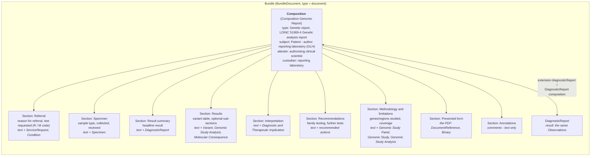
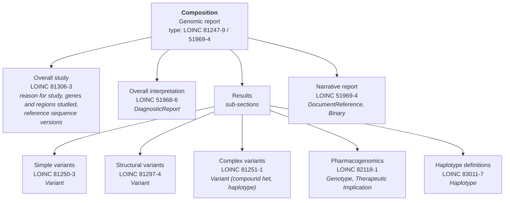

### References

- HL7 International [Genomics Reporting Implementation Guide](https://build.fhir.org/ig/HL7/genomics-reporting/index.html)
  - HL7 USA [minimal Common Oncology Data Elements (mCODE) Implementation Guide - Genomics](https://build.fhir.org/ig/HL7/fhir-mCODE-ig/group-genomics.html)
- [HL7 Version 2.5.1 Implementation Guide: Lab Results Interface (LRI), Release 1 from May 2017](https://confluence.hl7.org/download/attachments/25559919/2018%2004%2003%20-%20V2%20LRI%20-%20Ch.%205%20CG%20and%20Code%20System%20Tables.pdf?api=v2)
- [openEHR Project: Genomics](https://ckm.openehr.org/ckm/projects/1013.30.50)
- [NHS England FHIR Genomics Implementation Guide—Clinical Headings](https://simplifier.net/guide/fhir-genomics-implementation-guide/home/design/clinicalheadings)
- [NHS England Genomics Test Reporting Specification](https://www.england.nhs.uk/publication/genomics-testing-reporting-specification/)
- Related 
  - HL7 Europe [Laboratory Report](https://build.fhir.org/ig/hl7-eu/laboratory/index.html) 
  - HL7 Europe [Imaging](https://build.fhir.org/ig/hl7-eu/imaging/index.html)

### Document Layout

<b>Open question.</b> What is the common layout of a genomic laboratory report, and so which
sections should this Composition have? This profile's sections follow the <b>inferred</b> layout
below, as a starting point for discussion. It has not been agreed, and the section codes are
candidates.

A genomic report sent as a FHIR Document (see [Report Types](ReportTypes.html)) is a `Bundle` of
type `document` with this `Composition` as its first entry. Each section carries its own
human-readable narrative (`section.text`, mandatory in `Composition-eu-lab`). A viewer shows those
narratives in order, like the pages of the printed (PDF) report, and the coded entries sit behind
them for computers to use.

No single source defines a FHIR Document layout for a genomic report. A layout can be inferred by
combining these sources:

| Source | What it gives |
|---|---|
| HL7 Europe [Laboratory Report](https://hl7.eu/fhir/laboratory/) `Composition-eu-lab` | The base profile: at least one section, `section.code` and `section.text` 1..1, sections nested at most **two levels** (top level for the study or specialty, second for report items), and an **Annotations** section (LOINC `48767-8`) for comments, text only |
| HL7 [Genomics Reporting](https://hl7.org/fhir/uv/genomics-reporting/) `genomic-report` | The content but not the layout: `DiagnosticReport.result` slices for variant, genotype, haplotype, biomarker, diagnostic and therapeutic implication, and the `recommended-action`, `genomic-study` and `coded-note` extensions |
| [NHS England Genomics Test Reporting Specification](https://www.england.nhs.uk/publication/genomics-testing-reporting-specification/) and ACGS reporting guidance | The headings a UK genomic report is expected to show - to be confirmed against the published specification |
| [Master HL7 genetic variant reporting panel](https://loinc.org/81247-9) (LOINC `81247-9`), as used by the [HL7 v2.5.1 LRI Clinical Genomics chapter](https://confluence.hl7.org/download/attachments/25559919/2018%2004%2003%20-%20V2%20LRI%20-%20Ch.%205%20CG%20and%20Code%20System%20Tables.pdf?api=v2) | The HL7 v2 grouping of results: overall study, overall interpretation, simple, structural and complex variants, pharmacogenomics, haplotypes - see [Alternative Layout](#alternative-layout-hl7-v2-genetic-variant-panel) |
| NHS England [FHIR Genomics Implementation Guide - Clinical Headings](https://simplifier.net/guide/fhir-genomics-implementation-guide/home/design/clinicalheadings?version=0.6.2) | Headings from the Genomics Minimum Dataset for the test request - see [Alternative Layout](#alternative-layout-nhs-england-clinical-headings) |
{:.grid}

#### Inferred Layout

The headings of a typical UK genomic laboratory report, as a FHIR Document. These are the
`section` slices of this profile. The codes are candidates, not decisions. Section titles are not
fixed, so a laboratory can use its own headings.

| Section (slice) | Code | Content (entries) | Notes |
|---|---|---|---|
| Referral (`Referral`) | LOINC `42349-1` Reason for referral (narrative) | Text; entries [ServiceRequest](StructureDefinition-ServiceRequest.html), [Condition](StructureDefinition-Condition.html) | Clinical indication and the [National Genomic Test Directory](https://www.england.nhs.uk/publication/national-genomic-test-directories/) test requested. Could instead be in the Composition header only |
| Specimen (`Specimen`) | SNOMED CT `123038009` Specimen | Text; entry [Specimen](StructureDefinition-Specimen.html) | No LOINC document section code found; as used by the [ctDNA UGR example](Bundle-ctdna9737383222-eulab-document.html) |
| Result summary (`ResultSummary`) | LOINC `51968-6` Discrete variation analysis overall interpretation | Text; entry [DiagnosticReport](StructureDefinition-DiagnosticReport.html) | The headline result shown first on the report |
| Results (`Results`) | LOINC `69548-6` Genetic variant assessment | Text (the variant table); entries [Variant](StructureDefinition-Variant.html), [Genomic Study Analysis](https://hl7.org/fhir/uv/genomics-reporting/STU3/StructureDefinition-genomic-study-analysis.html), [Molecular Consequence](StructureDefinition-MolecularConsequence.html) | Optional sub-sections, one per `81247-9` panel group that applies - see [Results Sub-sections](#results-sub-sections) |
| Interpretation (`Interpretation`) | [Genomic Report Section](CodeSystem-GenomicReportSection.html) `interpretation` (local) | Text; entries [Diagnostic Implication](StructureDefinition-DiagnosticImplication.html), [Therapeutic Implication](StructureDefinition-TherapeuticImplication.html) | Is this separate from the result summary? |
| Recommendations (`Recommendations`) | LOINC `62385-0` Recommendation | Text; entries follow-up and medication recommendations (Task) | For example testing of relatives. LOINC `18783-1` Study recommendation is an alternative |
| Methodology and limitations (`Methodology`) | [Genomic Report Section](CodeSystem-GenomicReportSection.html) `methodology` (local) | Text; entries [Genomic Study Panel](StructureDefinition-GenomicStudyPanel.html), [Genomic Study](https://hl7.org/fhir/uv/genomics-reporting/STU3/StructureDefinition-genomic-study.html), [Genomic Study Analysis](https://hl7.org/fhir/uv/genomics-reporting/STU3/StructureDefinition-genomic-study-analysis.html) (regions studied) | Genes or regions studied, technology, coverage, limitations |
| Presented form (`PresentedForm`) | LOINC `77599-9` Additional documentation | Entries DocumentReference, Binary | Used while the PDF remains the authorised report (UGR phase 1) |
| Annotations (`annotations`) | LOINC `48767-8` Annotation comment | Text only, no entries | Inherited from `Composition-eu-lab` |
{:.grid}

##### Results Sub-sections

The Results section can be split into sub-sections (the second level allowed by
`Composition-eu-lab`), one for each group of the HL7 v2 [Master HL7 genetic variant reporting panel](Questionnaire-81247-9.html)
that applies to the test - see [Alternative Layout](#alternative-layout-hl7-v2-genetic-variant-panel).
Results holds what was found. What it means, including the medication implications of a
pharmacogenomic genotype, belongs in the Interpretation section, so a Therapeutic Implication
appears only once.

| Sub-section (slice) | Code | Content (entries) |
|---|---|---|
| Simple variants (`SimpleVariants`) | LOINC `81250-3` | [Variant](StructureDefinition-Variant.html) - single nucleotide changes, small insertions and deletions |
| Structural variants (`StructuralVariants`) | LOINC `81297-4` | [Variant](StructureDefinition-Variant.html) - copy number changes, with their ISCN or HGVS name |
| Complex variants (`ComplexVariants`) | LOINC `81251-1` | [Variant](StructureDefinition-Variant.html) - compound heterozygous variants, haplotypes |
| Pharmacogenomics (`Pharmacogenomics`) | LOINC `82118-1` | [Genotype](StructureDefinition-Genotype.html) - medication implications go in Interpretation |
| Haplotype definitions (`HaplotypeDefinitions`) | LOINC `83011-7` | [Haplotype](StructureDefinition-Haplotype.html) |
{:.grid}

Examples: [Lynch syndrome](Bundle-FHIRDocumentGeneticReportBundle2.html),
[ctDNA](Bundle-FHIRDocumentGeneticReportBundle-ctDNA.html) and
[Targeted Variant](Bundle-FHIRDocumentGeneticReportBundle.html).

##### What the Reader Sees (Inferred Layout)

A viewer shows each section's narrative in order, like the pages of a printed report. The mock below
is a fictitious germline (Lynch syndrome) report laid out this way, as the report looks today. The
small grey labels show which
part of the FHIR Document each block comes from - a real viewer would not show them.

Composition.title &middot; type SNOMED CT Genetic report, LOINC 51969-4

Genomic Test Report

North West Genomic Laboratory Hub (ODS 699X0)

FICTITIOUS EXAMPLE

Composition header: subject (Patient), identifier, date, status, author, attester

<table style="width:100%; font-size:14px; margin-bottom:14px; border:none;">
<tr><td style="border:none; padding:2px 8px 2px 0;"><b>Patient</b></td><td style="border:none;">EXAMPLE, Alex</td><td style="border:none;"><b>NHS Number</b></td><td style="border:none;">999 000 0001</td></tr>
<tr><td style="border:none; padding:2px 8px 2px 0;"><b>Date of birth</b></td><td style="border:none;">01-Jan-1970</td><td style="border:none;"><b>Laboratory number</b></td><td style="border:none;">G26-012345</td></tr>
<tr><td style="border:none; padding:2px 8px 2px 0;"><b>Requested by</b></td><td style="border:none;">Dr A Clinician, Clinical Genetics</td><td style="border:none;"><b>Report status</b></td><td style="border:none;">Final</td></tr>
<tr><td style="border:none; padding:2px 8px 2px 0;"><b>Reported</b></td><td style="border:none;">21-Oct-2026</td><td style="border:none;"><b>Authorised by</b></td><td style="border:none;">Dr B Scientist, Consultant Clinical Scientist</td></tr>
</table>

section Referral &middot; LOINC 42349-1 &middot; entries ServiceRequest, Condition

Referral

<b>Reason for referral.</b> R210 Inherited MMR deficiency (Lynch syndrome). Colorectal adenocarcinoma at age 42; tumour immunohistochemistry showed loss of MLH1 and PMS2 with no <i>MLH1</i> promoter hypermethylation.

<b>Test requested.</b> R210.2 - National Genomic Test Directory.

section Specimen &middot; SNOMED CT 123038009 &middot; entry Specimen

Specimen

Peripheral blood (EDTA). Collected 30-Sep-2026, received 01-Oct-2026.

section Result summary &middot; LOINC 51968-6 &middot; entry DiagnosticReport

Result summary

<b>Pathogenic <i>MLH1</i> variant detected. This result confirms a diagnosis of Lynch syndrome.</b> Test outcome: 311 RESULT CONSISTENT WITH REFERRAL INDICATION

section Results &middot; LOINC 69548-6 &middot; entries Variant

Results

<table style="width:100%; font-size:14px; border-collapse:collapse; margin:4px 0 10px;">
<tr style="background:#eee;"><th style="text-align:left; padding:3px 6px; border:1px solid #ccc;">Gene</th><th style="text-align:left; padding:3px 6px; border:1px solid #ccc;">Variant (HGVS)</th><th style="text-align:left; padding:3px 6px; border:1px solid #ccc;">Zygosity</th><th style="text-align:left; padding:3px 6px; border:1px solid #ccc;">Inheritance</th><th style="text-align:left; padding:3px 6px; border:1px solid #ccc;">Classification</th></tr>
<tr><td style="padding:3px 6px; border:1px solid #ccc;"><i>MLH1</i></td><td style="padding:3px 6px; border:1px solid #ccc;">NM_000249.4:c.350C&gt;T p.(Thr117Met)</td><td style="padding:3px 6px; border:1px solid #ccc;">Heterozygous</td><td style="padding:3px 6px; border:1px solid #ccc;">Germline</td><td style="padding:3px 6px; border:1px solid #ccc;"><b>Pathogenic</b> (class 5)</td></tr>
</table>

section Interpretation &middot; GenomicReportSection#interpretation &middot; entries Diagnostic Implication

Interpretation

This variant has been reported in many individuals with Lynch syndrome and is classified as pathogenic. It is consistent with the loss of MLH1 and PMS2 seen in the tumour.

section Recommendations &middot; LOINC 62385-0 &middot; entries recommended actions (Task)

Recommendations

Predictive testing is available for at-risk relatives through Clinical Genetics. Management should follow national guidance for Lynch syndrome.

section Methodology and limitations &middot; GenomicReportSection#methodology &middot; entries Genomic Study Panel, Genomic Study, Genomic Study Analysis

Methodology and limitations

Next generation sequencing of the coding regions and exon-intron boundaries of <i>MLH1</i>, <i>MSH2</i>, <i>MSH6</i>, <i>PMS2</i> and <i>EPCAM</i>, with copy number analysis. Deep intronic variants and low-level mosaicism may not be detected.

section Presented form &middot; LOINC 77599-9 &middot; entry DocumentReference (PDF)

<i>The authorised report is also attached as a PDF.</i>

##### What the Reader Sees (Inferred Layout with Results Sub-sections)

The same fictitious report, using the [Results sub-sections](#results-sub-sections) of this profile.
The Results section is split by kind of variant: the sequence variant under Simple variants, and the
copy number analysis under Structural variants. Sub-sections that do not apply to this germline
report (complex variants, pharmacogenomics, haplotype definitions) are left out.

Composition.title &middot; type SNOMED CT Genetic report, LOINC 51969-4

Genomic Test Report

North West Genomic Laboratory Hub (ODS 699X0)

FICTITIOUS EXAMPLE

Composition header: subject (Patient), identifier, date, status, author, attester

<table style="width:100%; font-size:14px; margin-bottom:14px; border:none;">
<tr><td style="border:none; padding:2px 8px 2px 0;"><b>Patient</b></td><td style="border:none;">EXAMPLE, Alex</td><td style="border:none;"><b>NHS Number</b></td><td style="border:none;">999 000 0001</td></tr>
<tr><td style="border:none; padding:2px 8px 2px 0;"><b>Date of birth</b></td><td style="border:none;">01-Jan-1970</td><td style="border:none;"><b>Laboratory number</b></td><td style="border:none;">G26-012345</td></tr>
<tr><td style="border:none; padding:2px 8px 2px 0;"><b>Requested by</b></td><td style="border:none;">Dr A Clinician, Clinical Genetics</td><td style="border:none;"><b>Report status</b></td><td style="border:none;">Final</td></tr>
<tr><td style="border:none; padding:2px 8px 2px 0;"><b>Reported</b></td><td style="border:none;">21-Oct-2026</td><td style="border:none;"><b>Authorised by</b></td><td style="border:none;">Dr B Scientist, Consultant Clinical Scientist</td></tr>
</table>

section Referral &middot; LOINC 42349-1 &middot; entries ServiceRequest, Condition

Referral

<b>Reason for referral.</b> R210 Inherited MMR deficiency (Lynch syndrome). Colorectal adenocarcinoma at age 42; tumour immunohistochemistry showed loss of MLH1 and PMS2 with no <i>MLH1</i> promoter hypermethylation.

<b>Test requested.</b> R210.2 - National Genomic Test Directory.

section Specimen &middot; SNOMED CT 123038009 &middot; entry Specimen

Specimen

Peripheral blood (EDTA). Collected 30-Sep-2026, received 01-Oct-2026.

section Result summary &middot; LOINC 51968-6 &middot; entry DiagnosticReport

Result summary

<b>Pathogenic <i>MLH1</i> variant detected. This result confirms a diagnosis of Lynch syndrome.</b> Test outcome: 311 RESULT CONSISTENT WITH REFERRAL INDICATION

section Results &middot; LOINC 69548-6

Results

sub-section Simple variants &middot; LOINC 81250-3 &middot; entries Variant

Simple variants

<table style="width:100%; font-size:14px; border-collapse:collapse; margin:4px 0 10px;">
<tr style="background:#eee;"><th style="text-align:left; padding:3px 6px; border:1px solid #ccc;">Gene</th><th style="text-align:left; padding:3px 6px; border:1px solid #ccc;">Variant (HGVS)</th><th style="text-align:left; padding:3px 6px; border:1px solid #ccc;">Zygosity</th><th style="text-align:left; padding:3px 6px; border:1px solid #ccc;">Inheritance</th><th style="text-align:left; padding:3px 6px; border:1px solid #ccc;">Classification</th></tr>
<tr><td style="padding:3px 6px; border:1px solid #ccc;"><i>MLH1</i></td><td style="padding:3px 6px; border:1px solid #ccc;">NM_000249.4:c.350C&gt;T p.(Thr117Met)</td><td style="padding:3px 6px; border:1px solid #ccc;">Heterozygous</td><td style="padding:3px 6px; border:1px solid #ccc;">Germline</td><td style="padding:3px 6px; border:1px solid #ccc;"><b>Pathogenic</b> (class 5)</td></tr>
</table>

sub-section Structural variants &middot; LOINC 81297-4 &middot; entries Variant

Structural variants

No copy number variants (exon deletions or duplications) detected.

section Interpretation &middot; GenomicReportSection#interpretation &middot; entries Diagnostic Implication

Interpretation

This variant has been reported in many individuals with Lynch syndrome and is classified as pathogenic. It is consistent with the loss of MLH1 and PMS2 seen in the tumour.

section Recommendations &middot; LOINC 62385-0 &middot; entries recommended actions (Task)

Recommendations

Predictive testing is available for at-risk relatives through Clinical Genetics. Management should follow national guidance for Lynch syndrome.

section Methodology and limitations &middot; GenomicReportSection#methodology &middot; entries Genomic Study Panel, Genomic Study, Genomic Study Analysis

Methodology and limitations

Next generation sequencing of the coding regions and exon-intron boundaries of <i>MLH1</i>, <i>MSH2</i>, <i>MSH6</i>, <i>PMS2</i> and <i>EPCAM</i>, with copy number analysis. Deep intronic variants and low-level mosaicism may not be detected.

section Presented form &middot; LOINC 77599-9 &middot; entry DocumentReference (PDF)

<i>The authorised report is also attached as a PDF.</i>

#### Alternative Layout: NHS England Clinical Headings

The NHS England [FHIR Genomics Implementation Guide - Clinical Headings](https://simplifier.net/guide/fhir-genomics-implementation-guide/home/design/clinicalheadings?version=0.6.2)
(version 0.6.2, draft) gives another possible layout. No PRSB headings exist for genomics, so its
headings are recreated from the Genomics Minimum Dataset (MDS v1.062). They describe the **test
request** (the Genomic Order Management Service order), so as document sections they would cover the
referral side of a report, not the results:

```mermaid
flowchart TB
    COMP["<b>Composition</b><br/>Genomic report"]
    H1["Healthcare Professional<br/><i>PractitionerRole</i>"]
    H2["Patient<br/><i>Patient</i>"]
    H3["Fetus<br/><i>Patient</i>"]
    H4["Test Request<br/><i>ServiceRequest</i>"]
    H5["NGRL Consent<br/><i>Consent, QuestionnaireResponse</i>"]
    H6["Primary Sample<br/><i>Specimen, BodyStructure</i>"]
    H7["Patient Clinical Information<br/><i>Condition, Observation</i>"]
    H8["Specialist Testing Requirements<br/><i>by test</i>"]
    H9["Miscellaneous<br/><i>Condition, Observation</i>"]
    H10["Hospital Encounter<br/><i>Encounter</i>"]
    RES["Results, interpretation, recommendations<br/><b>no heading defined</b>"]
    COMP --> H1
    COMP --> H2
    COMP --> H3
    COMP --> H4
    COMP --> H5
    COMP --> H6
    COMP --> H7
    COMP --> H8
    COMP --> H9
    COMP --> H10
    COMP -.-> RES
```

| Clinical heading | FHIR resource | Compared with the inferred layout |
|---|---|---|
| Healthcare Professional | PractitionerRole (`ServiceRequest.requester`) | Composition header, or the Referral section |
| Patient | Patient | Composition header (`subject`) |
| Fetus | Patient (fetus) | Not in the inferred layout - needed for prenatal reports |
| Test Request | ServiceRequest | Referral section |
| NGRL Consent | Consent, QuestionnaireResponse (record of discussion) | Not in the inferred layout |
| Primary Sample | Specimen, BodyStructure | Specimen section |
| Patient Clinical Information | Condition, Observation (for example HPO phenotypes) | Referral section (clinical indication) |
| Specialist Testing Requirements | By test (for example NIPD pregnancy details) | Not in the inferred layout |
| Miscellaneous | Condition, Observation, `ServiceRequest.note` | Annotations section |
| Hospital Encounter | Encounter | Composition header (`encounter`) |
| - | - | Result summary, Results, Interpretation, Recommendations, Methodology and limitations: **no clinical heading** |
{:.grid}

The guide also has headings that are not document content (Mapping to HL7v2/IHE, OMOP, Task
Updates). It gives no section codes and no cardinality for its headings.

#### Alternative Layout: HL7 v2 Genetic Variant Panel

The [HL7 Version 2.5.1 Lab Results Interface (LRI) Clinical Genomics chapter](https://confluence.hl7.org/download/attachments/25559919/2018%2004%2003%20-%20V2%20LRI%20-%20Ch.%205%20CG%20and%20Code%20System%20Tables.pdf?api=v2)
reports a genetic test as one OBR, using the LOINC [Master HL7 genetic variant reporting panel](Questionnaire-81247-9.html)
(`81247-9`). The OBX segments are grouped by OBX-4 sub-ID into the panel's groups. Treating
each group as a document section gives a third possible layout. It describes the **result**,
the opposite of the NHS England clinical headings, which describe the request. Every section has a
LOINC code, and the result groups fit the second level of `Composition-eu-lab`:

| Panel group | LOINC | Content (v2 OBX group) | Compared with the inferred layout |
|---|---|---|---|
| Overall study | `81306-3` Overall study variables | Reason for study (`53577-3`), disease assessed (`51967-8`), medication assessed (`51963-7`), genes studied (`48018-6`), mutations tested (`36908-2`), regions examined (`51959-5`, `81293-3`), reference assembly (`62374-4`) and HGVS, dbSNP, COSMIC and ClinVar versions | Referral and Methodology combined |
| Overall interpretation | `51968-6` Discrete variation analysis overall interpretation (`83006-7` for deletion/duplication) | The headline result | Result summary |
| Simple variants | `81250-3` Discrete genetic variant panel | One group per variant: HGVS, transcript, allelic state (`53034-5`), sample VAF (`81258-6`), genomic source class (`48002-0`), classification (`53037-8`) | Results (sub-section) |
| Structural variants | `81297-4` Structural variant panel | Copy number, length, outer and inner start-end ranges, ISCN name | Results (sub-section) |
| Complex variants | `81251-1` Complex variant panel | Compound heterozygous or haplotype, with the simple variants that make it up | Results (sub-section) |
| Pharmacogenomics | `82118-1` Pharmacogenomics result panel | Genotype (`84413-4`), drug metabolism and efficacy interpretation, medication usage implications (`82117-3`) | Results (sub-section) and Interpretation (therapeutic) |
| Haplotype definitions | `83011-7` Haplotype definition panel | Haplotype name and its defining variants | Not in the inferred layout |
| Narrative report | `51969-4` Genetic analysis report | The narrative or PDF report | Presented form |
| - | - | Specimen, Recommendations, Annotations: **no panel group** (in v2 these are carried by the SPM and NTE segments) | Specimen, Recommendations, Annotations |
{:.grid}

Germline, somatic and pharmacogenomic reports share this layout: groups that do not apply are
left out, and the genomic source class (germline, somatic, prenatal) is recorded on each variant
rather than by the layout.

Questions for discussion:

1. Is this the common layout of a NW GLH (and NHS England) genomic report, and in this order?
2. Should the sections be the same for germline (rare disease), somatic (cancer) and
   pharmacogenomic reports, or should each have its own layout?
3. Should the sections be one level (as above), or two levels as `Composition-eu-lab` allows - for
   example a top-level *Genetics* study section with these as sub-sections?
4. Which section codes should be used? LOINC has few document section codes for genomics; the
   alternatives are SNOMED CT or a local CodeSystem.
5. Should the referral and specimen details be sections, or only in the Composition header and
   the DiagnosticReport (`basedOn`, `specimen`)?
6. Should the report repeat the NHS England clinical headings of the test request (for example
   Patient Clinical Information, NGRL Consent, Fetus), and if so as sections or as entries in a
   Referral section?
7. Are the Results sub-sections, taken from the HL7 v2 panel groups (simple, structural and
   complex variants, pharmacogenomics, haplotypes), the right split, and should they be required
   where they apply?
