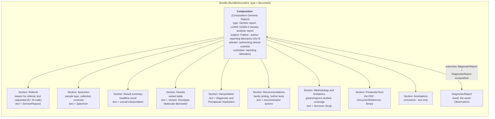

### References

- HL7 International [Genomics Reporting Implementation Guide](https://build.fhir.org/ig/HL7/genomics-reporting/index.html)
  - HL7 USA [minimal Common Oncology Data Elements (mCODE) Implementation Guide - Genomics](https://build.fhir.org/ig/HL7/fhir-mCODE-ig/group-genomics.html)
- [HL7 Version 2.5.1 Implementation Guide: Lab Results Interface (LRI), Release 1 from May 2017](https://confluence.hl7.org/download/attachments/25559919/2018%2004%2003%20-%20V2%20LRI%20-%20Ch.%205%20CG%20and%20Code%20System%20Tables.pdf?api=v2)
- [openEHR Project: Genomics](https://ckm.openehr.org/ckm/projects/1013.30.50)
- [NHS England FHIR Genomics Implementation Guide—Clinical Headings](https://simplifier.net/guide/fhir-genomics-implementation-guide/home/design/clinicalheadings)
- [NHS England Genomics Test Reporting Specification](https://www.england.nhs.uk/publication/genomics-testing-reporting-specification/)
- Related 
  - HL7 Europe [Laboratory Report](https://build.fhir.org/ig/hl7-eu/laboratory/index.html) 
  - HL7 Europe [Imaging](https://build.fhir.org/ig/hl7-eu/imaging/index.html)

### Document Layout

<b>Open question.</b> What is the common layout of a genomic laboratory report, and so which
sections should this Composition have? The sections currently in this profile are under review
(see <a href="#review-of-the-current-sections">Review of the Current Sections</a>). The layout
below is <b>inferred</b> as a starting point for discussion. It has not been agreed.

A genomic report sent as a FHIR Document (see [Report Types](ReportTypes.html)) is a `Bundle` of
type `document` with this `Composition` as its first entry. Each section carries its own
human-readable narrative (`section.text`, mandatory in `Composition-eu-lab`). A viewer shows those
narratives in order, like the pages of the printed (PDF) report, and the coded entries sit behind
them for computers to use.

No single source defines a FHIR Document layout for a genomic report. A layout can be inferred by
combining these sources:

| Source | What it gives |
|---|---|
| HL7 Europe [Laboratory Report](https://hl7.eu/fhir/laboratory/) `Composition-eu-lab` | The base profile: at least one section, `section.code` and `section.text` 1..1, sections nested at most **two levels** (top level for the study or specialty, second for report items), and an **Annotations** section (LOINC `48767-8`) for comments, text only |
| HL7 [Genomics Reporting](https://hl7.org/fhir/uv/genomics-reporting/) `genomic-report` | The content but not the layout: `DiagnosticReport.result` slices for variant, genotype, haplotype, biomarker, diagnostic and therapeutic implication, and the `recommended-action`, `genomic-study` and `coded-note` extensions |
| [NHS England Genomics Test Reporting Specification](https://www.england.nhs.uk/publication/genomics-testing-reporting-specification/) and ACGS reporting guidance | The headings a UK genomic report is expected to show - to be confirmed against the published specification |
| [Master HL7 genetic variant reporting panel](https://loinc.org/81247-9) (LOINC `81247-9`) | The HL7 v2 grouping of results: overall interpretation, discrete variants, complex variants, pharmacogenomics |
{:.grid}

#### Inferred Layout

The headings of a typical UK genomic laboratory report, as a FHIR Document. Codes marked **?** are
candidates, not decisions.

| Section | Candidate code | Content (entries) | Notes |
|---|---|---|---|
| Referral | LOINC `42349-1` Reason for referral (narrative) **?** | Text; entry ServiceRequest | Clinical indication and the [National Genomic Test Directory](https://www.england.nhs.uk/publication/national-genomic-test-directories/) test requested. Could instead be in the Composition header only |
| Specimen | **?** - no LOINC document section code found | Text; entry Specimen | The [ctDNA UGR example](Bundle-ctdna9737383222-eulab-document.html) uses SNOMED CT `123038009` Specimen |
| Result summary | LOINC `51968-6` Discrete variation analysis overall interpretation **?** | Text; entry overall interpretation Observation | The headline result shown first on the report |
| Results | LOINC `69548-6` Genetic variant assessment **?**, or `81247-9` Master HL7 genetic variant reporting panel | Text (the variant table); entries Variant, Genotype, Haplotype, Molecular Biomarker | Could be split into sub-sections following the `81247-9` panel (discrete variants, complex variants, pharmacogenomics) |
| Interpretation | **?** | Text; entries Diagnostic Implication, Therapeutic Implication | Is this separate from the result summary? |
| Recommendations | LOINC `62385-0` Recommendation **?**, or `18783-1` Study recommendation | Text; entries follow-up and medication recommendations | For example cascade testing for relatives |
| Methodology and limitations | **?** | Text; entry Genomic Study / Genomic Study Analysis | Genes or regions studied, technology, coverage, limitations |
| Presented form | LOINC `77599-9` Additional documentation | Entry DocumentReference (and Binary) | Used while the PDF remains the authorised report (UGR phase 1) |
| Annotations | LOINC `48767-8` Annotation comment | Text only, no entries | Defined by `Composition-eu-lab` |
{:.grid}

Questions for discussion:

1. Is this the common layout of a NW GLH (and NHS England) genomic report, and in this order?
2. Should the sections be the same for germline (rare disease), somatic (cancer) and
   pharmacogenomic reports, or should each have its own layout?
3. Should the sections be one level (as above), or two levels as `Composition-eu-lab` allows - for
   example a top-level *Genetics* study section with these as sub-sections?
4. Which section codes should be used? LOINC has few document section codes for genomics; the
   alternatives are SNOMED CT or a local CodeSystem.
5. Should the referral and specimen details be sections, or only in the Composition header and
   the DiagnosticReport (`basedOn`, `specimen`)?

#### Review of the Current Sections

All the section codes currently in this profile come from the LOINC *procedure note* family (the
sections of a surgical procedure note), not from laboratory or genomic reporting. Their meanings do
not match the section titles:

| Slice | Title | Code | LOINC meaning | Issue |
|---|---|---|---|---|
| `Order` | Laboratory Order | `59772-4` | Planned procedure Narrative | A planned (surgical) procedure, not a laboratory order or referral |
| `Specimen` | Specimen | `59773-2` | Procedure specimens taken Narrative | Specimens taken during a surgical procedure; close, but from a procedure note |
| `Narrative` | Narrative | `29554-3` | Procedure Narrative | Describes a procedure; holds the DiagnosticReport or PDF here |
| `GenomicFinding` | Findings | `59776-5` | Procedure findings Narrative | Findings of a procedure, not results of a genomic test |
| `GenomicImplication` | Implications | `59768-2` | Procedure indications [Interpretation] Narrative | **Indications** (the reason for a procedure) are not **implications** (what a result means) |
| `RecommendedActions` | Recommended Actions | `46209-3` | Provider orders | Orders placed by a provider, not recommendations made by the laboratory |
{:.grid}

Also:

- The examples use different section codes from each other and from these slices - for example
  LOINC `30954-2` *Relevant diagnostic tests/laboratory data note* in the
  [Targeted Variant](Bundle-FHIRDocumentGeneticReportBundle.html) document, and LOINC `81306-3`,
  SNOMED CT `123038009` and LOINC `69548-6` in the
  [ctDNA UGR Phase 2](Bundle-ctdna9737383222-eulab-document.html) document
- `section.title` is fixed in each slice, so the titles a laboratory shows cannot be its own
- `Composition-eu-lab` defines an Annotations section (LOINC `48767-8`); this profile does not mention it
- The [Domain Archetype](#domain-archetype) mind map below shows the current sections and will need
  updating once a layout is agreed

### Domain Archetype

> **DRAFT FOR ELABORATION PURPOSES**

<figure style="overflow-x:auto;">


Laboratory Report - Map

</figure>
 

#### Structured Report

This section is currently being elaborated and subject to change. It will include a modernisation to core FHIR concepts such as FHIR Workflow, FHIR Subscription and FHIR RESTful.

> **DRAFT FOR ELABORATION PURPOSES**

<!-- 
#### Somatic Reporting

[HL7 FHIR Genomics Reporting - Somatic Reporting](https://hl7.org/fhir/uv/genomics-reporting/pharmacogenomics.html)

is a mindmap 

#### Pharmacogenomic Reporting

[HL7 FHIR Genomics Reporting - Pharmacogenomic Reporting](https://hl7.org/fhir/uv/genomics-reporting/pharmacogenomics.html)

is a mindmap

#### HL7 v2 Genetic Variant Reporting (ORU_R01.txt)

> This is not included in the current phase and is for reference purposes. 

> [Master HL7 genetic variant reporting panel](https://fhir.nwgenomics.nhs.uk/R4/Questionnaire-81247-9.html)

-->

