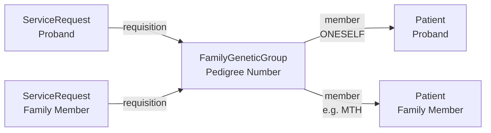

This section is currently being elaborated - see <a href="https://github.com/nw-gmsa/nw-gmsa-use-cases/blob/main/dWGS.md">Distributed WGS (dWGS)</a>.

A family (pedigree) whose members are tested together, for example a [Distributed WGS
(dWGS)](https://github.com/nw-gmsa/nw-gmsa-use-cases/blob/main/dWGS.md) Singleton, Duo or Trio.

**Ubiquitous terms:** Pedigree, Family, Kindred.

### Pedigree Number (Family Id)

The group is identified by its [Pedigree Number](StructureDefinition-GenomicsPedigreeNumber.html),
also known as **Family Id**. It is **not** a patient identifier: each family member is ordered
separately, and every one of those orders carries the Pedigree Number as its Order Group Number.

| Ubiquitous Term | HL7 FHIR | HL7 v2 |
|-----------------|----------|--------|
| Pedigree Number (Family Id) | `Group.identifier:PedigreeNumber` | - |
| Pedigree Number (Family Id) | `ServiceRequest.requisition` ([Order Group Number](StructureDefinition-OrderGroupNumber.html)) | ORC-4 Placer Group Number |
| Family Structure | `Group.code` ([Family Structure](ValueSet-FamilyStructure.html): Singleton, Duo, Trio) | - |
| Relationship to proband | `Group.member.extension:relationship` ([Family Member Relationship](StructureDefinition-FamilyMemberRelationship.html)) | - |
{:.grid}

### Members

Each member is a [Patient](StructureDefinition-Patient.html) - the proband and each family member
tested with them.

Each member's role in the family - their relationship to the proband (mother, father, son,
daughter, ...) - is given by the [Family Member Relationship](StructureDefinition-FamilyMemberRelationship.html)
extension, coded from the [RelatedPerson Relationship
Type](http://hl7.org/fhir/R4/valueset-relatedperson-relationshiptype.html) value set
(e.g. `MTH`, `FTH`, `SON`, `DAU`). The proband is `ONESELF`.

The `requisition` arrows show the shared identifier value, not a FHIR reference.
