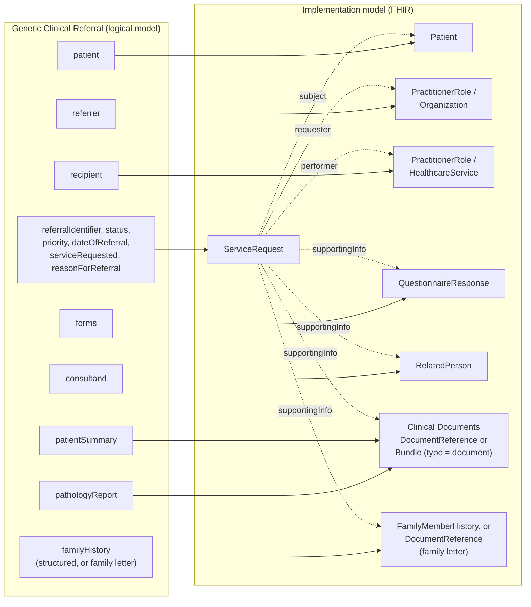
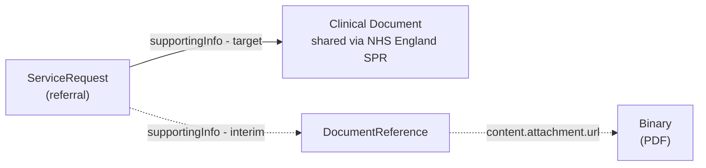
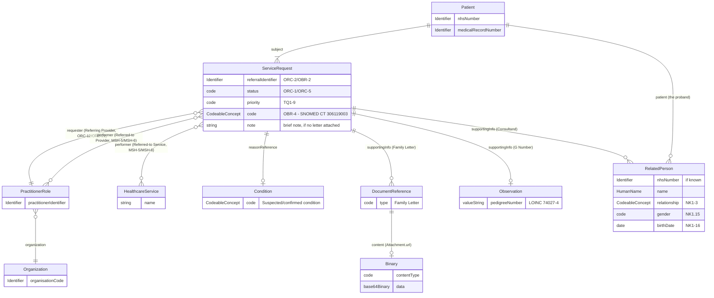

### From Logical Model to Implementation Model

The logical model above is one aggregate - the referral as sent. For
exchange it breaks down into a small `ServiceRequest` plus the forms and
clinical documents it references, each owned by the actor that produced it
and each reusable on its own.

| Logical model element(s) | FHIR Profile | HL7 v2 Segment | Owned by |
|---|---|---|---|
| referralIdentifier, status, priority, dateOfReferral, serviceRequested, reasonForReferral, clinicalInformation | `ServiceRequest` | [ORC](hl7v2.html#orc), [OBR](hl7v2.html#obr), TQ1, [DG1](hl7v2.html#dg1), [NTE](hl7v2.html#nte) | Referrer |
| patient | [Patient](StructureDefinition-Patient.html) | [PID](hl7v2.html#pid) | Patient administration (PAS/EPR) |
| referrer | [PractitionerRole](StructureDefinition-PractitionerRole.html), [Organization](StructureDefinition-Organization.html) | [ORC](hl7v2.html#orc)-12 / OBR-16, ORC-21 | Referrer |
| recipient | [PractitionerRole](StructureDefinition-PractitionerRole.html) or `HealthcareService` | [MSH](hl7v2.html#msh)-5 / MSH-6 | Referral recipient (directory of services) |
| forms | [QuestionnaireResponse](StructureDefinition-QuestionnaireResponse.html) | [OBX](hl7v2.html#obx) | Referrer |
| consultand | [RelatedPerson](StructureDefinition-RelatedPerson.html) - see [Genetic Referral Consultand](Questionnaire-GeneticReferralConsultand.html) | NK1 | Referrer |
| pathologyReport | Clinical document - [DocumentReference](StructureDefinition-DocumentReference.html) or [FHIR Document](StructureDefinition-BundleDocument.html) | [OBX](hl7v2.html#obx) (RP or ED) | Pathology laboratory |
| patientSummary | Clinical document - [DocumentReference](StructureDefinition-DocumentReference.html) or [FHIR Document](StructureDefinition-BundleDocument.html) | [OBX](hl7v2.html#obx) (RP or ED) | Patient's care provider (e.g. GP) |
| familyHistory | [FamilyMemberHistory](StructureDefinition-FamilyMemberHistory.html), or the family letter as a [DocumentReference](StructureDefinition-DocumentReference.html) -> `Binary` | [OBX](hl7v2.html#obx) (RP or ED) for the family letter | NHS England NDRS (structured, at present); Referrer (family letter) |
{:.grid}

This referral is not expected to be implemented within this IG - see the
introduction. The breakdown above shows what a Genomics England Limited
application, NHS England BaRS/eRS or the NHS England Genomic Order Management
Service would need to carry, using this IG's profiles as the reference shape.

#### Forms

Referral forms - e.g. a national GMS test order form or a service-specific
referral form - are carried as completed `QuestionnaireResponse`s, each
answering its own `Questionnaire`. This is the same pattern as Ask At Order
Entry on [Genomic Test Order](StructureDefinition-GenomicTestOrder.html#order-entry-questions):
the form varies by referral type, the referral itself does not. A form is a
**structured** answer set; it is not a clinical document.

#### Clinical Documents

A clinical document is referenced either as a `DocumentReference` (index
entry pointing at the content) or as a FHIR Document `Bundle` (type =
document, with a `Composition` as its root). The referral references the
document; it does not copy the document's content into itself. The
clinical documents in this model are `pathologyReport` and `patientSummary`.

##### Pathology Report

- **Target:** a reference to the pathology report as a clinical document
  shared by the **NHS England Single Patient Record (SPR)** - the referral
  points at the document where it already lives, rather than carrying a
  copy. The document itself would be a FHIR Document (e.g. following the
  HL7 Europe Laboratory Report document perspective).
- **Interim:** until that is available, the pathology report is an
  **attached PDF** - `ServiceRequest.supportingInfo` references a
  `DocumentReference`, whose `content.attachment.url` points at a `Binary`
  holding the PDF. In HL7 v2 this is an `OBX` with type `ED`.

Either way the logical model element is the same (`pathologyReport`); only
the implementation changes, so moving from the interim to the target does
not change the referral model.

NHS England **NDRS** (National Disease Registration Service) also holds
**Cancer Pathology Reports**. These are pathology studies, so the same
reports can also be included in the [Genomic Test
Order](StructureDefinition-GenomicTestOrder.html) (its `pathologyReport`
element) when a referral leads to a test.

##### Patient Summary

The patient summary is another clinical document referenced from the
referral, implemented the same way as the pathology report (a reference to
a shared clinical document, or an attached document in the interim).

<b>Difference from NHS England:</b> the patient summary is <b>not</b> part of the
<a href="https://simplifier.net/guide/fhir-genomics-implementation-guide/Home/FHIRAssets/Profiles/All-Profiles/Genomics-ServiceRequest">NHS England Genomics ServiceRequest</a>
specification. This model adds it as <code>ServiceRequest.supportingInfo</code>.

##### Family Letter

The family letter is carried in `familyHistory`, alongside structured family
history - see [Family History](#family-history) below.

#### How the Pieces Travel

| Exchange | Format | What is sent |
|---|---|---|
| HL7 v2 messaging | [`OMG^O19`](hl7v2.html#omg_o19-general-clinical-order), status updates [`OSU^O51`](hl7v2.html#osu_o51-order-status-update) | `PID`, `NK1`, `PV1`, `ORC`, `TQ1`, `OBR`, `DG1`, `NTE` segments; forms and documents as `OBX` (reference pointer, or encapsulated PDF) |
| FHIR Messaging | FHIR Message (referral) | `Bundle` (type = message) containing `MessageHeader`, `ServiceRequest`, `Patient`, `PractitionerRole`, `QuestionnaireResponse` and `RelatedPerson`; clinical documents by reference (or a `DocumentReference` + `Binary` in the interim) |
| FHIR RESTful API | Health Data API / SPR | `ServiceRequest` and its referenced resources; clinical documents retrieved from where they are shared |
| Document sharing | [MHD](MHD.html) / NHS England NRL / SPR | `DocumentReference` (pathology report, patient summary, family letter), with `DocumentReference.context.related` pointing back to the referral |
{:.grid}

#### Rules

- The **Referral Identifier** (`ORC-2`/`OBR-2`, `ServiceRequest.identifier`) is present in every message and on every resource that relates to the referral.
- Clinical content travels as **documents referenced from the referral** - the pathology report, patient summary and family letter are never copied into the `ServiceRequest`.
- Forms are structured (`QuestionnaireResponse`); documents are not. A form is never used to carry a document, and a document is never used to carry structured referral data.
- A named consultand is structured (`RelatedPerson`, `NK1`), one per relative.
- Family history retrieved from NDRS is structured (`FamilyMemberHistory`), one per relative, and may not be current.
- The [Genetic Clinical Referral Questionnaire](Questionnaire-GeneticClinicalReferral.html) is the form representation of this model - its `linkId`s are listed on the **Mappings** tab. `forms`, `pathologyReport` and `patientSummary` are in its Supporting Information group; `familyHistory` maps to its Family History group.

### Domain Archetype

<b>HL7 v2 Message:</b> `OMG^O19` (General Clinical Order, IHE 360X), status updates `OSU^O51`

This is a **level 2** (field-level) sketch of [Genetic Referrals'](GeneticReferrals.html)
own [Target Referral Model](GeneticReferrals.html#target-referral-model) - the
same entities, with the elements this model actually carries.

### Differences from Genomic Test Order

Both models exist for the same reason - a computable common core,
extended per scenario rather than re-modelled each time - but a clinical
referral and a laboratory order are genuinely different things. The table
below is the concrete comparison:

| Aspect | [Genomic Test Order](StructureDefinition-GenomicTestOrder.html) | Genetic Clinical Referral |
|---|---|---|
| HL7 v2 basis | `OML_O21` (Laboratory Order), `ORC`/`OBR` | `OMG^O19` (General Clinical Order, IHE 360X), `ORC`/`OBR`, status updates `OSU^O51` |
| What it requests | A specific laboratory test, from a Genomic Test Directory code | An assessment/service (e.g. genetic counselling, cascade testing) - not a specific lab test. `ServiceRequest.code` / OBR-4 is SNOMED CT `306119003` |
| Patient demographics | `PID` - Patient group | **Same** - reuses the identical items (both populate `PID`) |
| Who initiated it | Healthcare Professional group (`ORC-12`/`ORC-21`) - a single referrer | Referring Provider group (`ORC-12`/`ORC-21`) - same shape, same reused items |
| Who it's going to | *(implicit - the destination LIMS is fixed, not chosen per-order)* | **Referred-to Provider/Service group (`MSH-5`/`MSH-6`) - new, no equivalent in Genomic Test Order.** A referral explicitly names the receiving clinic/service; an order doesn't need to, because the Order Filler is already fixed |
| Test/order identifier | Order Placer/Filler Number (`ORC-2`/`ORC-3`) - no genuine `ORC-4`/Order Group Number field exists on either model (`G Number`/pedigree number is a separate, family-level concept - see [Genomic General Ask At Order Entry](Questionnaire-GenomicGeneralAskAtOrderEntry.html)) | Referral Identifier (`ORC-2`/`OBR-2`) - a single identifier, not a Placer/Filler pair, and no eRS UBRN equivalent modelled (see [Genetic Referrals - Notes on this sketch](GeneticReferrals.html#referral-data-model)) |
| Priority | `ServiceRequest.priority` (`LN/82768-3`) | **Same** - reuses the identical item (`TQ1-9` maps onto the same FHIR element) |
| Reason | Suspected disease/CITT code (`LN/51967-8`) plus free-text clinical information (`NTE-1`) | **Same** reason-code item reused (`OBR-31`/`DG1`) |
| Specimen | **Specimen/Biopsy group** - detailed fields (type, body site, accession number, collection/received dates, shipment tracking) | **None.** A referral is a request for assessment, not a physical test - no specimen is collected until/unless it leads to an actual [Genomic Test Order](StructureDefinition-GenomicTestOrder.html) later |
| Order/test-type-specific detail | **Ask At Order Entry Questionnaires** - structured, `derivedFrom`/extended, exactly **one** applies per order/test type (see [Order Entry Questions](StructureDefinition-GenomicTestOrder.html#order-entry-questions)) | **Partly structured.** General family history stays in an attached **family letter** (`supportingInfo` -> `DocumentReference` -> `Binary`, the same pattern eRS uses) or free text - but a *named* consultand is structured via [Genetic Referral Consultand](Questionnaire-GeneticReferralConsultand.html) (`supportingInfo` -> `RelatedPerson`, HL7 v2 `NK1`), `derivedFrom`/extended the same way, except **repeating** (one per named relative) rather than a single choice - see [Order Entry Questions](#order-entry-questions) below |
{:.grid}

#### Family History

Genomic Test Order's Ask At Order Entry Questionnaires model order-type-specific
detail as structured, coded data. A referral's equivalent detail doesn't have
that today: per [Genetic Referrals](GeneticReferrals.html)'s "Genetic Counselling /
Cascade Testing Referral" section and [Cancer Background Information for Use
Cases - Genetic Counselling Referral Across
Regions](https://github.com/nw-gmsa/nw-gmsa-use-cases/blob/main/CancerNOS.md#genetic-counselling-referral-across-regions), this
detail is carried in an unstructured **family letter** - a dictated or
secure-email clinical letter summarising the variant/condition, the
inheritance pattern, and which relatives are thought to be at risk. Rather
than inventing a structured family-history data model that doesn't exist in
current practice, this model treats the letter itself as an
attachment: `ServiceRequest.supportingInfo` references a `DocumentReference`,
whose `content.attachment.url` points at a `Binary` holding the actual
document (with a separate free-text `ServiceRequest.note` item as a fallback
for a brief note sent without an attached letter). This is not a new pattern
invented for this model - it is the **same shape NHS e-Referral
Service (eRS) already uses** for referral attachments
(`ReferralRequest.supportingInfo` -> `DocumentReference`), see [Genetic
Referrals - eRS FHIR Resource
Model](GeneticReferrals.html#ers-fhir-resource-model).

**Structured family history** (`familyHistory`, one `FamilyMemberHistory`
per relative) is also part of this model. At present clinical genetics is
believed to retrieve this information from NHS England **NDRS** (National
Disease Registration Service), rather than receiving it in the referral.

NDRS is a <b>reporting/analytical</b> service, not a care record, so family
history retrieved from it may not be concurrent with the patient's current
clinical record.

**General** family history - the wider pedigree, who else is affected - stays
in that unstructured letter; this model doesn't attempt to structure
all of it. The one part that *is* called out as structured is a **named
consultand** - a specific at-risk relative who is themselves being referred
for counselling/testing, not just mentioned in passing - see [Order Entry
Questions](#order-entry-questions) below.

### Order Entry Questions

The [Genetic Clinical Referral Questionnaire](Questionnaire-GeneticClinicalReferral.html) is the
**common core** referral form, the same way [Genomic Test
Order](StructureDefinition-GenomicTestOrder.html#order-entry-questions) is the
common core order form. Where a *named consultand* is being referred
alongside (or instead of) the proband, that detail is added by a separate,
`derivedFrom`/extended Questionnaire representing HL7 v2 `NK1` (Next of
Kin/Associated Parties) as a FHIR `RelatedPerson`, referenced from
`ServiceRequest.supportingInfo` - the same `supportingInfo` slot the family
letter's `DocumentReference` uses, just a different resource type:

| Referral Content | Questionnaire |
|---|---|
| Named consultand (structured, `NK1`/`RelatedPerson`) | [Genetic Clinical Referral - Consultand (RelatedPerson)](Questionnaire-GeneticReferralConsultand.html) |
{:.grid}

Unlike [Genomic Test Order](StructureDefinition-GenomicTestOrder.html#order-entry-questions),
where exactly one Ask At Order Entry Questionnaire applies per order/test
type, this table is expected to grow by **repetition** rather than by
alternative: a referral naming three at-risk relatives would reference three
separate `GeneticReferralConsultand`-derived answers, one per consultand, not
a choice between variants.

### Data Models

- [Genomic Test Order](StructureDefinition-GenomicTestOrder.html) - the equivalent
  archetype for a laboratory order, compared above
- [Genetic Clinical Referral - Consultand (RelatedPerson)](Questionnaire-GeneticReferralConsultand.html) -
  the `derivedFrom`/extended Questionnaire for a named consultand, see [Order
  Entry Questions](#order-entry-questions) above
- [RelatedPerson](StructureDefinition-RelatedPerson.html) - the FHIR profile
  the Consultand Questionnaire structures (HL7 v2 `NK1`)
- [Diagnostic Model Overview](diagnostic-core.html) - the identifier profiles reused
  above ([NHS Identifier](StructureDefinition-NHSIdentifier.html), [Medical
  Record Number](StructureDefinition-MedicalRecordNumber.html), [Order
  Identifier](StructureDefinition-OrderIdentifier.html))
- [Genetic Referrals](GeneticReferrals.html) - the narrative use case, actors,
  transactions and OMG_O19/eRS/BaRS mapping this model was first built from

Nothing on this page has been adopted as an active profile or interface in
this IG.
