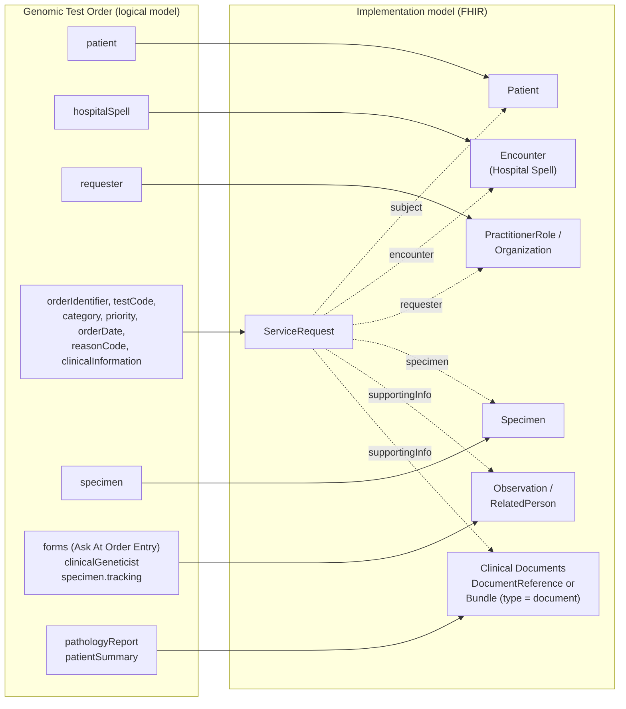
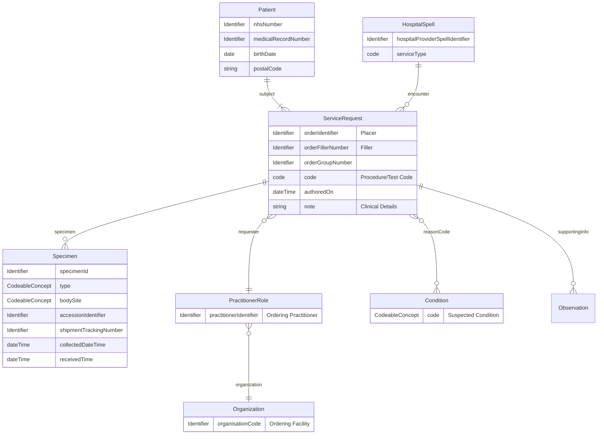
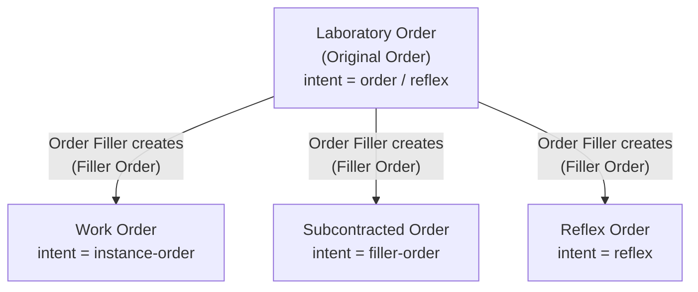
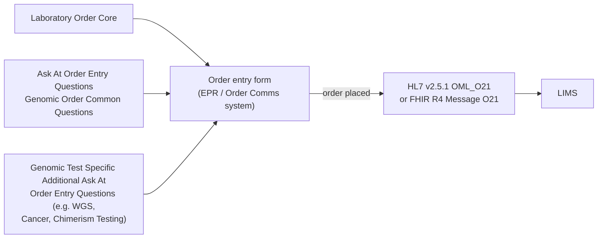
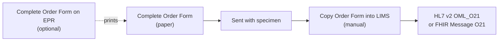

### From Logical Model to Implementation Model

The logical model above is one aggregate - the order as completed on an
order entry form. For exchange it breaks down into several FHIR resources
(or HL7 v2 segments), each owned by a different actor and each reusable on
its own.

`ServiceRequest` is the root: every other resource is referenced from it,
and it carries the order-level elements itself.

| Logical model element(s) | FHIR Profile | HL7 v2 Segment | Owned by |
|---|---|---|---|
| patient | [Patient](StructureDefinition-Patient.html) | [PID](hl7v2.html#pid), PD1 | Patient administration (PAS/EPR) |
| hospitalSpell | [Hospital Spell](StructureDefinition-HospitalSpell.html) (Encounter) | [PV1](hl7v2.html#pv1) | Order Placer (PAS/EPR) |
| requester | [PractitionerRole](StructureDefinition-PractitionerRole.html), [Practitioner](StructureDefinition-Practitioner.html), [Organization](StructureDefinition-Organization.html) | [ORC](hl7v2.html#orc)-12, ORC-21 | Order Placer |
| orderIdentifier, fillerOrderNumber, orderGroupNumber, category, testCode, orderDate, priority, performer, reasonCode, clinicalInformation | [ServiceRequest](StructureDefinition-ServiceRequest.html) | [ORC](hl7v2.html#orc), [OBR](hl7v2.html#obr), [DG1](hl7v2.html#dg1), [NTE](hl7v2.html#nte) | Order Placer (filler order number: Order Filler) |
| specimen | [Specimen](StructureDefinition-Specimen.html) | [SPM](hl7v2.html#spm) | Order Placer (collection); Order Filler (receipt, accession) |
| forms (Ask At Order Entry) | [QuestionnaireResponse](StructureDefinition-QuestionnaireResponse.html); answers as [Observation](StructureDefinition-Observation.html) / [RelatedPerson](StructureDefinition-RelatedPerson.html) via `ServiceRequest.supportingInfo` | [OBX](hl7v2.html#obx), NK1 | Order Placer |
| clinicalGeneticist, specimen.additive, specimen.tracking | [Observation](StructureDefinition-Observation.html) via `ServiceRequest.supportingInfo` | [OBX](hl7v2.html#obx) | Order Placer |
| pathologyReport, patientSummary | Clinical document - [DocumentReference](StructureDefinition-DocumentReference.html) or [FHIR Document](StructureDefinition-BundleDocument.html) via `ServiceRequest.supportingInfo` | [OBX](hl7v2.html#obx) (RP or ED) | Pathology laboratory (pathology report); patient's care provider, e.g. GP (patient summary) |
{:.grid}

#### Patient Demographics

<b>HL7 FHIR Profile:</b> <a href="StructureDefinition-Patient.html" _target="_blank">Patient</a> 

<b>HL7 v2 Segment:</b> <a href="hl7v2.html#pid" _target="_blank">PID</a>

`ServiceRequest.subject.identifier` carries the NHS Number; if the NHS
Number is not present, the Medical Record Number is used instead.

#### Hospital Spell

<b>HL7 FHIR Profile:</b> <a href="StructureDefinition-HospitalSpell.html" _target="_blank">Hospital Spell</a> 

<b>HL7 v2 Segment:</b> <a href="hl7v2.html#pv1" _target="_blank">PV1</a>

Treat as mandatory for reflex or subcontracted orders. Referenced as
`ServiceRequest.encounter.identifier`.

#### Diagnostic Workflow

<b>HL7 FHIR Profile:</b> <a href="StructureDefinition-ServiceRequest.html" _target="_blank">ServiceRequest</a> 

<b>HL7 v2 Segment:</b> <a href="hl7v2.html#orc" _target="_blank">ORC</a>

If the order has a requesting practitioner, `ServiceRequest.requester`
references a `PractitionerRole` (practitioner + ordering facility); otherwise
it references the ordering facility `Organization` directly. `performer` is
implied in HL7 v2 by the destination of the message. For genomics,
`testCode` is the [Genomic Test Directory](ValueSet-GenomicTestCodes.html)
code.

#### Specimen

<b>HL7 FHIR Profile:</b> <a href="StructureDefinition-Specimen.html" _target="_blank">Specimen</a> 

<b>HL7 v2 Segment:</b> <a href="hl7v2.html#spm" _target="_blank">SPM</a>

Note: it is likely that source systems will use ORM_01 and not include
specimen details. In this case it is suggested that the specimen details are
captured as 'Ask at Order Entry Questions' and so provided as OBX segments.

#### Pathology Report

Pathology studies can be included in the order as `pathologyReport` -
for example a **Cancer Pathology Report** held by NHS England **NDRS**
(National Disease Registration Service), or a pathology report shared by
the NHS England Single Patient Record. As on [Genetic Clinical
Referral](StructureDefinition-GeneticClinicalReferral.html#pathology-report),
it is referenced as a clinical document, or in the interim attached as a
PDF (`DocumentReference` -> `Binary`, HL7 v2 `OBX` type `ED`). NDRS is a
reporting/analytical service, so a report retrieved from it may not be the
latest version.

#### Patient Summary

The patient summary is another clinical document referenced from the order,
implemented the same way as the pathology report (a reference to a shared
clinical document, or an attached document in the interim).

<b>Difference from NHS England:</b> the patient summary is <b>not</b> part of the
<a href="https://simplifier.net/guide/fhir-genomics-implementation-guide/Home/FHIRAssets/Profiles/All-Profiles/Genomics-ServiceRequest">NHS England Genomics ServiceRequest</a>
specification. This model adds it as <code>ServiceRequest.supportingInfo</code>.

#### How the Pieces Travel

| Exchange | Format | What is sent |
|---|---|---|
| FHIR Messaging (primary) | [FHIR Message O21](MessageDefinition-laboratory-order.html) | `Bundle` (type = message) containing `MessageHeader`, `ServiceRequest` and the resources it references |
| HL7 v2 messaging | [OML_O21](hl7v2.html#oml_o21-laboratory-order), or [OMG_O19](hl7v2.html#omg_o19-general-clinical-order) instead | `PID`, `PD1`, `PV1`, `ORC`, `OBR`, `DG1`, `NTE`, `OBX`, `NK1`, `SPM` segments |
| FHIR RESTful API | [Health Data API](HIE.html) | `ServiceRequest` and its referenced resources |
{:.grid}

#### Rules

- The **Order Placer Number** (`ServiceRequest.identifier[OrderPlacerNumber]`, `ORC-2`) is present on every order, whichever format is used, and is echoed back on the [Genomic Test Report](StructureDefinition-GenomicTestReport.html).
- `Patient` and `Encounter` are owned by patient administration; the order references them using business identifiers.
- Ask At Order Entry questions (`forms`) are never part of the core - they are completed as a `QuestionnaireResponse` and carried as `Observation` (`OBX`) or `RelatedPerson` (`NK1`), linked via `ServiceRequest.supportingInfo`.
- A Filler Order (work order, subcontracted or reflex order) has the same shape, created by the Order Filler - see [Original Order, Instance and Filler Orders](#original-order-instance-and-filler-orders).
- The [Genomic Test Order Questionnaire](Questionnaire-GenomicTestOrder.html) is the form representation of this model - its `linkId`s are listed on the **Mappings** tab. It is the resources above, not the `Questionnaire`/`QuestionnaireResponse`, that are exchanged.

### Domain Archetype

This is a **level 2** (field-level) view of the [basic model](diagnostic-core.html#entity-relationship-diagram)
introduced in Diagnostic Model Overview, showing the entities and key attributes a
Genomic Test Order actually carries:

### Diagnostic Order

 

Order Test Form - Data Extraction Overview
 
 

[FHIR Message](https://hl7.org/fhir/R4/messaging.html), following the [laboratory-order](MessageDefinition-laboratory-order.html) message definition, is the **primary** format for order messages. HL7 v2 `OML_O21 Laboratory Order` is **also supported** (`OMG_O19 General Clinical Order`, which has the same segments including `SPM`, **MAY** be used instead) - the FHIR Message definition is deliberately based on `OML_O21`'s own structure, which simplifies conversion to/from pipe+hat (v2) and json (FHIR) formats.

> At present, the NW GLH Laboratory Information Management System (LIMS) will not support HL7 FHIR. The Regional Integration Exchange (RIE) will perform conversion between v2 and FHIR formats.

This message is an [aggregate (DDD)](https://martinfowler.com/bliki/DDD_Aggregate.html)/[archetype](https://en.wikipedia.org/wiki/Archetype_(information_science)) and so is a collection of FHIR Resources (similar to v2 segments) which is described in [From Logical Model to Implementation Model](#from-logical-model-to-implementation-model) above and [ServiceRequest](StructureDefinition-ServiceRequest.html).

#### Original Order, Instance and Filler Orders

`ServiceRequest` may also be split into two logical entities called
`OriginalOrder` and `FillerOrder`. The former represents the order received by
the Order Filler from the Order Placer, and the latter is orders the `Order
Filler` creates to fulfil that order. These are often also called `reflex`,
`work-order` or `sub-contract` orders - both are structurally the same
Genomic Test Order archetype above, just created by a different actor.

One Laboratory Order (the Original Order) can give rise to any of the three
Filler Order shapes in the table below - a Work Order, a Subcontracted
Order, or a Reflex Order - each created *by* the Order Filler rather than
the original requester, and each carrying its own `intent` value. See
[Diagnostic Model Overview - Linking Related
Orders](diagnostic-core.html#linking-related-orders-servicerequestrequisition)
for how `ServiceRequest.requisition` ties a Filler Order back to the
Original Order it descends from.

In IHE Laboratory Testing Workflow, the Original Order is the key entity in
[LAB-1](LTW.html#diagnostic-testing), and the Filler Order is the key entity
in [LAB-4](LTW.html#work-order-and-test-result-management-lab-4-and-lab-5) -
both share the field-by-field mapping in [Diagnostic
Workflow](#diagnostic-workflow) above.

##### Filler Order Intent

| Type                | Description                                                                                                                                                     | IHE PALM | Created by   | Original Order Intent | Filler Order Intent   |
|---------------------|-----------------------------------------------------------------------------------------------------------------------------------------------------------------|----------|--------------|----------------------------------------|-----------------------|
| Laboratory Order    | A request for one or more laboratory investigations submitted by the requesting clinician or system.                                                            | LAB-1    | Order Placer | order / reflex                         |                       | 
| Work Order          | A subordinate order created by the laboratory to organise and fulfil part of the overall Laboratory Order.                                                      | LAB-4    | Order Filler |                                        | instance-order       | 
| Subcontracted Order | A laboratory order forwarded to another laboratory for fulfilment, for example when a specialised test is referred to an external provider.                     | LAB-35   | Order Filler |                                        | filler-order |
| Reflex Order        | A new order created automatically by the Order Filler based on previous test results, for example when pathology findings automatically trigger a genomic test. | LAB-35   | Order Filler |                                        | reflex                | 
{:.grid}

#### Order Entry Questions

In the logical model these are the `forms` element - also known as **Ask At
Order Entry** questions.

The common core, plus whichever Ask At Order Entry Questionnaire(s) apply,
**together** are what a `Questionnaire`/`QuestionnaireResponse` represents -
the order entry form as it appears inside an EPR or Order Comms system.
`HL7 v2 OML_O21`/`FHIR Message O21` is a **different thing**: the wire
format that same order is sent onward to a LIMS in, once it's placed - not a
form a user fills in. Ask At Order Entry questions are what vary between
test types; the message shape they end up populating downstream does not.
Ask At Order Entry Questions generally get transformed to `Observation`
(`OBX`) or `RelatedPerson` (`NK1`) when added to this HL7 v2/FHIR message,
and are linked in FHIR via `ServiceRequest.supportingInfo`.

For most order/test types this is **two** Questionnaires combined - the
common core plus one Ask At Order Entry Questionnaire. Some test types split
the Ask At Order Entry side further, into questions **common** to several
test types (e.g. [Ask At Order Entry Questions
Common](Questionnaire-GenomicGeneralAskAtOrderEntry.html), shared by Cancer,
WGS and Rare and Inherited Disease orders) plus questions **specific** to
just one (e.g. [WGS Test Additional Ask At Order Entry
Questions](Questionnaire-WGSTestAdditionalAskAtOrderQuestions.html)) - a WGS
order therefore combines **three** Questionnaires. [HLA Tests -
Transplant](Questionnaire-HLATestsTransplantAskAtOrderEntry.html) and
[Chimerism Test Additional Ask At Order Entry Questions](Questionnaire-ChimerismTestAdditionalAskAtOrderQuestions.html) sit
in the same "Test Specific" tier as WGS, just without a shared "Common" tier
of their own today - each combines directly with the common core, the same
two-Questionnaire shape as most other test types.

**Coding Ask At Order Entry questions.** Local coding (against the `NWGMSA`
CodeSystem) is acceptable where no suitable national code exists, and is
used throughout this IG's own Ask At Order Entry Questionnaires. Where a
national code does exist for an important/key question, using it is
preferred, to aid communication with systems and services beyond this IG -
SNOMED CT or LOINC, whichever actually has a matching concept. In practice
this is more often LOINC than SNOMED CT: SNOMED CT is a clinical
terminology, and doesn't tend to hold codes for *questions* themselves (as
opposed to the findings/answers a question is about), whereas LOINC's own
question-and-panel structure covers this directly - so LOINC is often the
only coded option available, not a stylistic preference.

The same pattern recurs on the report side: [Genomic Test
Report](StructureDefinition-GenomicTestReport.html)'s panels and Genomic Results vary
according to which test is being recorded in the LIMS, in exactly the same way Ask At
Order Entry questions vary by test type here - and `HL7 v2 ORU_R01`/`FHIR Message R01`
is, correspondingly, how that varying report content is sent onward from the LIMS to
the EPR, the mirror image of `OML_O21`/`FHIR Message O21` on the order side.

The Questionnaires in this IG are regarded as **Domain Archetypes** - a term
deliberately borrowed from [openEHR](https://specifications.openehr.org/releases/AM/latest/Archetypes.html),
where an archetype is a formal, reusable model of a clinical/domain concept used to
elaborate a data model during a project's early stages, independent of how it's later
persisted or exchanged. The common cores ([Genomic Test
Order](StructureDefinition-GenomicTestOrder.html) and [Genomic Test
Report](StructureDefinition-GenomicTestReport.html)) are documented as FHIR logical
models; the Ask At Order Entry questions as `Questionnaire`s. The link to openEHR's
own archetype concept is intentional, not coincidental.

These Questionnaires may also represent a persistence standard for some
implementations, but this guide itself is about **exchange** - either HL7 v2/FHIR
messaging or a FHIR REST API. It is the resources that a completed questionnaire
(e.g. a `QuestionnaireResponse`) breaks down into - `Patient`, `ServiceRequest`,
`Observation`, `RelatedPerson`, `Specimen`, and so on - that are actually used for
data exchange, not the `Questionnaire`/`QuestionnaireResponse` itself.

Separately, a `Questionnaire` may also be used to build the actual data-entry screens
within an EPR or other application - see [HL7 FHIR Structured Data
Capture](https://build.fhir.org/ig/HL7/sdc/index.html) for more on that use.

This logical model (defined above, titled **Genomic Test Order** in this
IG, with the equivalent [Genomic Test Order
Questionnaire](Questionnaire-GenomicTestOrder.html)) represents the **Laboratory
Order Core**: the Patient, Healthcare Professional, Test Request and Specimen fields shared by every order,
regardless of test type or diagnostic domain - the same shape would apply
equally to a pathology or radiology order, not just genomics (see this
page's own introduction above) - mapping onto the standardised
[HL7 v2 OML_O21](hl7v2.html#oml_o21-laboratory-order) message and its FHIR equivalent,
the [FHIR Message O21](MessageDefinition-laboratory-order.html).

Ask At Order Entry questions vary by order/test type, so they are **not** part of the
common core - each order/test type instead uses its own Ask At Order Entry
Questionnaire. Those below `derivedFrom`/extend the common core [Genomic Test Order
Questionnaire](Questionnaire-GenomicTestOrder.html); the
[NW GLH Paper Test Request Forms](#nw-glh-paper-test-request-forms) further down
don't yet declare that relationship - see that section for why.

These Ask At Order Entry Questionnaires originated within this IG, modelling
an existing digital order-entry screen rather than a paper form:

| Order/Test Type                                                | Ask At Order Entry Questionnaire                                                                                                                                                                                                                                                                                                                                                                                    | Tier |
|----------------------------------------------------------------|---------------------------------------------------------------------------------------------------------------------------------------------------------------------------------------------------------------------------------------------------------------------------------------------------------------------------------------------------------------------------------------------------------------------|------|
| Ask At Order Entry Questions Common (default)                  | [Ask At Order Entry Questions Common](Questionnaire-GenomicGeneralAskAtOrderEntry.html) - the fallback for any order/test type without its own dedicated Ask At Order Entry Questionnaire, which today covers: - **Cancer** - **Whole Genome Sequencing (WGS)** - alongside the Test Specific Questionnaire below - **Rare and Inherited Diseases** | Common |
| Test Specific - Whole Genome Sequencing (WGS)                  | [WGS Test Additional Ask At Order Entry Questions](Questionnaire-WGSTestAdditionalAskAtOrderQuestions.html) - used *alongside* Ask At Order Entry Questions Common above, not instead of it - a WGS order combines both plus the common core | Test Specific |
| Test Specific - Cancer (proposal)                              | [Cancer Test Additional Ask At Order Entry Questions](Questionnaire-CancerTestAdditionalAskAtOrderQuestions.html) - a **proposal**, inferred from the two Cancer-category [NW GLH Paper Test Request Forms](#nw-glh-paper-test-request-forms) below, not yet wired into either of them | Test Specific |
| Distributed WGS (dWGS) sub-contracted order                    | [dWGS Ask At Order Entry Questions](Questionnaire-dWGSAskAtOrderEntry.html) - see [dWGS](https://github.com/nw-gmsa/nw-gmsa-use-cases/blob/main/dWGS.md#ask-at-order-entry-the-dwgs-digital-manifest). The full 42-field digital manifest is separately documented as a CSV manifest description at [dWGS Sub-Order Manifest](Questionnaire-dWGSSubOrder.html), not itself an Ask At Order Entry Questionnaire                                                           | Test Specific |
| Histocompatibility and Immunogenetics - HLA Tests (Transplant) | [HLA Tests - Transplant Ask At Order Entry](Questionnaire-HLATestsTransplantAskAtOrderEntry.html) - see [Histocompatibility and Immunogenetics](https://github.com/nw-gmsa/nw-gmsa-use-cases/blob/main/HistocompatibilityAndImmunogenetics.md#ask-at-order-entry-questions) - combines directly with the common core, no separate Common tier of its own today | Test Specific |
| Histocompatibility and Immunogenetics - Chimerism Testing      | [Chimerism Test Additional Ask At Order Entry Questions](Questionnaire-ChimerismTestAdditionalAskAtOrderQuestions.html) - see [Histocompatibility and Immunogenetics](https://github.com/nw-gmsa/nw-gmsa-use-cases/blob/main/HistocompatibilityAndImmunogenetics.md#chimerism-testing-ask-at-order-entry) - combines directly with the common core, no separate Common tier of its own today | Test Specific |
{:.grid}

##### NW GLH Paper Test Request Forms

Unlike [Order Entry Questions](#order-entry-questions) above, this pathway is manual
end to end: an EPR/Order Comms system may optionally exist upstream to *print* the
form, but the paper form itself - not a `Questionnaire`/`QuestionnaireResponse`
combination an EPR completes electronically - is what actually travels with the
specimen to the laboratory, where its answers are **manually** entered into the LIMS.
`HL7 v2 OML_O21`/`FHIR Message O21` can still be produced at the end of this - see
[ctDNA Management Information - Current
Process](https://github.com/nw-gmsa/nw-gmsa-use-cases/blob/main/NEYManagementInformation.md#current-process), where NW Genomics manually
enters a paper-based order into iGene and the Regional Integration Engine (RIE) later
converts that into a genuine `FHIR Message O21`, a copy of which is sent on to NE&Y
Genomics - but the message is only ever as complete as the paper form was: **a field
missing from the paper form is missing from the message too**, with no upstream
Questionnaire/QuestionnaireResponse to have captured it electronically in the first
place. This is the direct opposite of [Order Entry
Questions](#order-entry-questions)' own pathway, which requires substantially less
manual processing at both order creation in the referring NHS Trust and receipt at the
NHS Diagnostic Service, precisely because the Questionnaire/message combination is
populated electronically throughout rather than transcribed from paper partway
through.

The Ask At Order Entry Questionnaires below instead originated from real NW
GLH paper test request forms, rather than an existing digital order-entry
screen - see below for which forms and how they compare. None of the twelve
Questionnaires below `derivedFrom`/extends the common core Questionnaire
yet, unlike the digital-order-entry-screen-originated ones above: they
haven't been processed into the specific electronic Ask At Order Entry
shape that relationship implies for use in an actual order, only compared
against the common core field-by-field. Where a paper
form's own question turns out to already be covered by [NW Genomic General Test
Order](Questionnaire-GenomicGeneralAskAtOrderEntry.html) (e.g. gestation of
pregnancy), the paper-form Questionnaire carries a design note saying so
rather than silently duplicating it - both remain independent Ask At Order
Entry Questionnaires, since exactly one applies per order:

| Order/Test Type                          | Ask At Order Entry Questionnaire                                                                                     | Test Directory Code(s) |
|-------------------------------------------|------------------------------------------------------------------------------------------------------------------------|--------------------------|
| Rare and Inherited Disease - WGS (national GMS form) | [GMS WGS Rare Disease](Questionnaire-GMSWGSRareDisease.html) | Any Rare and Inherited Disease code with `test-method` = WGS on [Genomic Test Code](CodeSystem-GenomicTestCode.html) (e.g. `R14.1`) - not one fixed code |
| Rare and Inherited Disease - WGS (local paper order) | [WGS Local Test Order Ask At Order Entry](Questionnaire-WGSLocalTestOrderAskAtOrderEntry.html) | Same WGS codes as above, ordered via the local paper route rather than the national GMS form |
| Rare and Inherited Disease (generic) | [Rare Disease Genomic Testing Ask At Order Entry](Questionnaire-RareDiseaseGenomicAskAtOrderEntry.html) | Any Rare and Inherited Disease code not covered by a more specific row below |
| Rare and Inherited Disease - Prenatal Haemoglobinopathy | [Prenatal Haemoglobinopathy Ask At Order Entry](Questionnaire-HaemoglobinopathyPrenatalAskAtOrderEntry.html) | `R361`, `R372`, `R93` (haemoglobinopathy trait/carrier/diagnostic codes) - shared with Haemoglobinopathy Genetic Testing below; which specific code applies to which of the two forms is not confirmed from either form's own source |
| Rare and Inherited Disease - Haemoglobinopathy Genetic Testing | [Haemoglobinopathy Genetic Testing Ask At Order Entry](Questionnaire-HaemoglobinopathyGeneticAskAtOrderEntry.html) | `R361`, `R372`, `R93` - see caveat above |
| Rare and Inherited Disease - Cystic Fibrosis Carrier Testing | [Cystic Fibrosis Carrier Testing Ask At Order Entry](Questionnaire-CysticFibrosisCarrierAskAtOrderEntry.html) | `R185.1` "Cystic fibrosis carrier testing" |
| Rare and Inherited Disease - Genomic Variant Review | [Genomic Variant Review Ask At Order Entry](Questionnaire-VariantReviewAskAtOrderEntry.html) | Not applicable - reviews a variant already reported under a prior test code, rather than requesting a new one |
| Rare and Inherited Disease - Deafness (R67) | [Deafness (R67) Ask At Order Entry](Questionnaire-DeafnessR67AskAtOrderEntry.html) | `R67.1` "Monogenic hearing loss" |
| Rare and Inherited Disease - CYP2C19 Mavacamten (R454) | [CYP2C19 Mavacamten (R454) Ask At Order Entry](Questionnaire-CYP2C19MavacamtenAskAtOrderEntry.html) | `R454.1` "Mavacamten for treating symptomatic obstructive hypertrophic cardiomyopathy" |
| Cancer - Solid Tumour (HRD and Tumour BRCA) | [HRD and Tumour BRCA Ask At Order Entry](Questionnaire-HRDTumourBRCAAskAtOrderEntry.html) | `M2.5` (HRD test, tumour BRCA included) / `M2.1` (tumour BRCA only) |
| Cancer - WGS (national GMS form) | [GMS WGS Cancer Ask At Order Entry](Questionnaire-GMSWGSCancerAskAtOrderEntry.html) | Any Cancer code with `test-method` = WGS on [Genomic Test Code](CodeSystem-GenomicTestCode.html) - not one fixed code |
| Haematological Oncology | [Haemato-Oncology Ask At Order Entry](Questionnaire-HaematoOncologyAskAtOrderEntry.html) | Not applicable - the form selects a named laboratory test panel directly, not a Test Directory code (see the Questionnaire's own description) |
{:.grid}

**This list is not exhaustive.** A real NHS Trust order-entry screen for
Rare and Inherited Disease WGS orders lists several *further* Rare and
Inherited Disease test codes that also require their own paper form to be
completed and sent with the sample - none of which has a Questionnaire in
this IG yet: `R413.1` "Autoinflammatory Disorders", `R141.1` "Monogenic
diabetes" / `R142.1` "Glucokinase-related fasting hyperglycaemia" (offered
as alternatives on the same form), and `R201.1` "Atypical haemolytic
uraemic syndrome". All four codes are live in the current Rare and
Inherited Disease directory - see [Genomic Test
Code](CodeSystem-GenomicTestCode.html) - so these are genuine gaps in this
IG's own paper-form coverage, not retired codes.

The twelve forms above are the NW GLH's own [paper test request
forms](https://mft.nhs.uk/nwglh/documents/test-request-forms/), plus the two
*national* NHS Genomic Medicine Service (GMS) WGS forms NW GLH also uses
(distinct from the NW GLH-specific WGS local paper order) - each compared
directly against this logical model below using the same fields every paper
order form needs to identify: NHS Number, Medical Record Number, Order
Placer Number, Account Number/Hospital Spell Identifier, Specimen
Identifier, Test Code, Ordering Facility, and Ordering Clinician (GMC/GMP).

**Cancer**

| Form | NHS Number | Medical Record Number | Order Placer Number | Account Number/Hospital Spell | Specimen Identifier | Test Code | Ordering Facility | Ordering Clinician (GMC/GMP) |
|---|---|---|---|---|---|---|---|---|
| [HRD and Tumour BRCA](Questionnaire-HRDTumourBRCAAskAtOrderEntry.html) | Yes | Yes | No | No | Pathology block/sample number only | **Implied** - tick box (HRD / tBRCA / relapsed), not a GTD R-code | Yes (free text) | Name + position only, no GMC/GMP |
| [GMS WGS Cancer (national form)](Questionnaire-GMSWGSCancerAskAtOrderEntry.html) | Yes, with a "reason not available" fallback | Yes | No | No | Sample ID (tumour and germline sections) | **Explicit** - Test Directory Clinical Indication & code | Requesting organisation + GLH laboratory (two fields) | Name only, no GMC/GMP |
{:.grid}

**Haematological Oncology**

| Form | NHS Number | Medical Record Number | Order Placer Number | Account Number/Hospital Spell | Specimen Identifier | Test Code | Ordering Facility | Ordering Clinician (GMC/GMP) |
|---|---|---|---|---|---|---|---|---|
| [Haemato-Oncology](Questionnaire-HaematoOncologyAskAtOrderEntry.html) | Yes | Yes | No | No | Pathology block/sample number, optional | **Implied** - named panel tick box, not a GTD R-code | Yes (free text) | Name only, no GMC/GMP |
{:.grid}

Modelled as its own category, distinct from Cancer generally - the same
Haematological Oncology/Cancer split this IG applies elsewhere, e.g. the
`category` property on [NHS England Genomic Test
Code](CodeSystem-GenomicTestCode.html) and [NHS England Digital Genomic Test
Services](CodeSystem-DigitalGenomicTestServices.html).

**Rare and Inherited Disease**

| Form | NHS Number | Medical Record Number | Order Placer Number | Account Number/Hospital Spell | Specimen Identifier | Test Code | Ordering Facility | Ordering Clinician (GMC/GMP) |
|---|---|---|---|---|---|---|---|---|
| [Rare Disease (generic)](Questionnaire-RareDiseaseGenomicAskAtOrderEntry.html) | Yes | Yes | No | No | No (sticker/label only) | **Explicit** - R code | Yes (free text) | Name only, no GMC/GMP |
| [Haemoglobinopathy Prenatal](Questionnaire-HaemoglobinopathyPrenatalAskAtOrderEntry.html) | Yes (maternal + paternal) | Yes (maternal + paternal) | No | No | No | Not present - **implied** by the form itself | Free text | Name only, no GMC/GMP |
| [Haemoglobinopathy Genetic](Questionnaire-HaemoglobinopathyGeneticAskAtOrderEntry.html) | Yes | Yes | No | No | No | Not present - **implied** by the form itself | Free text | Name only, no GMC/GMP |
| [Cystic Fibrosis Carrier](Questionnaire-CysticFibrosisCarrierAskAtOrderEntry.html) | Yes | Yes | No | No | No | Not present - **implied** by the form itself | Free text (GP surgery) | GP name only, no GMC/GMP |
| [WGS (local paper order)](Questionnaire-WGSLocalTestOrderAskAtOrderEntry.html) | Yes | Yes | No | No | Barcode placeholder ("NGIS/Barcode") | **Explicit** - NGIS Test Code | Yes (free text) | Name only, no GMC/GMP |
| [Genomic Variant Review](Questionnaire-VariantReviewAskAtOrderEntry.html) | Yes | Yes | No (has "Report reference" - see below) | No | N/A - no new specimen | Not present - reviewing a prior result, not requesting a new one | Yes (free text) | Name only, no GMC/GMP |
| [Deafness (R67)](Questionnaire-DeafnessR67AskAtOrderEntry.html) | Yes | Yes | No | No | No (separate DNA request card assumed) | **Implied** - fixed, R67 is the form itself | No (free text address only) | Name only, no GMC/GMP |
| [CYP2C19 Mavacamten (R454)](Questionnaire-CYP2C19MavacamtenAskAtOrderEntry.html) | Yes | Yes | No | No | No (lab sticker only) | **Implied** - fixed, R454 is the form itself | Yes (free text) | Name only, no GMC/GMP |
| [GMS WGS Rare Disease (national form)](Questionnaire-GMSWGSRareDisease.html) | Yes, with a "reason not available" fallback | Yes | No | No | Sample ID, only if also used for sample collection | **Explicit** - Test Directory Clinical Indication & code | Requesting organisation + GMS laboratory (two fields) | Name only, no GMC/GMP |
{:.grid}

A pattern holds across **all twelve** paper forms: none captures an Order
Placer Number, an Account Number/Hospital Spell Identifier, or a clinician
professional identifier (GMC/GMP number) - see [Common Fields We May Have
Missed](#common-fields-we-may-have-missed) below for why the first two are a
structural difference rather than a gap, and the third genuinely is one.
Test Code is **explicit** on four forms (Rare Disease generic, WGS local
paper order, and both national GMS WGS forms); on five it is **implied** by
which specific form/tick-box was used rather than entered as a coded value,
and on one (Genomic Variant Review) no test code applies at all, since it
reviews a result already reported rather than requesting a new one.
Both national GMS WGS forms split "Ordering Facility" into **two** fields -
a requesting organisation and a separate receiving GMS/GLH laboratory.

##### Common Fields We May Have Missed

Comparing all twelve forms side by side surfaces a few candidate additions
to this common core, alongside two apparent gaps that are
better understood as structural differences between paper and digital
ordering:

- **Order Placer Number and Account Number/Hospital Spell Identifier are
  absent from every paper form, not missing from this model.** Both
  are usually assigned by the requesting system/PAS at the point of digital
  order creation - a paper form filled in by a referring clinician predates
  that assignment, so there is nothing on the form to capture. This
  model's own elements for these ([Diagnostic
  Workflow](#diagnostic-workflow), [Hospital Spell](#hospital-spell)) remain
  correct; the paper forms simply sit upstream of where those identifiers
  get created.
- **Ordering Clinician Professional Identifier (GMC/GMP) is a genuine gap -
  on the paper side, not this model.** Every one of the twelve forms
  captures the ordering clinician by **name only** (occasionally with
  position/specialty), never a GMC or GMP number, even though [Referring
  Clinician Professional Identifier](#diagnostic-workflow) (`LN/46608-6`) is
  `1..1` (`requester.professionalIdentifier`) in this model. Converting one of these paper
  forms to a digital order will need to resolve the clinician's professional
  identifier from name (+ organisation) some other way - e.g. an ODS/PDS
  lookup - since the form itself never supplies it.
- **Gender Identity**, distinct from Sex Registered at Birth, appears as its
  own field on four of the twelve forms (Rare Disease generic, Genomic
  Variant Review, Haemato-Oncology, CYP2C19 Mavacamten - all recent
  DOC-numbered templates). This model only has [Sex registered at
  birth](#patient-demographics) (`LN/46098-0`) - Gender Identity (LOINC
  `76691-5`) is a plausible common-core addition rather than something
  specific to any one order type.
- **Copy Report To / secondary report recipient**, distinct from the
  ordering clinician, appears on seven of the twelve forms ("Requested
  by/Cc. Report to", "Preferred method of report", "Main contact (if
  different from responsible clinician/consultant)" on both national GMS WGS
  forms). This model's own [Referring Clinician
  Email](#diagnostic-workflow) (`LN/89058-2`) already repeats, which can
  hold a second address, but there is no field for a second recipient's
  **name** distinct from the referrer - worth considering if a named cc'd
  recipient (not just an extra email address) turns out to matter
  operationally.
- **Specimen "Taken by"** (the person who collected the sample) appears
  consistently across the WGS, CYP2C19 and Haemato-Oncology forms, alongside
  Specimen Collection Date, which this model already has
  ([Specimen](#specimen), `LN/33882-2`) - a "collected by" field does not
  currently exist.
- **HPO (Human Phenotype Ontology) terms** are *mandatory* on [GMS WGS Rare
  Disease](Questionnaire-GMSWGSRareDisease.html) - WGS
  analysis and interpretation cannot commence without at least one. This model
  has no phenotype-term field at all, structured or
  otherwise, and no confirmed FHIR CodeSystem binding for HPO exists
  anywhere in this IG yet (`DiagnosticImplication.fsh`'s own
  predicted-phenotype component mentions HPO only as one of several
  acceptable free-text-bound terminologies). Of everything surfaced by this
  comparison, this is the field most likely to need resolving before any
  WGS order type could be implemented against this IG.
- **Reason NHS Number not available** appears on both national GMS WGS
  forms (e.g. "patient not eligible for NHS number (e.g. foreign
  national)") - a small but genuinely useful field this model
  doesn't have anywhere, since [NHS Number](#patient-demographics)
  (`LN/89061-6`) is simply left blank with no explanation captured.
- **A named relative/partner reference for comparative interpretation**
  recurs independently across four different Rare Disease forms
  (Haemoglobinopathy Genetic, Cystic Fibrosis Carrier, the WGS Proband
  reference for a Family Member sample, and GMS WGS Rare Disease's own
  repeating Family member(s) to be tested table) - each names a specific
  relative whose own affected/carrier status or result affects how *this*
  test is interpreted. Rather than adding this to the common core, each
  affected Ask At Order Entry Questionnaire above models it locally via
  `ServiceRequest.supportingInfo` -> `RelatedPerson`/`Patient`, the same
  shape as [Genetic Clinical Referral -
  Consultand](Questionnaire-GeneticReferralConsultand.html) - it recurs
  often enough to be worth naming as a pattern, even though it isn't
  universal enough to belong in the shared core.

