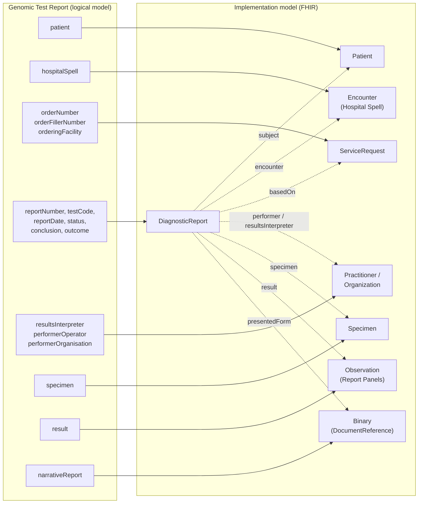
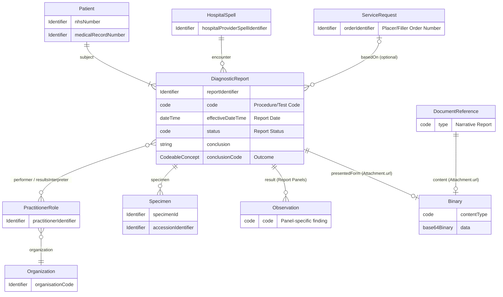
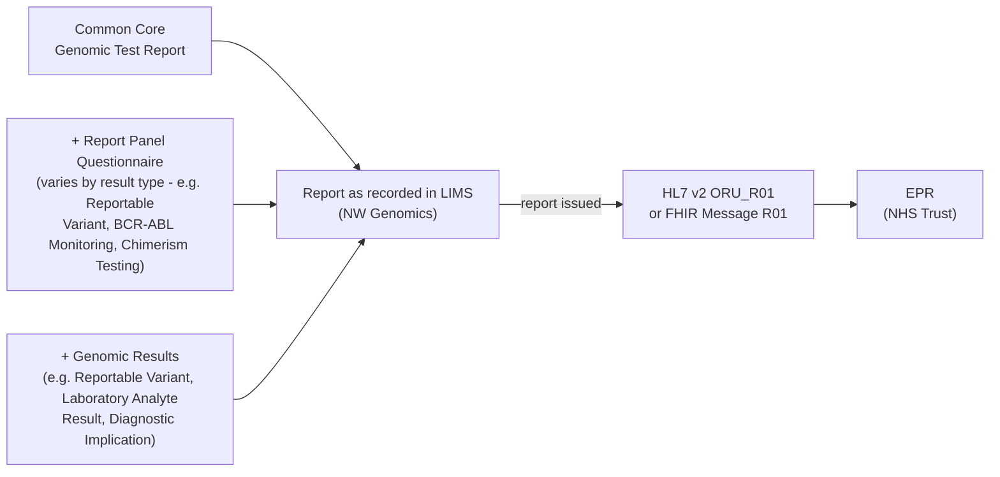
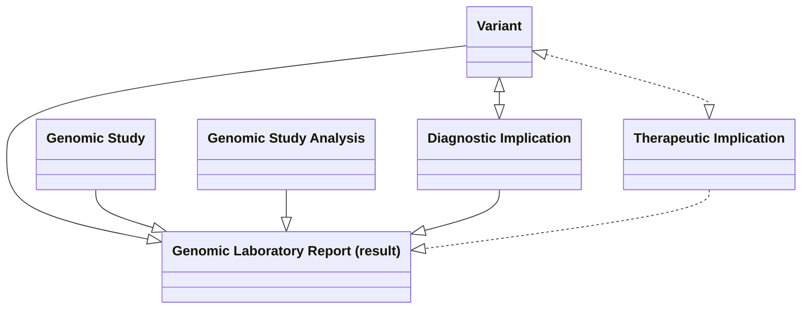

### From Logical Model to Implementation Model

The logical model above is one aggregate - the report as recorded in the
LIMS. For exchange it breaks down into several FHIR resources (or HL7 v2
segments), each owned by a different actor and each reusable on its own.

`DiagnosticReport` is the root: every other resource is referenced from it,
and it carries the report-level elements itself.

| Logical model element(s) | FHIR Profile | HL7 v2 Segment | Owned by |
|---|---|---|---|
| patient | [Patient](StructureDefinition-Patient.html) | [PID](hl7v2.html#pid) | Patient administration (PAS/EPR); referenced, not created, by the LIMS |
| hospitalSpell | [Hospital Spell](StructureDefinition-HospitalSpell.html) (Encounter) | [PV1](hl7v2.html#pv1) | Order Placer (PAS/EPR) |
| orderNumber, orderFillerNumber, orderingFacility | [ServiceRequest](StructureDefinition-ServiceRequest.html) - see [Genomic Test Order](StructureDefinition-GenomicTestOrder.html) | [ORC](hl7v2.html#orc) | Order Placer (order number); Order Filler (filler number). Absent for an unsolicited report |
| reportNumber, testCode, geneticDiseaseAssessed, reportDate, status, conclusion, outcome | [DiagnosticReport](StructureDefinition-DiagnosticReport.html) | [OBR](hl7v2.html#obr), [OBX](hl7v2.html#obx) | Order Filler (LIMS) |
| resultsInterpreter, performerOperator | [Practitioner](StructureDefinition-Practitioner.html) | [OBR](hl7v2.html#obr)-32/33/34 | Order Filler (LIMS) |
| performerOrganisation | [Organization](StructureDefinition-Organization.html) | - | Order Filler (LIMS) |
| specimen | [Specimen](StructureDefinition-Specimen.html) | [SPM](hl7v2.html#spm) | Order Placer (specimen id); Order Filler (accession id) |
| result | Report Panel results, e.g. [Reportable Variant](StructureDefinition-Variant.html), [Laboratory Analyte Result](StructureDefinition-LaboratoryAnalyteResult.html) - see [Results](#results) | [OBX](hl7v2.html#obx) | Order Filler (LIMS) |
| narrativeReport | `Binary`, via `DiagnosticReport.presentedForm` and [DocumentReference](StructureDefinition-DocumentReference.html) | [OBX (type = ED)](hl7v2.html#obx-type--ed) | Order Filler (LIMS) |
{:.grid}

#### How the Pieces Travel

| Exchange | Format | What is sent |
|---|---|---|
| HL7 v2 messaging | `ORU_R01` | `PID`, `PV1`, `ORC`, `OBR`, `OBX` (including `OBX` type = ED for the PDF), `SPM` segments |
| FHIR Messaging | FHIR Message R01 | `Bundle` (type = message) containing `MessageHeader`, `DiagnosticReport` and the resources it references |
| FHIR RESTful API | [Health Data API](HIE.html) / [IPA/QEDm](QEDm.html) | `DiagnosticReport` and its referenced resources, queried individually |
| Document sharing | [MHD](MHD.html) / NHS England NRL | `DocumentReference` pointing at the PDF (`Binary`), or a [FHIR Document](#fhir-document--clinical-document-architecture) (`Composition`-led `Bundle`) |
{:.grid}

#### Rules

- The **Report Number** (`DiagnosticReport.identifier[ReportNumber]`, `OBR-3`) is present on every report, whichever format is used.
- The **Order Number** is present only for a closed-loop report - see [Order Reference](#order-reference).
- `Patient`, `Encounter` and `ServiceRequest` are owned by the Order Placer; the LIMS references them, using business identifiers, rather than creating its own copies.
- Individual test findings are never modelled inline - they are carried as separate results under `DiagnosticReport.result`, one Report Panel per kind of test.
- `DiagnosticReport.presentedForm` and `DocumentReference.content` both point at the **same** `Binary` holding the PDF.
- The [Genomic Test Report Questionnaire](Questionnaire-GenomicTestReport.html) is the form representation of this model, as recorded in the LIMS - its `linkId`s are listed on the **Mappings** tab. It is the resources above, not the `Questionnaire`/`QuestionnaireResponse`, that are exchanged.

### Domain Archetype 

This is a **level 2** (field-level) view of the [basic model](diagnostic-core.html#entity-relationship-diagram)
introduced in Diagnostic Model Overview, showing the entities and key attributes a
Genomic Test Report actually carries:

`ServiceRequest` is shown as **optional** (`basedOn`) because it is only
present for a **closed-loop** report - one answering a specific prior order
the reporting system already knows about. An **unsolicited** report,
produced without a matching order ever having been received, has no order to
reference - see [Order Reference](#order-reference) below.

**Narrative Report.** The full report, as a PDF, is HL7 v2's `OBX (type =
ED)` - see [OBX (type = ED)](hl7v2.html#obx-type--ed), whose own v2-to-FHIR
conversion mapping is to `DocumentReference`. `DiagnosticReport.presentedForm`
and `DocumentReference.content` are both just an `Attachment` with a `url` -
in this IG, both point at the **same** `Binary` resource holding the actual
PDF bytes, rather than each carrying its own separate copy. `DocumentReference`
is the resource this content would be shared via (e.g. IHE XDS.b/MHD, or the
NHS England National Record Locator), while `DiagnosticReport.presentedForm`
is the more direct route for a system that already holds the `DiagnosticReport`
and just wants the PDF alongside it.

#### Order Reference

<b>HL7 FHIR Profile:</b> <a href="StructureDefinition-ServiceRequest.html" _target="_blank">ServiceRequest</a> 

<b>HL7 v2 Segment:</b> <a href="hl7v2.html#orc" _target="_blank">ORC</a>

`DiagnosticReport.basedOn` references the `ServiceRequest` (order, per
[Genomic Test Order](StructureDefinition-GenomicTestOrder.html)) that this report
answers, carried in HL7 v2 as `ORC-2`/`ORC-3` (the `orderNumber` and
`orderFillerNumber` elements).

- **Closed-loop referral:** where the reporting system already holds the
  original order (e.g. it filled that order itself, or was told about it via
  a prior [LAB-1](LTW.html#laboratory-order-lab-1)), `basedOn` is populated
  and `orderNumber` is present.
- **Unsolicited report:** `ORU_R01` (and its FHIR Message equivalent) is
  explicitly designed to also support reporting a result for an order the
  receiving system never saw in the first place. In that case there is no
  `ServiceRequest` to reference, `basedOn` is absent, and `orderNumber`
  simply doesn't apply.

See [ctDNA Management Information - How the Two Event Messages Link
Together](https://github.com/nw-gmsa/nw-gmsa-use-cases/blob/main/NEYManagementInformation.md#how-the-two-event-messages-link-together)
for a fuller worked explanation of solicited vs unsolicited reports in this
IG.

### Diagnostic Report

#### Unstructured and Structured Laboratory Reports

A laboratory report contains both structured and unstructured information, and they complement each other rather than replace one another.

- Structured data consists of discrete, machine-readable elements such as the patient, specimen, request, observations (test results), identifiers, and reporting clinician. In HL7 FHIR these are represented by resources such as Patient, Specimen, ServiceRequest, Observation, Practitioner, and DiagnosticReport. In HL7 v2 these correspond to segments such as PID, SPM, ORC, OBR, and OBX.
- Unstructured data is the human-readable laboratory report (typically a PDF) that includes the full clinical interpretation, comments, formatting, signatures, and contextual information that may not be represented as discrete data. In FHIR this is attached to the DiagnosticReport.presentedForm (or referenced via DocumentReference), while in HL7 v2 it is commonly carried in OBX segments using encapsulated data (ED).

The Laboratory Report acts as the bridge between these two worlds. It references the structured observations for computer processing, clinical decision support, analytics, and interoperability, while also linking to the complete unstructured report that clinicians view as the authoritative laboratory document. This approach ensures that systems can exchange computable data without losing the rich narrative and legal record contained in the original laboratory report.

##### Laboratory Report with FHIR and V2 Mappings

 

 

##### Laboratory Report with detailed FHIR Mappings

 

##### FHIR Document / Clinical Document Architecture

> The FHIR DiagnosticReport illustrated above is well suited to workflow-based information exchange, where structured clinical data is exchanged between systems and individual observations can be processed, queried, and acted upon. However, it may be less suitable for document sharing use cases, such as IHE XDS/MHD or the NHS England National Record Locator (NRL), where the laboratory report is exchanged as a complete clinical document. In these scenarios, the preferred approach is a FHIR Document (the FHIR equivalent of a Clinical Document Architecture (CDA) document), which packages the report into a self-contained, attested document with a Composition resource as its root. This preserves the report as a legal and clinical record while still allowing structured data to be included.
>
> Further details are available in the Document Perspective section of the HL7 Europe Laboratory Implementation Guide: [HL7 Europe Laboratory Report](https://build.fhir.org/ig/hl7-eu/laboratory/index.html)
>
> NW Genomics example [FHIR Document - Genomic Report](Bundle-FHIRDocumentGeneticReportBundle2.html)

##### Laboratory Report with FHIR Composition Mappings

 

### Results

The `result` element (`DiagnosticReport.result`) is where the individual
findings of a test live. This is specific to genomics and focused on the
requirements of general clinicians, not genomic specialists, so this section
will tend to be an extract of the wider [Genomics Reporting Implementation
Guide](https://build.fhir.org/ig/HL7/genomics-reporting/general.html) rather
than a complete restatement of it. It divides into two parts:

- **[Report Panels](#report-panels)** - the computable data models (FHIR
  Questionnaires) this IG has built for specific kinds of result, each
  `derivedFrom`/extended from the [Genomic Test Report
  Questionnaire](Questionnaire-GenomicTestReport.html) the same way Ask At
  Order Entry Questionnaires extend the [Genomic Test Order
  Questionnaire](Questionnaire-GenomicTestOrder.html).
- **[Genomic Results](#genomic-results)** - the underlying HL7 FHIR Genomics
  Reporting profiles and resources those panels (and this IG's other genomic
  content) are built from. Some of these are also modelled as a Report Panel
  Questionnaire above - where that's the case, the table below says so rather
  than repeating the same content twice.

The common core, whichever Report Panel applies, and the actual [Genomic
Results](#genomic-results) it carries **together** are the report as
recorded inside the LIMS. `HL7 v2 ORU_R01`/`FHIR Message R01` is a
**different thing**: the wire format that same report is sent onward to an
EPR in, once it's issued - not the record the LIMS itself holds. Report
Panels and Genomic Results are what vary between result types; the message
shape they end up populating downstream does not - the mirror image of
[Genomic Test Order](StructureDefinition-GenomicTestOrder.html#order-entry-questions)'s
Ask At Order Entry Questions/`OML_O21`/`FHIR Message O21` pattern on the
order side.

This logical model only models the report-level metadata common to every
report (patient, order/report identifiers, dates, status, conclusion,
performers) - its `result` element deliberately doesn't model individual
test findings inline. Instead, each individual result is carried under
`DiagnosticReport.result` as a separate, panel-specific Questionnaire, one
per kind of test - each documenting the discrete fields a particular result
type needs (see [How To Engineer (scale and deliver)
Interoperability](HowToEngineerInteroperability.html#documenting-the-data-model)).

#### Report Panels

| Report Panel Questionnaire | Code | Used In | Status |
|---|---|---|---|
| [Reportable Variant Result Panel](Questionnaire-ReportableVariantResultPanel.html) | LOINC `81250-3` "Discrete genetic variant panel" | [OMICS DSS Result Integration](https://github.com/nw-gmsa/nw-gmsa-use-cases/blob/main/reportable-variants.md) | Grounded in real `Variant` examples |
| [BCR-ABL Monitoring Result Panel](Questionnaire-BCRABLResultPanel.html) | LOINC `69380-4` "BCR-ABL1 fusion transcript ... [# Ratio] ... (International Scale)" | [BCR-ABL Monitoring](https://github.com/nw-gmsa/nw-gmsa-use-cases/blob/main/BCRABLMonitoring.md) | Grounded in real `Observation` examples |
| [Chimerism Testing Result Panel](Questionnaire-ChimerismResultPanel.html) | Local code (STR-based chimerism testing) | [Histocompatibility and Immunogenetics](https://github.com/nw-gmsa/nw-gmsa-use-cases/blob/main/HistocompatibilityAndImmunogenetics.md) | Candidate mapping, not yet confirmed against a real example - see the Questionnaire's own description |
{:.grid}

New result types should follow this pattern - add a new panel Questionnaire
(rather than extending this common core), and list it in the table above.

#### Genomic Results

The underlying HL7 FHIR profiles/resources this IG's genomic results are
built from - either directly, or (where noted) via one of the [Report
Panels](#report-panels) above:

| Genomic Result | Code | Used In | Report Panel |
|---|---|---|---|
| [Genomic Study (Procedure)](https://build.fhir.org/ig/HL7/genomics-reporting/StructureDefinition-genomic-study.html) - [description](https://build.fhir.org/ig/HL7/genomics-reporting/general.html#genomic-study) | - | [Examples](#examples) below (Lynch syndrome, cystic fibrosis carrier) | *(none yet)* |
| [Genomic Study Analysis](https://build.fhir.org/ig/HL7/genomics-reporting/StructureDefinition-genomic-study-analysis.html) (extension on Genomic Study) | LOINC `48002-0` "Genomic source class [Type]" | Not yet confirmed against a real example | *(none yet)* |
| [Laboratory Analyte Result (Observation)](StructureDefinition-LaboratoryAnalyteResult.html) | - | [BCR-ABL Monitoring](https://github.com/nw-gmsa/nw-gmsa-use-cases/blob/main/BCRABLMonitoring.md) | [BCR-ABL Monitoring Result Panel](Questionnaire-BCRABLResultPanel.html) |
| [Reportable Variant (Observation)](StructureDefinition-Variant.html) | LOINC `48018-6` "Gene studied [ID]" (component) | [OMICS DSS Result Integration](https://github.com/nw-gmsa/nw-gmsa-use-cases/blob/main/reportable-variants.md) | [Reportable Variant Result Panel](Questionnaire-ReportableVariantResultPanel.html) |
| [Molecular Consequence (Observation)](https://build.fhir.org/ig/HL7/genomics-reporting/StructureDefinition-molecular-consequence.html) | Sequence Ontology (`functional-effect`), e.g. `SO_0001786` loss_of_heterozygosity | [OMICS DSS Result Integration](https://github.com/nw-gmsa/nw-gmsa-use-cases/blob/main/reportable-variants.md) - see [Outstanding Issues](https://github.com/nw-gmsa/nw-gmsa-use-cases/blob/main/reportable-variants.md#outstanding-issues) for why Loss of Heterozygosity is modelled this way | [Reportable Variant Result Panel](Questionnaire-ReportableVariantResultPanel.html) |
| [Diagnostic Implication (Observation)](StructureDefinition-DiagnosticImplication.html) - [description](https://build.fhir.org/ig/HL7/genomics-reporting/general.html#genomic-implications) | - | [Examples](#examples) below (Lynch syndrome, cystic fibrosis carrier) | *(none yet)* |
| [Histocompatibility and Immunogenetic Reporting](https://hl7.org/fhir/uv/genomics-reporting/histocompatibility.html) | - | [Histocompatibility and Immunogenetics](https://github.com/nw-gmsa/nw-gmsa-use-cases/blob/main/HistocompatibilityAndImmunogenetics.md) | [Chimerism Testing Result Panel](Questionnaire-ChimerismResultPanel.html) (candidate mapping by analogy, not confirmed - see the Questionnaire's own description) |
| Cytogenetic Genomic Report *(this IG's own future/proposed model - no balloted HL7 profile exists yet)* | LOINC cytogenetics panels, e.g. `62389-2` (master panel), `62356-1` (ISCN), `62367-8` (FISH) | [Haemato-Oncology Diagnostic Pathway - Future genomic data model (proposed)](https://github.com/nw-gmsa/nw-gmsa-use-cases/blob/main/HaematoOncologyPathway.md#future-genomic-data-model-proposed) | *(none yet - proposed direction only)* |
{:.grid}

### Examples

#### Inherited MMR deficiency (Lynch syndrome) - R210

HL7 LRI (Ref A) Example 2 (5.9.1.2) - FOUND DISCRETE – TARGETED MUTATIONS ANALYSIS THAT STUDIES MANY MUTATIONS (106)

- [Patient LIVERPOOL](Patient-Patient-Liverpool.html) Patient Administration
- [Genomic Study- Inherited MMR deficiency (Lynch syndrome)](Procedure-f0036554-cd1a-463c-ac8a-d891ca409af9.html) Genomics
- [Diagnostic Implication - Lynch syndrome](Observation-6beb613f-d303-42af-b025-86e8e0872061.html) Genomics
- [Variant NTHL1](Observation-8385c2fd-313d-4fd5-b98e-d5ea4bae6f99.html) Genomics

##### Primary or Secondary Care Examples

- [Condition - Lynch syndrome](Condition-c8f82825-e4cb-4e1f-b728-3fd2808e93db.html) Patient Care
- [Observation - Lynch Syndrome Mutation Finding](Observation-4490c092-c78c-480a-8cb7-653b70113fd5.html) Patient Care

##### Genetic Counseling Examples

- [FamilyMemberHistory - Son Patient Leeds](FamilyMemberHistory-074ea905-8d91-452c-af3c-15b5b860fdb2.html) Patient Care
- [FamilyMemberHistory - Mother Patient Nottingham](FamilyMemberHistory-c76b8bc2-ec36-4ce1-a2ea-8c57215115e2.html) Patient Care

#### Cystic fibrosis Carrier R184

HL7 LRI (Ref A) Example 3 (5.9.1.3)  - SIMPLE VARIANT – MUTATION ANALYSIS WITH SEQUENCE PLUS DELETION-DUPLICATION STUDY

- [Patient LANCASTER](Patient-Patient-Lancaster.html) Patient Administration
- [RelatedPerson](StructureDefinition-RelatedPerson-examples.html)  Patient Administration
- [Genomic Study - Cystic fibrosis carrier testing](Procedure-7b362aa5-41a7-4168-94b4-f12dff0dfb2a.html) Genomics
- [Diagnostic Implication - Cystic Fibrosis Carrier](Observation-a954a98c-f427-4968-9022-8b760de66628.html) Genomics
- [Variant CFTR](Observation-bca547c1-78a5-41be-8cfc-03c05805ac85.html) Genomics
