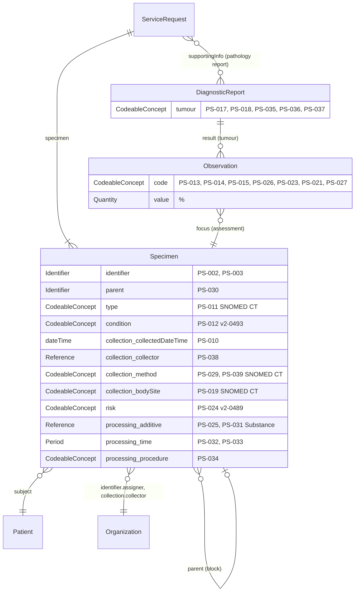

This logical model describes the **Primary sample**: the initial material provided
directly to the first laboratory. The requirements are from the NHS England Genomics
Master Dataset (MDS) v1.062, Genomic Test Ordering, **Data group - Primary sample**.
It adds detail to the `specimen` of the [Genomic Test
Order](StructureDefinition-GenomicTestOrder.html).

Most of the Primary sample data group is **not genomics specific**. It describes a
laboratory specimen, and the tumour it came from, which other domains already define
using international standards. This model therefore follows those standards in
preference to the MDS picklists:

| Part of the model | Owning domain | Standard followed |
|---|---|---|
| Specimen - identifier, collection, type, condition, additive, method, body site, risk, processing | Laboratory (all disciplines) | HL7 Europe Laboratory [Specimen-eu-lab](https://build.fhir.org/ig/hl7-eu/laboratory/StructureDefinition-Specimen-eu-lab.html), HL7 v2 `SPM`, SNOMED CT, HL7 v2 tables |
| Specimen assessment - necrosis, cell content, blasts, maternal cell contamination | Laboratory (cellular pathology, haematology, prenatal) | Observation about the specimen, coded with SNOMED CT or LOINC |
| Tumour - specimen nature, morphology, topography, stage, grade | Cancer (pathology report) | [Cancer Pathology Report](https://kevinmayfield.github.io/CancerPathologyReport/en/StructureDefinition-PathologyReport.html) - COSD Pathology, mCODE |
{:.grid}

It is not a FHIR profile and is not exchanged as is. The **Mappings** tab shows each
element's MDS data element (PS-nnn), the FHIR mapping (HL7 Europe Laboratory), an
indicative HL7 v2 `SPM` mapping, and the matching Cancer Pathology Report element.

### Reference

- [Genomics Master Dataset (MDS) v1.062](https://github.com/nw-gmsa/nw-gmsa-use-cases/blob/main/NHSGenomics/Genomics%20Master%20Dataset%20_MDS_%20v1.062.xlsx) - Genomic Test Ordering, Data group - Primary sample (source of requirements)
- [HL7 Europe Laboratory Report - Specimen](https://build.fhir.org/ig/hl7-eu/laboratory/StructureDefinition-Specimen-eu-lab.html) and [Specimen Types](https://build.fhir.org/ig/hl7-eu/laboratory/ValueSet-lab-specimenType-eu-lab.html)
- [Cancer Pathology Report (Proof of Concept)](https://kevinmayfield.github.io/CancerPathologyReport/en/index.html) - COSD Pathology v5 Core with mCODE aligned profiles; lists neoplastic cell content as a gap that belongs with the specimen
- HL7 v2 tables [0487 Specimen Type](https://terminology.hl7.org/CodeSystem-v2-0487.html), [0493 Specimen Condition](https://terminology.hl7.org/CodeSystem-v2-0493.html), [0371 Additive/Preservative](https://terminology.hl7.org/CodeSystem-v2-0371.html), [0489 Risk Codes](https://terminology.hl7.org/CodeSystem-v2-0489.html)
- HL7 USA [mCODE - Cancer Stage ValueSet](https://build.fhir.org/ig/HL7/fhir-mCODE-ig/ValueSet-mcode-cancer-stage-type-vs.html) (cited by the MDS for PS-036)

### Domain Archetype

### Terminology

Codes checked on [tx.fhir.org](https://tx.fhir.org) (SNOMED CT International and UK
editions, LOINC). The MDS column shows the code given in the MDS, where it differs.

| Element | MDS | Code | MDS code |
|---|---|---|---|
| assessment.necrosis | PS-013 | SNOMED CT `405921002` Percentage of neoplasm involved by necrosis | Same (marked TBC) |
| assessment.nucleatedCellCount | PS-014 | **None identified** | `1022461000000100` is *Nucleated red blood cell count* (UK) - not a total nucleated cell count |
| assessment.tumourContentWholeSection | PS-015 | SNOMED CT `371510003` Proportion of specimen involved by tumour | Same (marked TBC) |
| assessment.tumourContentMarkedArea | PS-026 | **None identified** | TBC |
| assessment.blasts | PS-023 | LOINC `11150-0` Blasts/cells in Bone marrow | SNOMED CT `1015521000000107` Percentage blast cells (UK edition only) |
| assessment.maternalCellContamination | PS-021, PS-027 | LOINC `59266-7` Maternal cell contamination [Identifier] in Specimen Nominal (also `35457-1` Amniotic fluid, `40704-9` Blood) | `726741007` is *Maternal cell free DNA* (a substance) - not MCC |
| collectionMethod | PS-029, PS-039 | SNOMED CT `129314006` Biopsy - action, `129304002` Excision - action ([FHIR Specimen Collection Method](https://hl7.org/fhir/R4/valueset-specimen-collection-method.html)) | Same for PS-029 |
| processing.fixative | PS-031 | HL7 v2-0371 `BF10` Buffered 10% formalin | Picklist |
| risk.code | PS-024 | HL7 v2-0489 `INF` Material Danger Infectious | Picklist of reasons only |
| tumour.morphology | PS-017 | SNOMED CT is-a `400177003` Neoplasm and/or hamartoma; LOINC `31206-6` (mCODE Histologic Behavior and Type) | - |
| tumour.topography | PS-018 | SNOMED CT is-a `442083009` Anatomical or acquired body structure | - |
| tumour.stage | PS-036 | LOINC `21902-2` Stage group.pathology Cancer (mCODE TNM Stage Group) | mCODE Cancer Stage ValueSet |
| tumour.grade | PS-037 | LOINC `33732-9` Histology grade [Identifier] in Cancer specimen; SNOMED CT `371469007` Histologic grade of neoplasm | `371469007` |
| tumour.specimenNature | PS-035 | COSD Specimen Nature (pCR0970): 1 Primary tumour, 5 Metastatic site, 9 Not known | `BodyStructure.morphology` child of `14799000` Neoplasm, metastatic |
{:.grid}

#### MDS Picklists to International Codes

**Specimen type (PS-011)** to SNOMED CT, from the HL7 Europe Laboratory [Specimen
Types](https://build.fhir.org/ig/hl7-eu/laboratory/ValueSet-lab-specimenType-eu-lab.html)
value set. Several are not yet in this IG's [Specimen Type](ValueSet-specimen-type.html)
subset.

| MDS | SNOMED CT | MDS | SNOMED CT |
|---|---|---|---|
| PERIPHERAL BLOOD | `122551003` Peripheral blood specimen | LIQUID BLOOD | **To confirm** |
| FETALBLOOD | `737357006` Fetal blood specimen | CORDBLOOD | `122556008` Cord blood specimen |
| POC | `258428005` Products of conception tissue specimen | CVS | `258565009` Chorionic villi specimen |
| AMNIOTIC FLUID | `119373006` Amniotic fluid specimen | URINE | `122575003` Urine specimen |
| SALIVA | `119342007` Saliva specimen | BUCCAL | `733104004` Swab from buccal mucosa |
| CSF | `258450006` Cerebrospinal fluid specimen | PERICARDIAL | `122571007` Pericardial fluid specimen |
| PERITONEAL | `168139001` Peritoneal fluid specimen | PLEURALFLUID | `418564007` Pleural fluid specimen |
| FIBROBLASTS | `119333000` Fibroblast specimen | TUMOUR | `258435002` Tumor tissue specimen |
| BONEMARRROWASPIRATE | `396997002` Specimen from bone marrow obtained by aspiration | BONEMARROWTREPHINE | **To confirm** - not in the HL7 Europe value set |
| LYMPHNODE | `258589002` Lymph node specimen | SKIN | `608969007` Specimen from skin |
| MUSCLE | `705054005` Muscle specimen | SPLEEN | `433308004` Specimen from spleen |
| HEART | `127462005` Specimen from heart | LIVER | `119383005` Specimen from liver |
| KIDNEY | `127473003` Specimen from kidney | OTHER | Text |
{:.grid}

**Specimen state (PS-012)**, **preservative (PS-025)** and **biopsy type (PS-039)**.
The MDS picklists mix specimen type, condition, additive and container, which the
international standards keep apart.

| MDS | MDS value | International code |
|---|---|---|
| PS-012 | FFPE | Specimen type SNOMED CT `441652008` Formalin-fixed paraffin-embedded tissue specimen |
| PS-012 | FRESH | Specimen type SNOMED CT `441479001` Fresh tissue specimen (no v2-0493 code) |
| PS-012 | FROZEN, FLASHFROZEN | Condition v2-0493 `FROZ` Frozen |
| PS-012 | BLOODSPOT | Specimen type SNOMED CT `119294007` Dried blood specimen |
| PS-012, PS-025 | NUCLEICACIDSTABILISER | Additive - **To confirm** |
| PS-025 | EDTA | Additive SNOMED CT `69519002` Edetic acid |
| PS-025 | LITHIUMHEPARIN | Additive SNOMED CT `1256102004` Heparin lithium |
| PS-025 | NONE | v2-0371 `NONE` None |
| PS-025 | STRECK, ROCHE | Container type (cell-free DNA blood collection tube brands), not an additive - **To confirm** codes |
| PS-025 | MEDIUM, SALINE | **To confirm** |
| PS-039 | BIOPSY | SNOMED CT `129314006` Biopsy - action |
| PS-039 | SURGICAL EXCISION | SNOMED CT `129304002` Excision - action |
| PS-039 | LIQUID | Not a collection method - a liquid biopsy is a blood or plasma specimen type. **Open** |
{:.grid}

### Obligations by Modality

From the MDS DGTS Modalities columns. **M** Mandatory, **M IF** Mandatory if the
condition is met, **O** Optional, **-** Not applicable. The Beta Broker rejects a
missing PS-038, PS-002 or PS-003 (hard error); all other elements are permissive.

| Element | MDS | Solid Tumour (Tissue) | Solid Tumour (Blood) | Haem Malignancies | R&ID | PGx | Reanalysis | R&ID Sample Storage | Condition |
|---|---|---|---|---|---|---|---|---|---|
| collector | PS-038 | M | M | M | M | M | - | M | |
| identifier.value | PS-002 | M | M | M | M | M | - | M | |
| identifier.assigner | PS-003 | M | M | M | M | M | - | M | |
| collectedDate | PS-010 | M | M | M | M | M | - | M | |
| type | PS-011 | M | M | M | M | M | - | M | |
| condition | PS-012 | M | M | M | M | M | - | M | |
| additive | PS-025 | M | M | M | M | M | - | M | |
| parentIdentifier | PS-030 | M IF | - | M IF | M IF | M IF | - | M IF | PS-012 is FFPE or tissue |
| processing.fixative | PS-031 | M IF | - | O | O | O | - | O | PS-012 is FFPE or tissue |
| processing.hoursToFixation | PS-032 | O | - | O | O | O | - | O | |
| processing.hoursInFixative | PS-033 | O | - | O | O | O | - | O | |
| processing.tumourEnrichment | PS-034 | O | - | - | - | - | - | - | |
| collectionMethod (is biopsy) | PS-029 | M | - | M | M | - | - | M | |
| collectionMethod (biopsy type) | PS-039 | M | - | - | - | - | - | - | |
| bodySite | PS-019 | M IF | - | - | M IF | - | - | M IF | PS-029 is Y |
| risk | PS-024 | M | M | O | O | O | - | O | |
| assessment.necrosis | PS-013 | O | - | O | - | - | - | - | |
| assessment.nucleatedCellCount | PS-014 | - | - | M | - | - | - | - | |
| assessment.tumourContentWholeSection | PS-015 | M IF | - | M IF | - | - | - | - | PS-012 is FFPE or test method is WGS, and PS-026 not populated |
| assessment.tumourContentMarkedArea | PS-026 | M IF | - | M IF | - | - | - | - | PS-012 is FFPE or test method is WGS, and PS-015 not populated |
| assessment.blasts | PS-023 | - | - | O | - | - | - | - | |
| assessment.maternalCellContamination.observed | PS-021 | - | - | - | M IF | - | - | - | PS-011 is FETALBLOOD, AMNIOTIC FLUID or CVS, and PS-027 not populated |
| assessment.maternalCellContamination.confirmed | PS-027 | - | - | - | M IF | - | - | - | PS-011 is FETALBLOOD, AMNIOTIC FLUID or CVS, and PS-021 not populated |
| tumour.specimenNature | PS-035 | O | O | - | - | - | - | - | |
| tumour.morphology | PS-017 | M IF | - | O | - | - | - | - | test is treatment determining (TR-038) |
| tumour.topography | PS-018 | M IF | - | - | - | - | - | - | test (TR-024) is not GT401 or GT19 |
| tumour.stage | PS-036 | M IF | - | - | - | - | - | - | test (TR-024) is GT401 or GT19 |
| tumour.grade | PS-037 | O | - | - | - | - | - | - | |
{:.grid}

### MDS Items Not in this Model

These Primary sample data elements are not properties of the specimen. They belong to
other domains and are left out of this model.

| MDS | Data element | Where it belongs |
|---|---|---|
| PS-028 | Patient life status at the time of collection (ALIVE, DECEASED) | Patient. Derived from the collection date and `Patient.deceasedDateTime` - not captured |
| PS-022 | Option for all products of conception (SENSITIVEINCINERATION, CREMATION, RETURNTOPATIENT). M IF for R&ID and R&ID Sample Storage when gestation (PCI-039) is under 24 weeks | Consent and disposal of tissue - the patient's wishes, not a laboratory property. Belongs with consent or the order. MDS maps it to `specimen-specialHandling`, whose HL7 v2 table 0376 has storage and transport codes only |
{:.grid}

### Open Issues

| MDS | Issue |
|---|---|
| PS-014, PS-021, PS-027 | MDS codes do not mean what the data element says - see [Terminology](#terminology). |
| PS-014, PS-026 | No international code identified. |
| PS-024 | The MDS values are clinical reasons (conditions) for the risk, not a risk code. Modelled as `risk.code` (v2-0489) plus `risk.reason` (SNOMED CT condition). FHIR R4 has no core Specimen element for HL7 v2 `SPM-16`. |
| PS-030, PS-031 | The condition "state is FFPE or tissue" - tissue is not a PS-012 value. **To confirm** whether this means the specimen type is a tissue. |
| PS-021, PS-027 | MDS value set is TEXT, but the FHIR mapping is `valueBoolean` and `valueQuantity`. Modelled as the FHIR mapping; MCC units **to confirm**. LOINC `59266-7` is a Nominal result. |
| PS-013, PS-014, PS-015, PS-023, PS-026 | MDS value set is INTEGER (%). Modelled as Quantity (UCUM `%`), as an Observation value. |
| PS-038 | FHIR conformance is 0..1, but the element is mandatory for every modality and a hard error in the Beta Broker. Modelled as 1..1. |
| PS-018 | FHIR conformance is `BodyStructure.location` 1..1, but the element is Mandatory IF. Modelled as 0..1. |
| PS-017, PS-018, PS-035, PS-036, PS-037 | Tumour content duplicates the cancer pathology report. **Open** whether the order should carry them, or reference the pathology report (Genomic Test Order `pathologyReport`). |
| PS-002, PS-003 | The local id assigned by the sending organisation, carried in `Specimen.identifier` (MDS cites the system `https://fhir.nhs.uk/local-identifier/specimen`). It is not the [NGIS Primary Sample Identifier](NamingSystem-NGIS-PrimarySampleIdentifier.html), which is the GLH's id carried in `Specimen.accessionIdentifier`. |
{:.grid}
