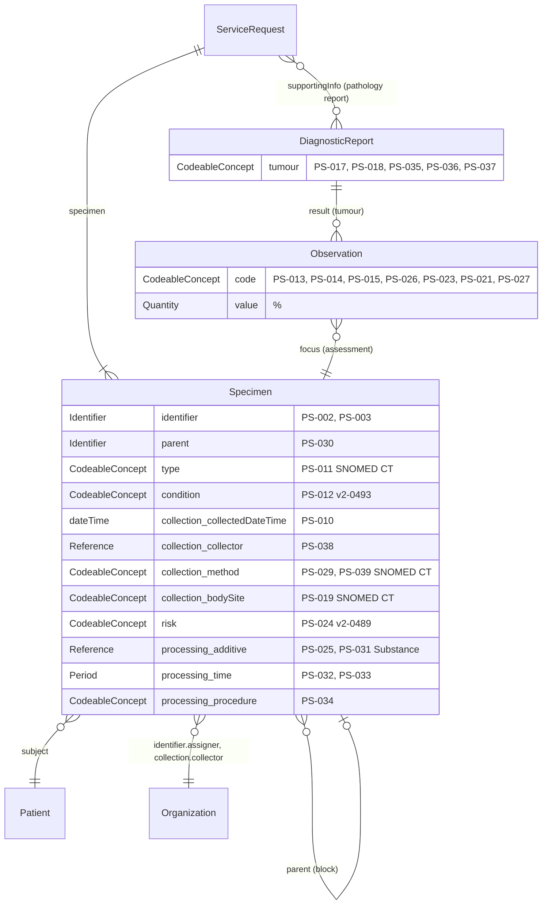

This logical model describes the **Primary sample**: the initial material provided
directly to the first laboratory. The requirements are from the NHS England Genomics
Master Dataset (MDS) v1.062, Genomic Test Ordering, **Data group - Primary sample**.
It adds detail to the `specimen` of the [Genomic Test
Order](StructureDefinition-GenomicTestOrder.html).

Most of the Primary sample data group is **not genomics specific**. It describes a
laboratory specimen, and the tumour it came from, which other domains already define
using international standards. This model therefore follows those standards in
preference to the MDS picklists:

| Part of the model | Owning domain | Standard followed |
|---|---|---|
| Specimen - identifier, collection, type, condition, additive, method, body site, risk, processing | Laboratory (all disciplines) | HL7 Europe Laboratory [Specimen-eu-lab](https://build.fhir.org/ig/hl7-eu/laboratory/StructureDefinition-Specimen-eu-lab.html), HL7 v2 `SPM`, SNOMED CT, HL7 v2 tables |
| Specimen assessment - necrosis, cell content, blasts, maternal cell contamination | Laboratory (cellular pathology, haematology, prenatal) | Observation about the specimen, coded with SNOMED CT or LOINC |
| Tumour - specimen nature, morphology, topography, stage, grade | Cancer (pathology report) | [Cancer Pathology Report](https://kevinmayfield.github.io/CancerPathologyReport/en/StructureDefinition-PathologyReport.html) - COSD Pathology, mCODE |
{:.grid}

It is not a FHIR profile and is not exchanged as is. The **Mappings** tab shows each
element's MDS data element (PS-nnn), the FHIR mapping (HL7 Europe Laboratory), an
indicative HL7 v2 `SPM` mapping, and the matching Cancer Pathology Report element.

### Reference

- [Genomics Master Dataset (MDS) v1.062](https://github.com/nw-gmsa/nw-gmsa-use-cases/blob/main/NHSGenomics/Genomics%20Master%20Dataset%20_MDS_%20v1.062.xlsx) - Genomic Test Ordering, Data group - Primary sample (source of requirements)
- [HL7 Europe Laboratory Report - Specimen](https://build.fhir.org/ig/hl7-eu/laboratory/StructureDefinition-Specimen-eu-lab.html) and [Specimen Types](https://build.fhir.org/ig/hl7-eu/laboratory/ValueSet-lab-specimenType-eu-lab.html)
- [Cancer Pathology Report (Proof of Concept)](https://kevinmayfield.github.io/CancerPathologyReport/en/index.html) - COSD Pathology v5 Core with mCODE aligned profiles; lists neoplastic cell content as a gap that belongs with the specimen
- HL7 v2 tables [0487 Specimen Type](https://terminology.hl7.org/CodeSystem-v2-0487.html), [0493 Specimen Condition](https://terminology.hl7.org/CodeSystem-v2-0493.html), [0371 Additive/Preservative](https://terminology.hl7.org/CodeSystem-v2-0371.html), [0489 Risk Codes](https://terminology.hl7.org/CodeSystem-v2-0489.html)
- HL7 USA [mCODE - Cancer Stage ValueSet](https://build.fhir.org/ig/HL7/fhir-mCODE-ig/ValueSet-mcode-cancer-stage-type-vs.html) (cited by the MDS for PS-036)

### Domain Archetype



### Terminology

Codes checked on [tx.fhir.org](https://tx.fhir.org) (SNOMED CT International and UK
editions, LOINC). The MDS column shows the code given in the MDS, where it differs.

| Element | MDS | Code | MDS code |
|---|---|---|---|
| assessment.necrosis | PS-013 | SNOMED CT `405921002` Percentage of neoplasm involved by necrosis | Same (marked TBC) |
| assessment.nucleatedCellCount | PS-014 | **None identified** | `1022461000000100` is *Nucleated red blood cell count* (UK) - not a total nucleated cell count |
| assessment.tumourContentWholeSection | PS-015 | SNOMED CT `371510003` Proportion of specimen involved by tumour | Same (marked TBC) |
| assessment.tumourContentMarkedArea | PS-026 | **None identified** | TBC |
| assessment.blasts | PS-023 | LOINC `11150-0` Blasts/cells in Bone marrow | SNOMED CT `1015521000000107` Percentage blast cells (UK edition only) |
| assessment.maternalCellContamination | PS-021, PS-027 | LOINC `59266-7` Maternal cell contamination [Identifier] in Specimen Nominal (also `35457-1` Amniotic fluid, `40704-9` Blood) | `726741007` is *Maternal cell free DNA* (a substance) - not MCC |
| collectionMethod | PS-029, PS-039 | SNOMED CT `129314006` Biopsy - action, `129304002` Excision - action ([FHIR Specimen Collection Method](https://hl7.org/fhir/R4/valueset-specimen-collection-method.html)) | Same for PS-029 |
| processing.fixative | PS-031 | HL7 v2-0371 `BF10` Buffered 10% formalin | Picklist |
| risk.code | PS-024 | HL7 v2-0489 `INF` Material Danger Infectious | Picklist of reasons only |
| tumour.morphology | PS-017 | SNOMED CT is-a `400177003` Neoplasm and/or hamartoma; LOINC `31206-6` (mCODE Histologic Behavior and Type) | - |
| tumour.topography | PS-018 | SNOMED CT is-a `442083009` Anatomical or acquired body structure | - |
| tumour.stage | PS-036 | LOINC `21902-2` Stage group.pathology Cancer (mCODE TNM Stage Group) | mCODE Cancer Stage ValueSet |
| tumour.grade | PS-037 | LOINC `33732-9` Histology grade [Identifier] in Cancer specimen; SNOMED CT `371469007` Histologic grade of neoplasm | `371469007` |
| tumour.specimenNature | PS-035 | COSD Specimen Nature (pCR0970): 1 Primary tumour, 5 Metastatic site, 9 Not known | `BodyStructure.morphology` child of `14799000` Neoplasm, metastatic |
{:.grid}

#### MDS Picklists to International Codes

**Specimen type (PS-011)** to SNOMED CT, from the HL7 Europe Laboratory [Specimen
Types](https://build.fhir.org/ig/hl7-eu/laboratory/ValueSet-lab-specimenType-eu-lab.html)
value set. Several are not yet in this IG's [Specimen Type](ValueSet-specimen-type.html)
subset.

| MDS | SNOMED CT | MDS | SNOMED CT |
|---|---|---|---|
| PERIPHERAL BLOOD | `122551003` Peripheral blood specimen | LIQUID BLOOD | **To confirm** |
| FETALBLOOD | `737357006` Fetal blood specimen | CORDBLOOD | `122556008` Cord blood specimen |
| POC | `258428005` Products of conception tissue specimen | CVS | `258565009` Chorionic villi specimen |
| AMNIOTIC FLUID | `119373006` Amniotic fluid specimen | URINE | `122575003` Urine specimen |
| SALIVA | `119342007` Saliva specimen | BUCCAL | `733104004` Swab from buccal mucosa |
| CSF | `258450006` Cerebrospinal fluid specimen | PERICARDIAL | `122571007` Pericardial fluid specimen |
| PERITONEAL | `168139001` Peritoneal fluid specimen | PLEURALFLUID | `418564007` Pleural fluid specimen |
| FIBROBLASTS | `119333000` Fibroblast specimen | TUMOUR | `258435002` Tumor tissue specimen |
| BONEMARRROWASPIRATE | `396997002` Specimen from bone marrow obtained by aspiration | BONEMARROWTREPHINE | **To confirm** - not in the HL7 Europe value set |
| LYMPHNODE | `258589002` Lymph node specimen | SKIN | `608969007` Specimen from skin |
| MUSCLE | `705054005` Muscle specimen | SPLEEN | `433308004` Specimen from spleen |
| HEART | `127462005` Specimen from heart | LIVER | `119383005` Specimen from liver |
| KIDNEY | `127473003` Specimen from kidney | OTHER | Text |
{:.grid}

**Specimen state (PS-012)**, **preservative (PS-025)** and **biopsy type (PS-039)**.
The MDS picklists mix specimen type, condition, additive and container, which the
international standards keep apart.

| MDS | MDS value | International code |
|---|---|---|
| PS-012 | FFPE | Specimen type SNOMED CT `441652008` Formalin-fixed paraffin-embedded tissue specimen |
| PS-012 | FRESH | Specimen type SNOMED CT `441479001` Fresh tissue specimen (no v2-0493 code) |
| PS-012 | FROZEN, FLASHFROZEN | Condition v2-0493 `FROZ` Frozen |
| PS-012 | BLOODSPOT | Specimen type SNOMED CT `119294007` Dried blood specimen |
| PS-012, PS-025 | NUCLEICACIDSTABILISER | Additive - **To confirm** |
| PS-025 | EDTA | Additive SNOMED CT `69519002` Edetic acid |
| PS-025 | LITHIUMHEPARIN | Additive SNOMED CT `1256102004` Heparin lithium |
| PS-025 | NONE | v2-0371 `NONE` None |
| PS-025 | STRECK, ROCHE | Container type (cell-free DNA blood collection tube brands), not an additive - **To confirm** codes |
| PS-025 | MEDIUM, SALINE | **To confirm** |
| PS-039 | BIOPSY | SNOMED CT `129314006` Biopsy - action |
| PS-039 | SURGICAL EXCISION | SNOMED CT `129304002` Excision - action |
| PS-039 | LIQUID | Not a collection method - a liquid biopsy is a blood or plasma specimen type. **Open** |
{:.grid}

### Obligations by Modality

From the MDS DGTS Modalities columns. **M** Mandatory, **M IF** Mandatory if the
condition is met, **O** Optional, **-** Not applicable. The Beta Broker rejects a
missing PS-038, PS-002 or PS-003 (hard error); all other elements are permissive.

| Element | MDS | Solid Tumour (Tissue) | Solid Tumour (Blood) | Haem Malignancies | R&ID | PGx | Reanalysis | R&ID Sample Storage | Condition |
|---|---|---|---|---|---|---|---|---|---|
| collector | PS-038 | M | M | M | M | M | - | M | |
| identifier.value | PS-002 | M | M | M | M | M | - | M | |
| identifier.assigner | PS-003 | M | M | M | M | M | - | M | |
| collectedDate | PS-010 | M | M | M | M | M | - | M | |
| type | PS-011 | M | M | M | M | M | - | M | |
| condition | PS-012 | M | M | M | M | M | - | M | |
| additive | PS-025 | M | M | M | M | M | - | M | |
| parentIdentifier | PS-030 | M IF | - | M IF | M IF | M IF | - | M IF | PS-012 is FFPE or tissue |
| processing.fixative | PS-031 | M IF | - | O | O | O | - | O | PS-012 is FFPE or tissue |
| processing.hoursToFixation | PS-032 | O | - | O | O | O | - | O | |
| processing.hoursInFixative | PS-033 | O | - | O | O | O | - | O | |
| processing.tumourEnrichment | PS-034 | O | - | - | - | - | - | - | |
| collectionMethod (is biopsy) | PS-029 | M | - | M | M | - | - | M | |
| collectionMethod (biopsy type) | PS-039 | M | - | - | - | - | - | - | |
| bodySite | PS-019 | M IF | - | - | M IF | - | - | M IF | PS-029 is Y |
| risk | PS-024 | M | M | O | O | O | - | O | |
| assessment.necrosis | PS-013 | O | - | O | - | - | - | - | |
| assessment.nucleatedCellCount | PS-014 | - | - | M | - | - | - | - | |
| assessment.tumourContentWholeSection | PS-015 | M IF | - | M IF | - | - | - | - | PS-012 is FFPE or test method is WGS, and PS-026 not populated |
| assessment.tumourContentMarkedArea | PS-026 | M IF | - | M IF | - | - | - | - | PS-012 is FFPE or test method is WGS, and PS-015 not populated |
| assessment.blasts | PS-023 | - | - | O | - | - | - | - | |
| assessment.maternalCellContamination.observed | PS-021 | - | - | - | M IF | - | - | - | PS-011 is FETALBLOOD, AMNIOTIC FLUID or CVS, and PS-027 not populated |
| assessment.maternalCellContamination.confirmed | PS-027 | - | - | - | M IF | - | - | - | PS-011 is FETALBLOOD, AMNIOTIC FLUID or CVS, and PS-021 not populated |
| tumour.specimenNature | PS-035 | O | O | - | - | - | - | - | |
| tumour.morphology | PS-017 | M IF | - | O | - | - | - | - | test is treatment determining (TR-038) |
| tumour.topography | PS-018 | M IF | - | - | - | - | - | - | test (TR-024) is not GT401 or GT19 |
| tumour.stage | PS-036 | M IF | - | - | - | - | - | - | test (TR-024) is GT401 or GT19 |
| tumour.grade | PS-037 | O | - | - | - | - | - | - | |
{:.grid}

### MDS Items Not in this Model

These Primary sample data elements are not properties of the specimen. They belong to
other domains and are left out of this model.

| MDS | Data element | Where it belongs |
|---|---|---|
| PS-028 | Patient life status at the time of collection (ALIVE, DECEASED) | Patient. Derived from the collection date and `Patient.deceasedDateTime` - not captured |
| PS-022 | Option for all products of conception (SENSITIVEINCINERATION, CREMATION, RETURNTOPATIENT). M IF for R&ID and R&ID Sample Storage when gestation (PCI-039) is under 24 weeks | Consent and disposal of tissue - the patient's wishes, not a laboratory property. Belongs with consent or the order. MDS maps it to `specimen-specialHandling`, whose HL7 v2 table 0376 has storage and transport codes only |
{:.grid}

### Example in HL7 v2

How this model looks in an HL7 v2 `OML_O21` order: the Royal Blackburn Hospital laboratory
(`690D0`) reflexes a tumour BRCA test (M2.1) to the North West GLH from an archived FFPE
block - step 2 of [Pathology to Genomics Reflex - Ovarian Cancer Tumour
BRCA](ExampleScenario-PathologyReflexTumourBRCA.html), also shown with the other
[Sub-order (LAB-35)](hl7v2.html#sub-order-lab-35) examples. The PDF is shortened.

```
MSH|^~\&|LIMS|690D0|RIE|699X0|20261103143000+0000||OML^O21^OML_O21|urn:uuid:3f0c9e52-6b1d-4c1e-9a57-2d8f1b7e4a10|T|2.5.1|||AL
PID|1||9737383389^^^NHS^NH~690D07418265^^^690D0^MR~RXN7316420^^^RXN^MR||BURNLEY^Selyse^^^^^L||19670918|F|||Manchester Road^^Burnley^Lancashire^BB11 9SA
PV1|1|I|^^^RXN02^^^^^^^RXN||||C5678901^FICTITIOUS^Priya^^^Dr^^^GMC|||503^Gynaecological Oncology^2.16.840.1.113883.2.1.6.8|||||||C5678901^FICTITIOUS^Priya^^^Dr^^^GMC||SP2503130417^^^RXN^AN|||||||||||||||||||||||||20250313090000+0000
ORC|NW|G26-04417-1^690D0||||||EPR-552871&RXN^H25-11823&690D0|20261103143000+0000|||C7890123^FICTITIOUS^Morgan^^^Dr^^^GMC|||||||||ROYAL BLACKBURN HOSPITAL LABORATORY^^690D0^^^ODS
OBR|1|G26-04417-1^690D0||M2.1^Ovarian Carcinoma, Multi-target NGS panel - small variant (BRCA1, BRCA2, SMARCA4)^England-GenomicTestDirectory||20261103||||^^^^^^^^^^^^^RXN||||||C7890123^FICTITIOUS^Morgan^^^Dr^^^GMC|||||||||||||||M2^Ovarian Carcinoma^GenomicClinicalIndication
NTE|1||Relapsed high-grade serous ovarian carcinoma, second line. Tumour BRCA for PARP inhibitor eligibility.
OBX|1|CWE|RelapsedDiseaseConfirmation^Confirmation of relapsed high-grade disease, second line of treatment or beyond^NWGMSA||Y^Yes^HL70136||||||F
SPM|1|H25-11823-A3-S1&690D0|H25-11823-A3&690D0|441652008^Formalin-fixed paraffin-embedded tissue specimen^SNM3||BF10^Buffered 10% formalin^HL70371|65801008^Excision^SNM3|15497006^Ovarian structure^SNM3||||||10 x 5 um sections and marked H&E guide slide from block A3|||20250314100000+0000|20250314150000+0000||Y
PV1|1|I|^^^RXN02^^^^^^^RXN||||C5678901^FICTITIOUS^Priya^^^Dr^^^GMC|||503^Gynaecological Oncology^2.16.840.1.113883.2.1.6.8|||||||C5678901^FICTITIOUS^Priya^^^Dr^^^GMC||SP2503130417^^^RXN^AN|||||||||||||||||||||||||20250313090000+0000
ORC|RE|EPR-552871^RXN|H25-11823^690D0||CM|||||||C5678901^FICTITIOUS^Priya^^^Dr^^^GMC|||||||||LANCASHIRE TEACHING HOSPITALS NHS FOUNDATION TRUST^^RXN^^^ODS
OBR|1|EPR-552871^RXN|H25-11823^690D0|HISTO^Histopathology^690D0|||20250314100000+0000|||||||||C5678901^FICTITIOUS^Priya^^^Dr^^^GMC||||||20250321160000+0000|||F
OBX|1|CWE|21855-2^Primary site Cancer^LN^pCR6410^Topography (SNOMED)^COSD||C56.9^Ovary^ICDO3^15497006^Ovarian structure^SNM3||||||F
OBX|2|ED|1054291000000102^Cellular pathology report^SNM3||^application^pdf^Base64^JVBERi0x...||||||F
OBR|2|EPR-552871^RXN|H25-11823^690D0|77753-2^Tumor morphology panel Cancer^LN|||20250314100000+0000|||||||||||||||20250321160000+0000|||F||||EPR-552871&RXN^H25-11823&690D0
OBX|1|CWE|31205-8^Histology ICD-O-3 Cancer^LN^pCR6420^Morphology (SNOMED)^COSD||8461^High grade serous carcinoma^ICDO3^703563003^High grade serous carcinoma^SNM3||||||F
OBX|2|CWE|31206-6^Behavior ICD-O-3 Cancer^LN||3^Malignant, primary site^ICDO3||||||F
OBR|3|EPR-552871^RXN|H25-11823^690D0|TMA^Tumour assessment for molecular testing^690D0|||20250314100000+0000|||||||||||||||20261102110000+0000|||F
NTE|1||Block A3 - tumour area ringed on H&E guide slide
OBX|1|NM|TCC^Tumour cell content^690D0||60|%^percent^UCUM|||||F|||20261102110000+0000
```

> FHIR Message Example: [Bundle Message - Genomics Order - Pathology Reflex](Bundle-GenomicsOrderMessage-PathologyReflex.html)

The Specimen elements are in the genomic order's `SPM` (and `OBR-10`). The assessment and
tumour elements are **prior results** of the pathology order, because they are pathology's
findings, not statements made by genomics.

| Element | MDS | HL7 v2 | In the example |
|---|---|---|---|
| identifier.value, identifier.assigner | PS-002, PS-003 | `SPM-2` | `H25-11823-A3-S1&690D0` - the sections sent, numbered by `690D0` |
| parentIdentifier | PS-030 | `SPM-3` | `H25-11823-A3&690D0` - block A3 |
| collector | PS-038 | `OBR-10` (`XCN.14` assigning facility) | `RXN` - Lancashire Teaching Hospitals, where the surgery was done |
| collectedDate | PS-010 | `SPM-17` | 14 March 2025 |
| type | PS-011, PS-012 | `SPM-4` | `441652008` Formalin-fixed paraffin-embedded tissue specimen |
| condition | PS-012 | `SPM-24` | Not sent - FFPE is carried by the type |
| additive, processing.fixative | PS-025, PS-031 | `SPM-6` | `BF10` Buffered 10% formalin |
| collectionMethod | PS-029, PS-039 | `SPM-7` | `65801008` Excision |
| bodySite | PS-019 | `SPM-8` | `15497006` Ovarian structure |
| risk | PS-024 | `SPM-16` | Not sent - no known infection risk, and no "none" code |
| assessment.tumourContentMarkedArea | PS-026 | Prior `OBR` 3, `OBX` 1 | `TCC` Tumour cell content, 60 % - the tumour area ringed on the H&E guide slide |
| tumour.topography | PS-018 | Prior `OBR` 1, `OBX` 1 | LOINC `21855-2` Primary site: ICD-O-3 `C56.9`, SNOMED CT `15497006` |
| tumour.morphology | PS-017 | Prior `OBR` 2, `OBX` 1-2 | LOINC `31205-8` Histology: ICD-O-3 `8461`, SNOMED CT `703563003` High grade serous carcinoma; `31206-6` Behaviour: malignant |
| tumour.stage, tumour.grade, tumour.specimenNature | PS-036, PS-037, PS-035 | - | Not sent as discrete results (not required for M2.1); stage is in the PDF text |
{:.grid}

#### What the reader sees

The histopathology report for H25-11823, shown the way a genomic scientist would read it.
Nearly all of this logical model is already in the pathology report: the specimen, its
collection and fixation, the tumour site and morphology, and the tumour assessment made when
block A3 was selected for testing. The genomic order adds little more than the test requested
and the identifier of the sections sent. The mock is fictitious. The small grey labels show
which model elements and HL7 v2 segments each part matches - a real report would not show them.

<div style="border:1px solid #bbb; box-shadow:0 2px 8px rgba(0,0,0,0.15); background:#fafafa; color:#222; max-width:820px; margin:16px auto; padding:28px 36px; font-family:Georgia,'Times New Roman',serif; font-size:14px; line-height:1.5;">

<div style="display:flex; justify-content:space-between; align-items:flex-start; border-bottom:2px solid #333; padding-bottom:6px; margin-bottom:8px;">
  <div><div style="font-size:20px; font-weight:bold;">Histopathology Report</div><div>Royal Blackburn Hospital Laboratory (690D0)</div></div>
  <div style="text-align:right; font-size:13px;"><span style="font-size:12px; color:#c00; font-weight:bold; border:1px solid #c00; padding:2px 6px; font-family:Arial,sans-serif;">FICTITIOUS EXAMPLE</span><br/>Lab No: <b>H25-11823</b><br/>Final report, with supplementary report</div>
</div>

<div style="font-size:11px; color:#888; font-family:Arial,sans-serif;">PID &middot; PATIENT_VISIT_PRIOR (PV1) &middot; ORDER_PRIOR ORC, OBR 1</div>
<table style="width:100%; font-size:13px; margin-bottom:8px; border:none;">
<tr><td style="border:none; padding:1px 8px 1px 0;"><b>Patient</b></td><td style="border:none;">BURNLEY, Selyse (F)</td><td style="border:none;"><b>NHS No</b></td><td style="border:none;">973 738 3389</td></tr>
<tr><td style="border:none; padding:1px 8px 1px 0;"><b>DOB</b></td><td style="border:none;">18-Sep-1967</td><td style="border:none;"><b>Hospital No</b></td><td style="border:none;">RXN7316420 (RXN), 690D07418265 (690D0)</td></tr>
<tr><td style="border:none; padding:1px 8px 1px 0;"><b>Requested by</b></td><td style="border:none;">Dr Priya FICTITIOUS (GMC C5678901), Gynaecological Oncology, Lancashire Teaching Hospitals NHS Foundation Trust</td><td style="border:none;"><b>Order No</b></td><td style="border:none;">EPR-552871 (RXN)</td></tr>
<tr><td style="border:none; padding:1px 8px 1px 0;"><b>Spell</b></td><td style="border:none;">SP2503130417, inpatient ward RXN02, admitted 13-Mar-2025</td><td style="border:none;"><b>Received</b></td><td style="border:none;">14-Mar-2025</td></tr>
</table>

<p style="margin:2px 0 6px;"><b>Clinical details.</b> Pelvic mass with omental disease and raised CA125. Primary debulking surgery.</p>

<div style="font-size:11px; color:#888; font-family:Arial,sans-serif;">collectionMethod, bodySite, collector, collectedDate, additive / processing.fixative (PS-029, PS-019, PS-038, PS-010, PS-025) &middot; SPM-6, -7, -8, -17, OBR-10</div>
<p style="margin:2px 0 6px;"><b>Specimen.</b> A: Total abdominal hysterectomy, bilateral salpingo-oophorectomy and omentectomy (excision), collected 14-Mar-2025 at Lancashire Teaching Hospitals (RXN). Fixed in buffered 10% formalin.</p>
<p style="margin:2px 0 6px;"><b>Macroscopy.</b> The right ovary is replaced by a solid and cystic tumour, 85 mm in maximum dimension, with surface involvement. The left ovary, uterus and tubes are unremarkable to the eye. The omentum contains tumour deposits up to 30 mm. Blocks A1 to A3 right ovarian tumour, A4 left ovary, A5 uterus, A6 omentum.</p>
<p style="margin:2px 0 6px;"><b>Microscopy.</b> The right ovarian tumour is a high-grade serous carcinoma, with marked nuclear pleomorphism and frequent mitoses. Omental deposits of carcinoma are present. The left ovary, uterus and fallopian tubes are not involved. Immunohistochemistry: WT1 positive; p53 aberrant (null pattern).</p>

<div style="font-size:11px; color:#888; font-family:Arial,sans-serif;">tumour.topography, tumour.morphology (PS-018, PS-017) &middot; prior OBR 1 OBX 1, OBR 2 (LOINC 77753-2) OBX 1-2; stage, grade (PS-036, PS-037) are text only</div>
<div style="border:1px solid #999; background:#fff; padding:6px 10px; margin:0 0 8px;"><b>Diagnosis.</b> Right ovary: high-grade serous carcinoma, with omental metastases. FIGO stage IIIC (pT3c).<br/>
<span style="font-size:13px;">Primary site: Ovary (ICD-O-3 C56.9; SNOMED CT 15497006) &middot; Histology: High grade serous carcinoma (ICD-O-3 8461; SNOMED CT 703563003) &middot; Behaviour: Malignant, primary site</span></div>
<p style="margin:2px 0 6px;"><b>Comment.</b> FFPE blocks A1 to A6 are retained in the laboratory archive.</p>
<div style="border-top:1px solid #333; padding-top:4px; font-size:13px;">Reported by: Dr M FICTITIOUS, Consultant Histopathologist &nbsp;&middot;&nbsp; Authorised: 21-Mar-2025 16:00</div>

<div style="font-size:11px; color:#888; margin-top:14px; font-family:Arial,sans-serif;">assessment.tumourContentMarkedArea (PS-026) &middot; prior OBR 3 (TMA), NTE, OBX 1; identifier, parentIdentifier, type (PS-002, PS-030, PS-011) &middot; SPM-2, -3, -4, -14</div>
<div style="border-top:2px solid #333; padding-top:6px; margin-top:4px;">
<div style="font-size:16px; font-weight:bold;">Supplementary report - Tumour assessment for molecular testing</div>
<p style="margin:2px 0 6px;">Block <b>A3</b> (right ovarian tumour) selected for genomic test M2.1, tumour BRCA, requested from the North West GLH (order G26-04417-1). Tumour area ringed on the H&amp;E guide slide. Tumour cell content: <b>60 %</b>.</p>
<p style="margin:2px 0 6px;">Sent: 10 x 5 &micro;m sections <b>H25-11823-A3-S1</b> and the marked H&amp;E guide slide from block <b>H25-11823-A3</b> - formalin-fixed paraffin-embedded tissue.</p>
<div style="border-top:1px solid #333; padding-top:4px; font-size:13px;">Reported by: Dr Morgan FICTITIOUS (GMC C7890123), Consultant Histopathologist &nbsp;&middot;&nbsp; Authorised: 02-Nov-2026 11:00</div>
</div>

</div>

**Reading the mock**

- The **header** keeps the original pathology order's own identity: its numbers, the requesting
  clinician and Trust (`RXN`) and the hospital spell. The genomic report can be sent back to
  that clinician.
- **Specimen** and **Diagnosis** are the original report from March 2025. The coded primary
  site and histology are the discrete data genomics checks against the MDS (PS-017, PS-018);
  stage and IHC are text only.
- The **Supplementary report** (02-Nov-2026) was added when block A3 was selected for this
  test. It gives the tumour assessment (PS-026) and describes the sections sent, which the
  genomic order carries in `SPM`.
- What the pathology report does not hold - the test requested (M2.1), the relapsed-disease
  answer and the order's clinical note - comes from the genomic order itself.

#### Colorectal example: Lynch syndrome triage

The same model for a colonoscopy biopsy: the Manchester Royal Infirmary laboratory (`690S0`)
reflexes MLH1 promoter hypermethylation (M1.5) after mismatch repair (MMR) immunohistochemistry
shows loss of MLH1 and PMS2 - step 2 of [Lynch Syndrome](ExampleScenario-LynchSyndrome.html).
No clinician requests the test. The MMR immunohistochemistry is the trigger, sent as its own
prior result (`OBR` 3); it is not a Primary sample item. The PDF is shortened.

```
MSH|^~\&|LIMS|690S0|RIE|699X0|20230821140000+0000||OML^O21^OML_O21|urn:uuid:952c8215-d682-4b79-a652-5e73ba1a7584|T|2.5.1|||AL
PID|1||9737383206^^^NHS^NH~7742315^^^R0A^MR||LIVERPOOL^Ned^^^^^L||19420618|M|||20 Forthlin Road^^LIVERPOOL^^L18 9TN
ORC|NW|G23-08317-1^690S0||||||1583320&R0A^H23-41022&690S0|20230821140000+0000|||C2468013^FICTITIOUS^Anika^^^Dr^^^GMC|||||||||MANCHESTER ROYAL INFIRMARY LABORATORY^^690S0^^^ODS
OBR|1|G23-08317-1^690S0||M1.5^Colorectal Carcinoma, MLH1 promoter hypermethylation^England-GenomicTestDirectory||20230821||||^^^^^^^^^^^^^R0A||||||C2468013^FICTITIOUS^Anika^^^Dr^^^GMC|||||||||||||||M1^Colorectal Carcinoma^GenomicClinicalIndication
NTE|1||Caecal adenocarcinoma. Loss of MLH1 and PMS2 on MMR immunohistochemistry. MLH1 promoter hypermethylation for Lynch syndrome triage.
SPM|1|H23-41022-A1-S1&690S0|H23-41022-A1&690S0|441652008^Formalin-fixed paraffin-embedded tissue specimen^SNM3||BF10^Buffered 10% formalin^HL70371|86273004^Biopsy^SNM3|32713005^Caecum structure^SNM3||||||10 x 5 um sections and marked H&E guide slide from block A1|||20230814100000+0000|20230814150000+0000||Y
ORC|RE|1583320^R0A|H23-41022^690S0||CM|||||||C3456789^Darwin^Samuel^^^Dr^^^GMC|||||||||MANCHESTER UNIVERSITY NHS FOUNDATION TRUST^^R0A^^^ODS
OBR|1|1583320^R0A|H23-41022^690S0|HISTO^Histopathology^690S0|||20230814100000+0000|||||||||C3456789^Darwin^Samuel^^^Dr^^^GMC||||||20230821090000+0000|||F
OBX|1|CWE|21855-2^Primary site Cancer^LN^pCR6410^Topography (SNOMED)^COSD||C18.0^Cecum^ICDO3^32713005^Caecum structure^SNM3||||||F
OBX|2|ED|1054291000000102^Cellular pathology report^SNM3||^application^pdf^Base64^JVBERi0x...||||||F
OBR|2|1583320^R0A|H23-41022^690S0|77753-2^Tumor morphology panel Cancer^LN|||20230814100000+0000|||||||||||||||20230821090000+0000|||F||||1583320&R0A^H23-41022&690S0
OBX|1|CWE|31205-8^Histology ICD-O-3 Cancer^LN^pCR6420^Morphology (SNOMED)^COSD||8140^Adenocarcinoma, NOS^ICDO3^35917007^Adenocarcinoma^SNM3||||||F
OBX|2|CWE|31206-6^Behavior ICD-O-3 Cancer^LN||3^Malignant, primary site^ICDO3||||||F
OBR|3|1583320^R0A|H23-41022^690S0|MMR^Mismatch repair immunohistochemistry^690S0|||20230814100000+0000|||||||||||||||20230821090000+0000|||F||||1583320&R0A^H23-41022&690S0
OBX|1|CWE|81691-8^MLH-1 Ag [Presence] in Cancer specimen by Immune stain^LN^pCR7020^MLH1 Nuclear Expression Intact^COSD||LA9634-2^Absent^LN||||||F
OBX|2|CWE|81694-2^PMS2 Ag [Presence] in Cancer specimen by Immune stain^LN^pCR7030^PMS2 Nuclear Expression Intact^COSD||LA9634-2^Absent^LN||||||F
OBX|3|CWE|81692-6^MSH-2 Ag [Presence] in Cancer specimen by Immune stain^LN^pCR7040^MSH2 Nuclear Expression Intact^COSD||LA9633-4^Present^LN||||||F
OBX|4|CWE|81693-4^MSH-6 Ag [Presence] in Cancer specimen by Immune stain^LN^pCR7050^MSH6 Nuclear Expression Intact^COSD||LA9633-4^Present^LN||||||F
OBR|4|1583320^R0A|H23-41022^690S0|TMA^Tumour assessment for molecular testing^690S0|||20230814100000+0000|||||||||||||||20230821110000+0000|||F
NTE|1||Block A1 - tumour area ringed on H&E guide slide
OBX|1|NM|TCC^Tumour cell content^690S0||40|%^percent^UCUM|||||F|||20230821110000+0000
```

> FHIR Message Example: [Bundle Message - Genomic Reflex Order M1.5](Bundle-GenomicsOrderMessage-LynchReflex.html)

| Element | MDS | HL7 v2 | In the example |
|---|---|---|---|
| identifier.value, identifier.assigner | PS-002, PS-003 | `SPM-2` | `H23-41022-A1-S1&690S0` - the sections sent |
| parentIdentifier | PS-030 | `SPM-3` | `H23-41022-A1&690S0` - biopsy block A1 |
| collector | PS-038 | `OBR-10` | `R0A` - Manchester University NHS Foundation Trust, where the colonoscopy was done |
| collectedDate | PS-010 | `SPM-17` | 14 August 2023 |
| type | PS-011, PS-012 | `SPM-4` | `441652008` Formalin-fixed paraffin-embedded tissue specimen |
| additive, processing.fixative | PS-025, PS-031 | `SPM-6` | `BF10` Buffered 10% formalin |
| collectionMethod | PS-029, PS-039 | `SPM-7` | `86273004` Biopsy |
| bodySite | PS-019 | `SPM-8` | `32713005` Caecum structure |
| risk | PS-024 | `SPM-16` | Not sent - no known infection risk |
| assessment.tumourContentMarkedArea | PS-026 | Prior `OBR` 4, `OBX` 1 | `TCC` Tumour cell content, 40 % |
| tumour.topography | PS-018 | Prior `OBR` 1, `OBX` 1 | LOINC `21855-2`: ICD-O-3 `C18.0` Cecum, SNOMED CT `32713005` |
| tumour.morphology | PS-017 | Prior `OBR` 2, `OBX` 1-2 | LOINC `31205-8`: ICD-O-3 `8140` Adenocarcinoma, NOS, SNOMED CT `35917007`; `31206-6` malignant |
| tumour.stage, tumour.grade | PS-036, PS-037 | - | Not reported on a biopsy |
{:.grid}

The histopathology report for H23-41022, in the same form as the ovarian example. The second
supplementary report is not part of the reflex order: it is issued to the clinician (`LAB-3`)
once the genomic result is back - step 6 of the scenario.

<div style="border:1px solid #bbb; box-shadow:0 2px 8px rgba(0,0,0,0.15); background:#fafafa; color:#222; max-width:820px; margin:16px auto; padding:28px 36px; font-family:Georgia,'Times New Roman',serif; font-size:14px; line-height:1.5;">

<div style="display:flex; justify-content:space-between; align-items:flex-start; border-bottom:2px solid #333; padding-bottom:6px; margin-bottom:8px;">
  <div><div style="font-size:20px; font-weight:bold;">Histopathology Report</div><div>Manchester Royal Infirmary Laboratory (690S0)</div></div>
  <div style="text-align:right; font-size:13px;"><span style="font-size:12px; color:#c00; font-weight:bold; border:1px solid #c00; padding:2px 6px; font-family:Arial,sans-serif;">FICTITIOUS EXAMPLE</span><br/>Lab No: <b>H23-41022</b><br/>Final report, with supplementary reports</div>
</div>

<div style="font-size:11px; color:#888; font-family:Arial,sans-serif;">PID &middot; ORDER_PRIOR ORC, OBR 1</div>
<table style="width:100%; font-size:13px; margin-bottom:8px; border:none;">
<tr><td style="border:none; padding:1px 8px 1px 0;"><b>Patient</b></td><td style="border:none;">LIVERPOOL, Ned (M)</td><td style="border:none;"><b>NHS No</b></td><td style="border:none;">973 738 3206</td></tr>
<tr><td style="border:none; padding:1px 8px 1px 0;"><b>DOB</b></td><td style="border:none;">18-Jun-1942</td><td style="border:none;"><b>Hospital No</b></td><td style="border:none;">7742315 (R0A)</td></tr>
<tr><td style="border:none; padding:1px 8px 1px 0;"><b>Requested by</b></td><td style="border:none;">Dr Samuel Darwin (GMC C3456789), Manchester University NHS Foundation Trust</td><td style="border:none;"><b>Order No</b></td><td style="border:none;">1583320 (R0A)</td></tr>
<tr><td style="border:none; padding:1px 8px 1px 0;"></td><td style="border:none;"></td><td style="border:none;"><b>Received</b></td><td style="border:none;">14-Aug-2023</td></tr>
</table>

<p style="margin:2px 0 6px;"><b>Clinical details.</b> Change in bowel habit. Colonoscopy: ulcerated mass in the caecum.</p>

<div style="font-size:11px; color:#888; font-family:Arial,sans-serif;">collectionMethod, bodySite, collector, collectedDate, additive / processing.fixative (PS-029, PS-019, PS-038, PS-010, PS-025) &middot; SPM-6, -7, -8, -17, OBR-10</div>
<p style="margin:2px 0 6px;"><b>Specimen.</b> A: Caecal mass, colonoscopic biopsies (biopsy), collected 14-Aug-2023 at Manchester University NHS Foundation Trust (R0A). Fixed in buffered 10% formalin.</p>
<p style="margin:2px 0 6px;"><b>Macroscopy.</b> Four cores of tan tissue, 2 to 5 mm. All embedded in block A1.</p>
<p style="margin:2px 0 6px;"><b>Microscopy.</b> Fragments of large bowel mucosa infiltrated by an adenocarcinoma, forming irregular glands with a desmoplastic stroma. Tumour-infiltrating lymphocytes are prominent.</p>
<p style="margin:2px 0 6px;"><b>Mismatch repair immunohistochemistry.</b> MLH1: <b>loss</b> of nuclear expression. PMS2: <b>loss</b> of nuclear expression. MSH2: retained. MSH6: retained.</p>

<div style="font-size:11px; color:#888; font-family:Arial,sans-serif;">tumour.topography, tumour.morphology (PS-018, PS-017) &middot; prior OBR 1 OBX 1, OBR 2 (LOINC 77753-2) OBX 1-2; MMR immunohistochemistry &middot; prior OBR 3 OBX 1-4</div>
<div style="border:1px solid #999; background:#fff; padding:6px 10px; margin:0 0 8px;"><b>Diagnosis.</b> Caecum, biopsy: adenocarcinoma. Mismatch repair deficient (loss of MLH1 and PMS2). MLH1 promoter hypermethylation testing requested to assess for Lynch syndrome.<br/>
<span style="font-size:13px;">Primary site: Cecum (ICD-O-3 C18.0; SNOMED CT 32713005) &middot; Histology: Adenocarcinoma, NOS (ICD-O-3 8140; SNOMED CT 35917007) &middot; Behaviour: Malignant, primary site</span></div>
<div style="border-top:1px solid #333; padding-top:4px; font-size:13px;">Reported by: Dr A FICTITIOUS, Consultant Histopathologist &nbsp;&middot;&nbsp; Authorised: 21-Aug-2023 09:00</div>

<div style="font-size:11px; color:#888; margin-top:14px; font-family:Arial,sans-serif;">assessment.tumourContentMarkedArea (PS-026) &middot; prior OBR 4 (TMA), NTE, OBX 1; identifier, parentIdentifier, type (PS-002, PS-030, PS-011) &middot; SPM-2, -3, -4, -14</div>
<div style="border-top:2px solid #333; padding-top:6px; margin-top:4px;">
<div style="font-size:16px; font-weight:bold;">Supplementary report - Tumour assessment for molecular testing</div>
<p style="margin:2px 0 6px;">Block <b>A1</b> selected for genomic test M1.5, MLH1 promoter hypermethylation, requested from the North West GLH (order G23-08317-1). Tumour area ringed on the H&amp;E guide slide. Tumour cell content: <b>40 %</b>.</p>
<p style="margin:2px 0 6px;">Sent: 10 x 5 &micro;m sections <b>H23-41022-A1-S1</b> and the marked H&amp;E guide slide from block <b>H23-41022-A1</b> - formalin-fixed paraffin-embedded tissue.</p>
<div style="border-top:1px solid #333; padding-top:4px; font-size:13px;">Reported by: Dr Anika FICTITIOUS (GMC C2468013), Consultant Histopathologist &nbsp;&middot;&nbsp; Authorised: 21-Aug-2023 11:00</div>
</div>

<div style="font-size:11px; color:#888; margin-top:14px; font-family:Arial,sans-serif;">Not in the reflex order - LAB-3 to the clinician after the LAB-36 genomic report (scenario step 6)</div>
<div style="border-top:2px solid #333; padding-top:6px; margin-top:4px;">
<div style="font-size:16px; font-weight:bold;">Supplementary report - Molecular result</div>
<p style="margin:2px 0 6px;">MLH1 promoter hypermethylation: <b>not detected</b> (North West GLH, report T23-55120, 01-Sep-2023). The loss of MLH1 and PMS2 may be due to Lynch syndrome. Referral for germline testing (R210) is recommended.</p>
<div style="border-top:1px solid #333; padding-top:4px; font-size:13px;">Reported by: Dr Anika FICTITIOUS (GMC C2468013), Consultant Histopathologist &nbsp;&middot;&nbsp; Authorised: 04-Sep-2023 10:00</div>
</div>

</div>

**Reading the colorectal mock**

- Unlike the ovarian example, the reflex is made at diagnosis, so the original report and the
  tumour assessment are issued on the same day, from the same biopsy block.
- The **MMR immunohistochemistry** is pathology's result and the reason for the order. Genomics
  needs it as discrete data, but it sits outside this logical model, with the pathology report.
- The **molecular result** supplementary report shows the genomic result reaching the clinician
  through pathology. The North West GLH also sends the clinician a copy of its own report
  directly (an unsolicited `LAB-3`) - step 7 of the scenario.

### Open Issues

| MDS | Issue |
|---|---|
| PS-014, PS-021, PS-027 | MDS codes do not mean what the data element says - see [Terminology](#terminology). |
| PS-014, PS-026 | No international code identified. |
| PS-024 | The MDS values are clinical reasons (conditions) for the risk, not a risk code. Modelled as `risk.code` (v2-0489) plus `risk.reason` (SNOMED CT condition). FHIR R4 has no core Specimen element for HL7 v2 `SPM-16`. |
| PS-030, PS-031 | The condition "state is FFPE or tissue" - tissue is not a PS-012 value. **To confirm** whether this means the specimen type is a tissue. |
| PS-021, PS-027 | MDS value set is TEXT, but the FHIR mapping is `valueBoolean` and `valueQuantity`. Modelled as the FHIR mapping; MCC units **to confirm**. LOINC `59266-7` is a Nominal result. |
| PS-013, PS-014, PS-015, PS-023, PS-026 | MDS value set is INTEGER (%). Modelled as Quantity (UCUM `%`), as an Observation value. |
| PS-038 | FHIR conformance is 0..1, but the element is mandatory for every modality and a hard error in the Beta Broker. Modelled as 1..1. |
| PS-018 | FHIR conformance is `BodyStructure.location` 1..1, but the element is Mandatory IF. Modelled as 0..1. |
| PS-017, PS-018, PS-035, PS-036, PS-037 | Tumour content duplicates the cancer pathology report. **Open** whether the order should carry them, or reference the pathology report (Genomic Test Order `pathologyReport`). |
| PS-002, PS-003 | The local id assigned by the sending organisation, carried in `Specimen.identifier` (MDS cites the system `https://fhir.nhs.uk/local-identifier/specimen`). It is not the [NGIS Primary Sample Identifier](NamingSystem-NGIS-PrimarySampleIdentifier.html), which is the GLH's id carried in `Specimen.accessionIdentifier`. |
{:.grid}
