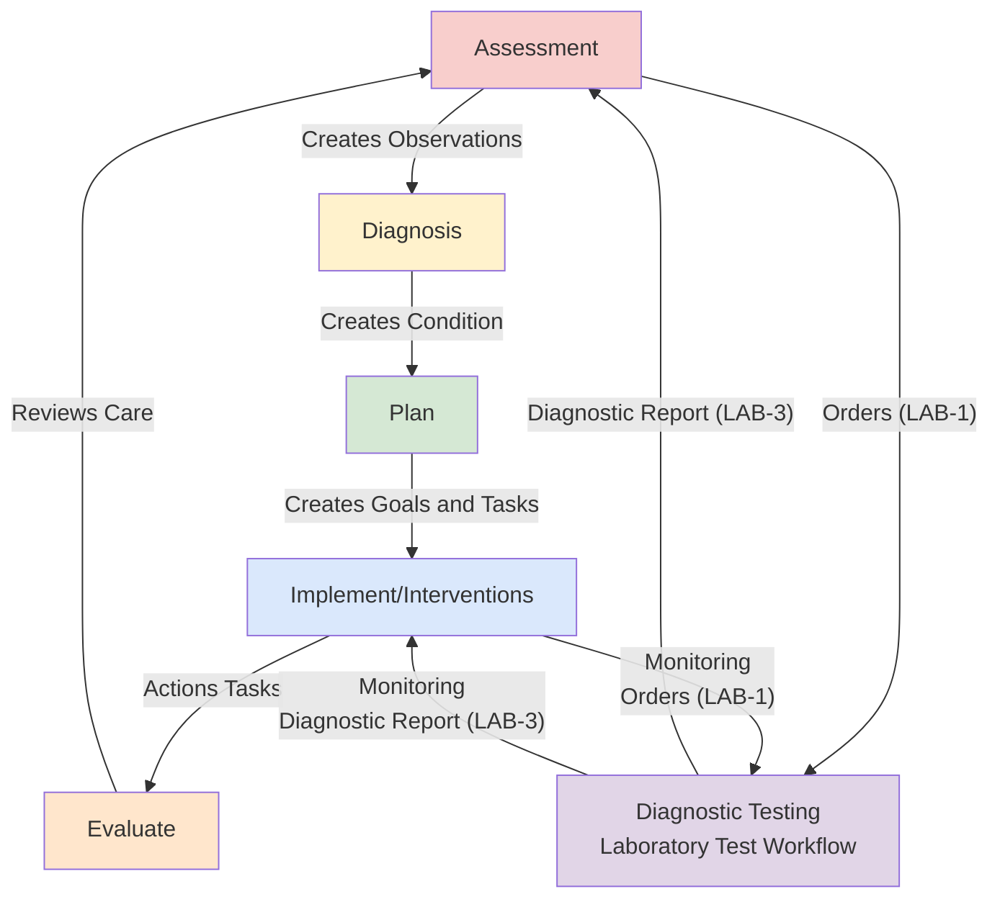
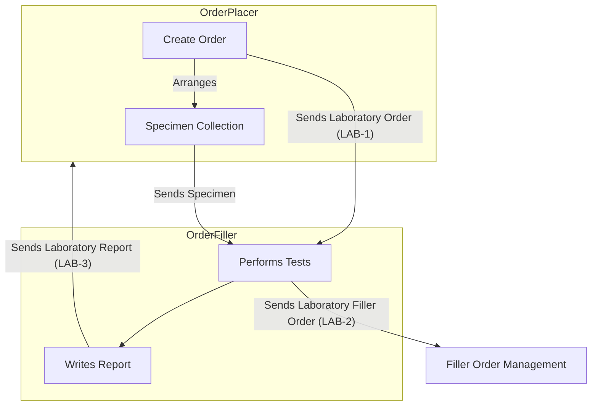
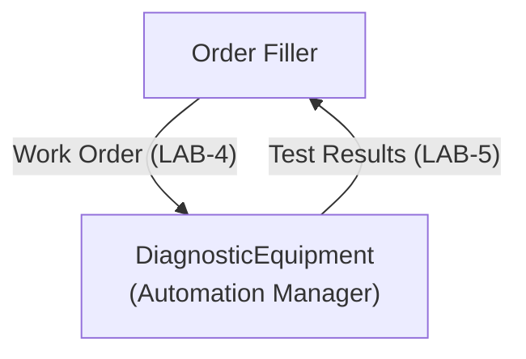
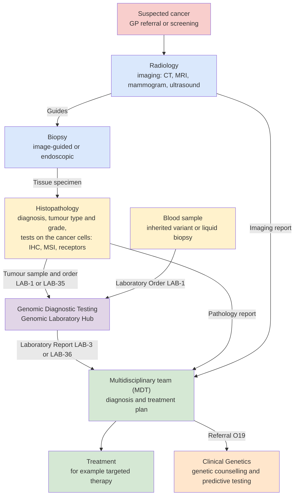

This page gives an overview of how genomic diagnostic testing fits into clinical care: the clinical process, how tests are ordered, performed and reported, the cancer diagnostic pathway, and the example scenarios that show these end to end.

### Clinical Process

Diagnostic testing (Laboratory Testing Workflow) is a supporting workflow that is embedded within the wider clinical care pathway rather than a separate process. The laboratory or diagnostic service is used whenever the clinical team needs additional evidence to make, confirm, monitor, or review a diagnosis and treatment plan.

### Diagnostic Testing

The diagnostic testing begins when the Order Placer creates a laboratory order after determining that diagnostic testing is required. The clinician selects the test order form for the test, completes it (the Genomic Test Order) and submits it. The laboratory order (LAB-1) is transmitted electronically to the laboratory.

At the same time, the requesting organisation arranges for the patient's specimen to be collected, and the physical specimen is sent to the laboratory (usually by post). A specimen does not always need collecting:

- it has already been sent to the GLH and extracted DNA is already stored there, or
- the sample is somewhere else in the country. In this instance the ordering clinician will need to arrange the sample transfer to the GLH.

The order may be updated after it has been submitted, for example with the specimen collection details. When an order has been entered manually, or when the Specimen arrives at the laboratory, a laboratory filler order (LAB-2) is generated.

Within the Order Filler, the laboratory receives both the electronic order and the specimen, in either order (or locates the stored DNA). Laboratory staff perform the requested tests, validate the results, and produce a diagnostic report. Once authorised, the laboratory sends the laboratory report (LAB-3) back to the requesting clinical system. One or more initial (interim) reports may be sent before the final report, each as a LAB-3, so the Order Result Tracker receives reports until the final report arrives.

### Perform Tests

Order Filler generates one or more Work Orders (LAB-4). A work order contains the operational instructions needed by the diagnostic equipment, such as the specimen identifier, requested tests, analyser configuration, priority, and quality control requirements. These work orders are transmitted to the appropriate laboratory instruments or automation manager, which routes specimens and schedules testing across one or more analysers.

The Diagnostic Equipment performs the requested analytical procedures and measures the required biomarkers or characteristics of the specimen. Once testing is complete, the instrument returns the measured values as Test Results (LAB-5) to the Order Filler. These results typically include quantitative or qualitative observations together with instrument identifiers, measurement units, reference ranges, flags indicating abnormal values, quality control information, and timestamps.

### Cancer Diagnostic Pathway

Genomic testing is one of several diagnostic services in a cancer pathway. The diagnosis is usually built up step by step:
imaging finds and locates the abnormality, a biopsy takes a sample, histopathology makes the diagnosis and does the first
tests on the cancer cells, and genomic testing then looks for gene changes that guide treatment or show an inherited
cause. The multidisciplinary team (MDT) brings the results together to agree the diagnosis and treatment plan.

This section focuses on the pathway: the diagnostic services involved and the workflow between them. For cancer data models, see <a href="https://build.fhir.org/ig/HL7/fhir-mCODE-ig/">HL7 FHIR minimal Common Oncology Data Elements (mCODE)</a>, which is believed to have a similar data model to the NHS England National Disease Registration Service (NDRS) <a href="https://digital.nhs.uk/ndrs/data/data-sets/cosd">Cancer Outcomes and Services Data set (COSD)</a>, the national standard for collecting cancer data in the NHS.

| Step | What happens | Standards and guides |
|------|--------------|----------------------|
| Radiology | Imaging (for example CT, MRI, a mammogram or ultrasound) finds and locates the abnormality, and is often used to guide the biopsy | [IHE Radiology Technical Framework - Volume 1](https://www.ihe.net/uploadedFiles/Documents/Radiology/IHE_RAD_TF_Vol1.pdf), for example Scheduled Workflow for ordering and performing imaging and reporting. Not covered by this guide |
| Biopsy | A sample of the abnormal area is taken, for example an image-guided core biopsy or a biopsy during an endoscopy or colonoscopy | [IHE Pathology and Laboratory Medicine (PaLM)](https://profiles.ihe.net/PaLM/index.html): Laboratory Specimen Barcode Labeling (LBL) for labelling the specimen, Specimen Event Tracking (SET, trial implementation) for tracking it, and Radiology Pathology Concordance (RPC, trial implementation) for comparing the imaging with the pathology result. This guide: [Collect Specimen - Biopsy Procedure](ExampleScenario-BiopsyProcedure.html) (background) and [Specimen Transportation and Management](SpecimenTransportationAndManagement.html) |
| Histopathology | The pathologist examines the sample to confirm the cancer and its type and grade, and does tests on the cancer cells, such as immunohistochemistry (IHC), microsatellite instability (MSI) or hormone receptor and HER2 tests | [IHE PaLM](https://profiles.ihe.net/PaLM/index.html): Anatomic Pathology Structured Report (APSR, trial implementation) for the histopathology report, and Anatomic Pathology Reporting to Public Health (ARPH, trial implementation). Cancer registration: NHS England [National Disease Registration Service (NDRS)](https://digital.nhs.uk/services/national-disease-registration-service). Pathology reports to cancer registries: [HL7 FHIR US Cancer Pathology Data Sharing](https://hl7.org/fhir/us/cancer-reporting/index.html). This guide: a copy of the pathology report is sent with the genomic order (`ServiceRequest.supportingInfo`); where histopathology itself asks for genomic testing on the tumour sample, see [Inter-Laboratory Workflow - Reflex Order](ILW.html#reflex-order) |
| Genomic testing | The Genomic Laboratory Hub tests the tumour sample for gene changes (somatic testing), or a blood sample for an inherited variant (germline testing) or for DNA from the cancer cells (liquid biopsy) | This guide: the [Laboratory Testing Workflow](LTW.html) and [Inter-Laboratory Workflow](ILW.html), based on [IHE Pathology and Laboratory Medicine (PaLM)](https://www.ihe.net/uploadedFiles/Documents/PaLM/IHE_PaLM_TF_Vol1.pdf), with results based on [HL7 FHIR Genomics Reporting](https://hl7.org/fhir/uv/genomics-reporting/STU3/) and the report as a FHIR Document based on [HL7 Europe Laboratory Report](https://hl7.eu/fhir/laboratory/2.1.0/) for the central repository |
| MDT and treatment | The MDT reviews the imaging, pathology and genomic reports and agrees the treatment plan | Cancer registration of diagnosis and treatment: [NDRS](https://digital.nhs.uk/services/national-disease-registration-service). Not covered by this guide: the reports are sent back to the requesting clinician |
| Clinical genetics | If an inherited variant is found, the family is referred for genetic counselling, and relatives can have predictive testing for the same variant | This guide: the referral (O19) - see [Genetic Referrals](GeneticReferrals.html). Family history may be recorded in another system, such as [NDRS](https://digital.nhs.uk/services/national-disease-registration-service) |
{:.grid}

How the cancer scenarios below fit this pathway:

- [Lynch Syndrome](ExampleScenario-LynchSyndrome.html) - a colonoscopy biopsy confirms bowel cancer, and histopathology's
  IHC on the cancer cells suggests an inherited cause, so a blood sample is sent for germline testing.
- [Inherited Breast Cancer (BRCA)](ExampleScenario-BreastCancer.html) - imaging and an image-guided core biopsy confirm
  breast cancer, and histopathology's receptor tests show it is triple negative, so a blood sample is sent for germline testing.
- [Lung Cancer - Liquid Biopsy (ctDNA)](ExampleScenario-ctDNA.html) - for non-small cell lung cancer the gene changes are
  usually tested on the biopsy sample; here a blood sample (liquid biopsy) is tested instead. The
  [Somatic genomic report](Bundle-FHIRDocumentGeneticReportBundle-Somatic.html) example shows testing of the tumour sample.

### Example Scenarios

The example scenarios are worked examples of genomic testing pathways, from the order to the report and, where it applies, the
referral of the family to clinical genetics. Each scenario lists its actors, the messages and documents exchanged, and the
example resources for each step, so the scenarios can also be used for **end-to-end testing**: the example messages are the
test data for each step.

#### Scope

The scenarios cover **genomic diagnostic testing**: the genomic test order (HL7 FHIR Message O21), the Laboratory Report
(R01) with its results and the report PDF, the FHIR Document sent to a central repository, and the referral of the family
to clinical genetics (O19). Other testing is mentioned where it is part of the pathway but is not modelled, for example
tests on the cancer cells done by histopathology (immunohistochemistry, microsatellite instability, hormone receptors and
HER2). A copy of the pathology report is sent with the order instead. Clinical decisions, such as the choice of treatment,
are not covered.

The plain-English descriptions of the cancer pathways follow [Macmillan Cancer Support](https://www.macmillan.org.uk/),
for example **diagnostic testing** (testing the person who has had cancer) and **predictive testing** (testing relatives
for the same variant).

#### Cancer

| Scenario | What happens | Genomic test | Messages and documents |
|----------|--------------|--------------|------------------------|
| [Lynch Syndrome](ExampleScenario-LynchSyndrome.html) | Bowel cancer, and tests on the cancer cells suggest an inherited cause. A blood test finds a pathogenic MLH1 variant, and the family is referred for predictive testing | R210.2 Inherited MMR deficiency (Lynch syndrome) | O21 order with the pathology report, R01 report, FHIR Document, O19 referral |
| [Suspected Lynch Syndrome - Clinical Workflow](ExampleScenario-ClinicalAndGenomicWorkflow.html) | The consultant's view of Lynch Syndrome: the Condition is recorded as suspected, the tests are requested, and the Condition is updated to confirmed when the test is positive | R210.2 | The Lynch Syndrome messages, and the Condition before and after |
| [Inherited Breast Cancer (BRCA)](ExampleScenario-BreastCancer.html) | Triple-negative breast cancer at a young age. A blood test finds a pathogenic BRCA1 variant, and the family is referred so her sister can have predictive testing | R208.1 Inherited breast cancer and ovarian cancer | O21 order with the pathology report, R01 report, FHIR Document, O19 referral |
| [Lung Cancer - Liquid Biopsy (ctDNA)](ExampleScenario-ctDNA.html) | A blood test (liquid biopsy) looks for gene changes in DNA from lung cancer cells, to help choose targeted treatment | M4.14 Non-small cell lung cancer, multi-target ctDNA panel | O21 order, work order (LAB-4), test results (LAB-5), R01 report, FHIR Document |
{:.grid}

#### Rare and inherited disease, pregnancy and medicines

| Scenario | What happens | Genomic test | Messages and documents |
|----------|--------------|--------------|------------------------|
| [Rapid Genetic Testing in Pregnancy](ExampleScenario-RapidPrenatalExomeSequencing.html) | A scan finds a fetal anomaly. The home GLH does first-line tests and sends a sub-order to a national testing GLH, and the family is referred to clinical genetics | R21 Fetal anomalies with a likely genetic cause | O21 order, sub-order (LAB-35) via GOMS, order status (O51), sub-order report (LAB-36), R01 report, O19 referral |
| [Hearing Loss Test for Another Region](ExampleScenario-SpecialistTestForAnotherGLH.html) | Another region's GLH sends the North West GLH a sub-order for a specialist test it provides nationally | R67.1 Monogenic hearing loss | O21 order, sub-order (LAB-35) via GOMS, order status (O51), sub-order report (LAB-36), R01 report |
| [Whole Genome Sequencing for a Rare Condition](ExampleScenario-WholeGenomeSequencing.html) | A child's referral is registered with Genomics England. Each family member is sequenced, and the requesting laboratory reports on the family | R27.3 Paediatric disorders | O19 family referral, sub-orders (LAB-35), R01 report |
| [Gene Test Before Starting a Medicine](ExampleScenario-Pharmacogenomics.html) | A gene test before starting mavacamten shows how the patient processes the medicine | R454.1 CYP2C19 genotyping | O21 order, R01 report, FHIR Document |
{:.grid}

#### Background

These describe the processes the scenarios above build on.

- [Genomic Test Order Process](ExampleScenario-GenomicTestOrderProcess.html) - order entry and transmission of the order
- [Genomic Test Report Process](ExampleScenario-GenomicTestReportProcess.html) - reporting
- [Collect Specimen - Biopsy Procedure](ExampleScenario-BiopsyProcedure.html) - specimen collection, not part of this specification

#### How the examples are built

The example messages follow the same rules in every scenario:

- **One ServiceRequest per message.** Later order messages (sub-orders) and report messages do not carry the original
  order. They identify it by its identifier in `basedOn` (the Order Placer Number, or the NGIS referral id for whole genome
  sequencing).
- **Laboratory Orders and Reports are for one patient.** Specimens and Patients for other family members are not
  included. Relatives appear only in the family referral.
- **The family is the subject of an O19 referral**, as a [Family Genetic Group](StructureDefinition-FamilyGeneticGroup.html)
  whose members are Patients. The referral references the testing done as the Genomic Report document on the central
  registry (a `DocumentReference`). See [Genetic Referrals](GeneticReferrals.html).
- **Laboratory Reports carry their results** as `Observation`s ([Variant](StructureDefinition-Variant.html),
  [Diagnostic Implication](StructureDefinition-DiagnosticImplication.html) and the other genomic result profiles), and the
  report as a PDF (`DiagnosticReport.presentedForm` and a `DocumentReference`).
- **A FHIR Document includes every `Observation`** from the scenario's R01 test results and Laboratory Report messages.
