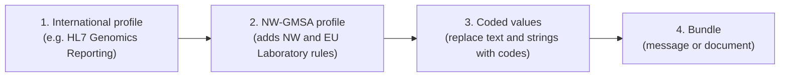

For background, see [FHIR Validation](https://hl7.org/fhir/R4/validation.html) in the FHIR specification. For test patients and test environments, see [Testing](testing.html).

### The FHIR Validator

See [Using the FHIR Validator](https://confluence.hl7.org/display/FHIR/Using+the+FHIR+Validator). You need Java 17 or later and [validator_cli.jar](https://github.com/hapifhir/org.hl7.fhir.core/releases/latest/download/validator_cli.jar).

To validate against this Implementation Guide, download it as a package ([package.tgz](package.tgz)) and pass it with `-ig package.tgz`. The validator loads the packages this IG depends on (HL7 Genomics Reporting, HL7 Europe Laboratory, UK Core, etc.) automatically.

Every command follows the same pattern: the resource file, the FHIR version, the package(s) holding the profile, and the `-profile` to check against.

```
java -jar validator_cli.jar <resource.json> -version 4.0.1 -ig <package> -profile <profile canonical URL> -output results.json
```

- `-output results.json` writes the results as a FHIR `OperationOutcome`. Each `issue` has a `severity` (error, warning or information), an `expression` (where in the resource the problem is), and a message. This is easier to work through than the console output.
- `-tx n/a` turns off the terminology server. Validation is faster, but codes are not checked against LOINC, HGNC, SNOMED CT, etc. Leave it out (the default is `tx.fhir.org`) once the structure is right, so that your codes are checked too.
- The NHS England Ontology Service cannot be used as the terminology server (`-tx`) because of its API security requirements. This IG is configured to use the UK edition of SNOMED CT (83821000000107).

#### Using a web browser

[validator.fhir.org](https://validator.fhir.org/) provides a web interface to the same validator. It defaults to international FHIR. Use the options tab to choose packages and the SNOMED CT edition (listed as `UK - 999000041000000102`). This IG is not currently published to the package registry, so use `ukcore` (latest release) instead.

### Recommended approach

Validating a whole Bundle (a message or document) checks every entry at once, against every profile, and checks that the references between entries resolve. On a first attempt this usually produces a long list of errors. Many of them are repeats of the same mistake, and it is hard to tell which ones matter.

Instead, validate one resource at a time, building up conformance in stages:



1. **International profile**: validate the resource against the profile this IG builds on. These rules are the smallest set and the best documented.
2. **NW-GMSA profile**: validate against this IG's profile. It inherits stage 1 and adds local NW requirements. It also imposes the [HL7 Europe Laboratory Report](https://hl7.eu/fhir/laboratory/2.1.0/) Observation profile.
3. **Coded values**: a resource can pass with free text (`CodeableConcept.text`, `valueString`), but receiving systems cannot act on text. Replace it with codes.
4. **Bundle**: once each resource passes, put the resources in the Bundle and [validate the Bundle](#validating-a-bundle). The remaining errors will mostly be about references and Bundle structure. Validation of a document Bundle is likely to be required for conformance with the NHS England Unified Genomic Record (UGR).

At each stage, repeat the same loop: run the validator, read the issues in the `OperationOutcome`, change the resource, and run it again. Fix **errors** first. Warnings and information messages often go away once the errors are fixed.

### Worked example: Variant Observation

This Observation was produced by a laboratory decision support system for a Lynch Syndrome (MSH2) variant. Save it as `observation.json`.

```json
{
  "resourceType": "Observation",
  "basedOn": [ {
    "type": "ServiceRequest",
    "identifier": {
      "assigner": { "identifier": { "system": "https://fhir.nhs.uk/Id/ods-organization-code", "value": "RM3" } },
      "type": { "coding": [ { "code": "PLAC", "system": "http://terminology.hl7.org/CodeSystem/v2-0203" } ] },
      "value": "1037019086"
    }
  } ],
  "status": "final",
  "category": [ { "coding": [ { "system": "http://terminology.hl7.org/CodeSystem/observation-category", "code": "laboratory" } ] } ],
  "code": { "coding": [ { "system": "http://loinc.org", "code": "69548-6" } ] },
  "subject": {
    "type": "Patient",
    "identifier": { "system": "https://fhir.nwgenomics.nhs.uk/iGene/PatientIdentifier", "value": "200048" }
  },
  "effectiveDateTime": "2026-11-24T15:10:10.391645+00:00",
  "performer": [ {
    "type": "PractitionerRole",
    "identifier": { "system": "https://fhir.nwgenomics.nhs.uk/Id/laboratory-information-system", "value": "OmicsDSS" }
  } ],
  "specimen": {
    "type": "Specimen",
    "identifier": { "system": "https://fhir.nwgenomics.nhs.uk/iGene/SpecimenIdentifier", "value": "S26-2G39" }
  },
  "component": [
    { "code": { "coding": [ { "system": "http://loinc.org", "code": "83005-9" } ] }, "valueCodeableConcept": { "text": "SNPs" } },
    { "code": { "text": "Description" }, "valueString": "MSH2 c.212-4del -" },
    { "code": { "text": "State" }, "valueString": "10.72" },
    { "code": { "text": "Genomic coordinates" }, "valueString": "2:47408384" },
    { "code": { "coding": [ { "system": "http://loinc.org", "code": "53037-8" } ] }, "valueCodeableConcept": { "text": "Oncogenic" } },
    { "code": { "text": "Evidence" }, "valueString": "PS1" }
  ]
}
```

#### Stage 1: HL7 Genomics Reporting Variant

The international profile is [Genomics Reporting STU3 Variant](https://hl7.org/fhir/uv/genomics-reporting/STU3/StructureDefinition-variant.html). The validator downloads this package from the FHIR package registry.

##### Run 1

```
java -jar validator_cli.jar observation.json -version 4.0.1 -ig hl7.fhir.uv.genomics-reporting#3.0.0 -profile http://hl7.org/fhir/uv/genomics-reporting/StructureDefinition/variant -tx n/a -output results.json
```

Issues in `results.json`:

| Severity | Location | Message |
|----------|----------|---------|
| error | `Observation` | Observation.category: minimum required = 2, but only found 1 (from http://hl7.org/fhir/uv/genomics-reporting/StructureDefinition/variant\|3.0.0) |
| error | `Observation` | Slice 'Observation.category:geCategory': a matching slice is required, but not found (from http://hl7.org/fhir/uv/genomics-reporting/StructureDefinition/variant\|3.0.0). Note that other slices are allowed in addition to this required slice |
| warning | `Observation` | Constraint failed: dom-6: 'A resource should have narrative for robust management' (defined in http://hl7.org/fhir/StructureDefinition/DomainResource) (Best Practice Recommendation) |
| information | `Observation.component[0] to [5]` | This element does not match any known slice defined in the profile http://hl7.org/fhir/uv/genomics-reporting/StructureDefinition/variant\|3.0.0 (this may not be a problem, but you should check that it's not intended to match a slice) |
{:.grid}

There are three kinds of issue here:

- **Errors** (two of them, with the same cause): the Variant profile requires **two** categories, `laboratory` and `GE` (Genetics) from HL7 v2 table 0074. The example only has `laboratory`.
- **Warning** `dom-6`: the resource has no narrative (`text`). This is a best-practice recommendation and can be ignored for laboratory messages; you will see it on every run.
- **Information** "does not match any known slice": none of the six components uses a code that the Variant profile recognises (`83005-9` is not one of its slices either). Information messages don't stop a resource from validating, but these ones point to the problem dealt with in [Stage 3](#stage-3-replace-text-with-coded-values).

##### Changes after run 1

Add the second category:

```json
"category": [
  { "coding": [ { "system": "http://terminology.hl7.org/CodeSystem/observation-category", "code": "laboratory" } ] },
  { "coding": [ { "system": "http://terminology.hl7.org/CodeSystem/v2-0074", "code": "GE" } ] }
]
```

##### Run 2

Run the same command again.

| Severity | Location | Message |
|----------|----------|---------|
| warning | `Observation` | Constraint failed: dom-6: 'A resource should have narrative for robust management' (defined in http://hl7.org/fhir/StructureDefinition/DomainResource) (Best Practice Recommendation) |
| information | `Observation.component[0] to [5]` | This element does not match any known slice defined in the profile http://hl7.org/fhir/uv/genomics-reporting/StructureDefinition/variant\|3.0.0 (this may not be a problem, but you should check that it's not intended to match a slice) |
{:.grid}

There are no errors, so the resource passes the Genomics Reporting rules. This is because the Variant profile's `component` slicing is **open**: a component with an unrecognised code, or with only `code.text`, is allowed, and is reported only as information. Passing stage 1 does not mean the variant is described correctly. Stage 3 deals with that.

#### Stage 2: NW-GMSA Variant

Next, validate against this IG's [Variant](StructureDefinition-Variant.html) profile. This inherits stage 1 and imposes the NW [Observation](StructureDefinition-Observation.html) profile, which is based on EU Laboratory [Observation Results: laboratory](https://hl7.eu/fhir/laboratory/2.1.0/StructureDefinition-Observation-resultslab-eu-lab.html).

##### Run 3

```
java -jar validator_cli.jar observation.json -version 4.0.1 -ig package.tgz -profile https://fhir.nwgenomics.nhs.uk/StructureDefinition/Variant -tx n/a -output results.json
```

| Severity | Location | Message |
|----------|----------|---------|
| error | `Observation` | Observation.method: minimum required = 1, but only found 0 (from https://fhir.nwgenomics.nhs.uk/StructureDefinition/Variant\|2.3.0) |
| error | `Observation` | Observation.identifier: minimum required = 1, but only found 0 (from https://fhir.nwgenomics.nhs.uk/StructureDefinition/Observation\|2.3.0) |
| error | `Observation.subject` | Observation.subject.reference: minimum required = 1, but only found 0 (from https://fhir.nwgenomics.nhs.uk/StructureDefinition/Observation\|2.3.0) |
| error | `Observation.subject.identifier` | Unable to find a match for the specified profile among choices: https://fhir.nwgenomics.nhs.uk/StructureDefinition/MedicalRecordNumber, https://fhir.nwgenomics.nhs.uk/StructureDefinition/NHSIdentifier, https://fhir.nwgenomics.nhs.uk/StructureDefinition/PatientIdentifier |
| error | `Observation.subject.identifier` | Identifier.assigner: minimum required = 1, but only found 0 (from https://fhir.nwgenomics.nhs.uk/StructureDefinition/PatientIdentifier\|2.3.0) (validating against https://fhir.nwgenomics.nhs.uk/StructureDefinition/PatientIdentifier\|2.3.0 [PatientIdentifier]) |
| error | `Observation.subject.identifier.system` | The System URI could not be determined for the code 'https://fhir.nwgenomics.nhs.uk/iGene/PatientIdentifier' in the ValueSet 'https://fhir.nwgenomics.nhs.uk/ValueSet/UKNationalHealthIdentifiers\|2.3.0' (validating against https://fhir.nwgenomics.nhs.uk/StructureDefinition/NHSIdentifier\|2.3.0 [NHSIdentifier]) |
| error | `Observation.subject.identifier.system` | The value provided ('https://fhir.nwgenomics.nhs.uk/iGene/PatientIdentifier') was not found in the value set 'UK National Health Identifiers' (https://fhir.nwgenomics.nhs.uk/ValueSet/UKNationalHealthIdentifiers\|2.3.0), and a code is required from this value set  (error message = The System URI could not be determined for the code 'https://fhir.nwgenomics.nhs.uk/iGene/PatientIdentifier' in the ValueSet 'https://fhir.nwgenomics.nhs.uk/ValueSet/UKNationalHealthIdentifiers\|2.3.0'; The provided code '#https://fhir.nwgenomics.nhs.uk/iGene/PatientIdentifier' was not found in the value set 'https://fhir.nwgenomics.nhs.uk/ValueSet/UKNationalHealthIdentifiers\|2.3.0') (validating against https://fhir.nwgenomics.nhs.uk/StructureDefinition/NHSIdentifier\|2.3.0 [NHSIdentifier]) |
| error | `Observation.subject.identifier` | Identifier.assigner: minimum required = 1, but only found 0 (from https://fhir.nwgenomics.nhs.uk/StructureDefinition/MedicalRecordNumber\|2.3.0) (validating against https://fhir.nwgenomics.nhs.uk/StructureDefinition/MedicalRecordNumber\|2.3.0 [MedicalRecordNumber]) |
| warning | `Observation.component[0].value.ofType(CodeableConcept)` | No code provided, and a code should be provided from the value set 'iGene Variant Category' (https://fhir.nwgenomics.nhs.uk/ValueSet/IGeneVariantCategoryVS\|2.3.0) |
| warning | `Observation` | Constraint failed: dom-6: 'A resource should have narrative for robust management' (defined in http://hl7.org/fhir/StructureDefinition/DomainResource) (Best Practice Recommendation) |
| information | `Observation.component[1] to [5]` | This element does not match any known slice defined in the profile https://fhir.nwgenomics.nhs.uk/StructureDefinition/Variant\|2.3.0 (this may not be a problem, but you should check that it's not intended to match a slice) |
{:.grid}

The NW profile reports errors that the international profile didn't. The five `subject.identifier` errors come from one problem. The NW profile only accepts an NHS Number ([NHS Identifier](StructureDefinition-NHSIdentifier.html)), a [Medical Record Number](StructureDefinition-MedicalRecordNumber.html) or a [Patient Identifier](StructureDefinition-PatientIdentifier.html). The validator tries each, and reports why each one failed: the `system` is not an NHS Number system, and both a Medical Record Number and a Patient Identifier need an `assigner`. The validator doesn't report the missing `type`, but without it a receiver can't tell which kind of identifier this is. The iGene patient number is a Patient Identifier (type `PI`) assigned by NW GLH (`699X0`), see [iGene Patient Identifier](NamingSystem-iGene-PatientIdentifier.html).

There is also a new warning: the NW profile binds the variant category (`83005-9`) to [iGene Variant Category](ValueSet-IGeneVariantCategoryVS.html), and `"text": "SNPs"` has no code. This is fixed in Stage 3.

##### Changes after run 3

| Element | Rule | Source | Change made |
|---------|------|--------|-------------|
| `identifier` | 1..1 | NW Observation | Added the identifier the laboratory system uses for this result |
| `method` | 1..1 | NW Variant | Added SNOMED CT `264896000` *Nucleic acid analysis*, with `method.text` giving the technique |
| `subject.reference` | 1..1 | NW Observation | An identifier on its own is not enough. Added a `reference` to the Patient (a `urn:uuid:` within a Bundle, or the Patient's URL on a FHIR server) |
| `subject.identifier` | NHS Number, Medical Record Number or Patient Identifier | NW Observation | Added `type` = `PI` and an `assigner` of `699X0` (NW GLH), making the iGene patient number a Patient Identifier. Use the NHS Number instead where it is known |
| `performer` | NW PractitionerRole or Organization | NW Observation | Not reported, because the validator cannot check the type of an identifier-only reference. But `OmicsDSS` is a software system, not a performer, so it was replaced with the performing laboratory, NW GLH, as an Organization identified by its ODS code `699X0` |
{:.grid}

```json
"identifier": [ { "system": "https://fhir.nwgenomics.nhs.uk/iGene/VariantIdentifier", "value": "S26-2G39-V1" } ],
"subject": {
  "reference": "urn:uuid:5b3a8c1e-0d7f-4c55-9b9e-2f8a6d1c4e70",
  "type": "Patient",
  "identifier": {
    "type": { "coding": [ { "system": "http://terminology.hl7.org/CodeSystem/v2-0203", "code": "PI" } ] },
    "system": "https://fhir.nwgenomics.nhs.uk/iGene/PatientIdentifier",
    "value": "200048",
    "assigner": { "identifier": { "system": "https://fhir.nhs.uk/Id/ods-organization-code", "value": "699X0" } }
  }
},
"performer": [ {
  "type": "Organization",
  "identifier": { "system": "https://fhir.nhs.uk/Id/ods-organization-code", "value": "699X0" }
} ],
"method": {
  "coding": [ { "system": "http://snomed.info/sct", "code": "264896000", "display": "Nucleic acid analysis" } ],
  "text": "Targeted next generation sequencing"
}
```

The `basedOn` identifier (placer order number, with `type` `PLAC` and an ODS `assigner`) already follows the NW [Correlation Identifier](StructureDefinition-CorrelationIdentifier.html) pattern, so it doesn't need to change.

##### Run 4

Run the same command again.

| Severity | Location | Message |
|----------|----------|---------|
| warning | `Observation.component[0].value.ofType(CodeableConcept)` | No code provided, and a code should be provided from the value set 'iGene Variant Category' (https://fhir.nwgenomics.nhs.uk/ValueSet/IGeneVariantCategoryVS\|2.3.0) |
| warning | `Observation` | Constraint failed: dom-6: 'A resource should have narrative for robust management' (defined in http://hl7.org/fhir/StructureDefinition/DomainResource) (Best Practice Recommendation) |
| information | `Observation.component[1] to [5]` | This element does not match any known slice defined in the profile https://fhir.nwgenomics.nhs.uk/StructureDefinition/Variant\|2.3.0 (this may not be a problem, but you should check that it's not intended to match a slice) |
| information | `Observation.method` | Could not confirm that the codes provided are from the extensible value set http://loinc.org/vs/LL4048-6 because there is no terminology service |
{:.grid}

There are no errors, so the resource now conforms to the NW Variant profile. The issues that are left are:

- the uncoded variant category, and the components that don't match a slice. Stage 3 deals with both.
- an information message that the `method` code could not be checked, because `-tx n/a` turned off the terminology server. Run 5 checks it.

#### Stage 3: Replace text with coded values

The resource now passes, but with free-text components. A receiving system, or the NW FHIR Repository, cannot reliably query or act on `"valueString": "MSH2 c.212-4del -"`. Each piece of information has a coded slot in the Variant profile:

| Original component | What it means | Coded representation |
|--------------------|---------------|----------------------|
| `83005-9` = text *SNPs* | Variant category | `83005-9` with [IGeneVariantCategory](CodeSystem-IGeneVariantCategory.html) `SEQV` *Sequence Variant*. Note that c.212-4del is a deletion, not a SNP. |
| *Description* = `MSH2 c.212-4del -` | Gene and DNA change | Split into `gene-studied` (`48018-6`, HGNC `HGNC:7325` *MSH2*), `representative-transcript-ref-seq` (`51958-7`, RefSeq transcript), and `representative-coding-hgvs` (`48004-6`, HGVS on that transcript). Also `coding-change-type` (`48019-4`, Sequence Ontology `SO:0000159` *deletion*). |
| *State* = `10.72` | Most likely the variant allele fraction, as a percentage (confirm with the system supplier) | `sample-allelic-frequency` (`81258-6`) as a `valueQuantity` with UCUM unit `1`, i.e. `0.1072` |
| *Genomic coordinates* = `2:47408384` | Chromosome and position | `chromosome-identifier` (`48000-4`, LOINC chromosome 2), `exact-start-end` (`81254-5`, `valueRange`), `coordinate-system` (`92822-6`) and `reference-sequence-assembly` (`62374-4`, GRCh37 or GRCh38). A position without its genome build cannot be interpreted. |
| `53037-8` = text *Oncogenic* | Clinical significance | **Does not belong on Variant.** Classification goes on a separate [Diagnostic Implication](StructureDefinition-DiagnosticImplication.html) Observation, which points to the Variant with `derivedFrom`. See [Clinical significance and evidence](#clinical-significance-and-evidence). |
| *Evidence* = `PS1` | ACMG/AMP classification criterion | Also part of the classification, so it goes on the Diagnostic Implication, not the Variant. |
| *(missing)* | Was the variant found? | `valueCodeableConcept` = LOINC `LA9633-4` *Present* (answer list LL1971-2). This is Must Support in the NW profile. |
| *(missing)* | Germline or somatic | `genomic-source-class` (`48002-0`), e.g. `LA6684-0` *Somatic* for tumour testing |
{:.grid}

The corrected Variant is shown below. The patient, laboratory and transcript details are illustrative, and the values marked as assumptions above must be confirmed against the source system.

```json
{
  "resourceType": "Observation",
  "identifier": [ { "system": "https://fhir.nwgenomics.nhs.uk/iGene/VariantIdentifier", "value": "S26-2G39-V1" } ],
  "basedOn": [ {
    "type": "ServiceRequest",
    "identifier": {
      "type": { "coding": [ { "system": "http://terminology.hl7.org/CodeSystem/v2-0203", "code": "PLAC" } ] },
      "value": "1037019086",
      "assigner": { "identifier": { "system": "https://fhir.nhs.uk/Id/ods-organization-code", "value": "RM3" } }
    }
  } ],
  "status": "final",
  "category": [
    { "coding": [ { "system": "http://terminology.hl7.org/CodeSystem/observation-category", "code": "laboratory" } ] },
    { "coding": [ { "system": "http://terminology.hl7.org/CodeSystem/v2-0074", "code": "GE" } ] }
  ],
  "code": { "coding": [ { "system": "http://loinc.org", "code": "69548-6", "display": "Genetic variant assessment" } ] },
  "subject": {
    "reference": "urn:uuid:5b3a8c1e-0d7f-4c55-9b9e-2f8a6d1c4e70",
    "type": "Patient",
    "identifier": {
      "type": { "coding": [ { "system": "http://terminology.hl7.org/CodeSystem/v2-0203", "code": "PI" } ] },
      "system": "https://fhir.nwgenomics.nhs.uk/iGene/PatientIdentifier",
      "value": "200048",
      "assigner": { "identifier": { "system": "https://fhir.nhs.uk/Id/ods-organization-code", "value": "699X0" } }
    }
  },
  "effectiveDateTime": "2026-11-24T15:10:10+00:00",
  "performer": [ {
    "type": "Organization",
    "identifier": { "system": "https://fhir.nhs.uk/Id/ods-organization-code", "value": "699X0" }
  } ],
  "specimen": {
    "type": "Specimen",
    "identifier": { "system": "https://fhir.nwgenomics.nhs.uk/iGene/SpecimenIdentifier", "value": "S26-2G39" }
  },
  "method": {
    "coding": [ { "system": "http://snomed.info/sct", "code": "264896000", "display": "Nucleic acid analysis" } ],
    "text": "Targeted next generation sequencing"
  },
  "valueCodeableConcept": { "coding": [ { "system": "http://loinc.org", "code": "LA9633-4", "display": "Present" } ] },
  "component": [
    {
      "code": { "coding": [ { "system": "http://loinc.org", "code": "83005-9", "display": "Variant category" } ] },
      "valueCodeableConcept": { "coding": [ { "system": "https://fhir.nwgenomics.nhs.uk/CodeSystem/IGeneVariantCategory", "code": "SEQV", "display": "Sequence Variant" } ] }
    },
    {
      "code": { "coding": [ { "system": "http://loinc.org", "code": "48018-6", "display": "Gene studied [ID]" } ] },
      "valueCodeableConcept": { "coding": [ { "system": "http://www.genenames.org", "code": "HGNC:7325", "display": "MSH2" } ] }
    },
    {
      "code": { "coding": [ { "system": "http://loinc.org", "code": "51958-7", "display": "Transcript reference sequence [ID]" } ] },
      "valueCodeableConcept": { "coding": [ { "system": "http://www.ncbi.nlm.nih.gov/refseq", "code": "NM_000251.3" } ] }
    },
    {
      "code": { "coding": [ { "system": "http://loinc.org", "code": "48004-6", "display": "DNA change (c.HGVS)" } ] },
      "valueCodeableConcept": { "coding": [ { "system": "http://varnomen.hgvs.org", "code": "NM_000251.3:c.212-4del" } ] }
    },
    {
      "code": { "coding": [ { "system": "http://loinc.org", "code": "48019-4", "display": "DNA change type" } ] },
      "valueCodeableConcept": { "coding": [ { "system": "http://www.sequenceontology.org", "code": "SO:0000159", "display": "deletion" } ] }
    },
    {
      "code": { "coding": [ { "system": "http://loinc.org", "code": "81258-6", "display": "Sample variant allelic frequency [NFr]" } ] },
      "valueQuantity": { "value": 0.1072, "system": "http://unitsofmeasure.org", "code": "1" }
    },
    {
      "code": { "coding": [ { "system": "http://loinc.org", "code": "48002-0", "display": "Genomic source class [Type]" } ] },
      "valueCodeableConcept": { "coding": [ { "system": "http://loinc.org", "code": "LA6684-0", "display": "Somatic" } ] }
    }
  ]
}
```

Chromosome, position, coordinate system and genome build are left out because the source data does not say which genome build `47408384` refers to. Add them once that is known. If you are not sure of a LOINC answer code (e.g. which `LA` code means chromosome 2), look it up in the answer list bound to that slice on the [Variant](StructureDefinition-Variant.html) page.

##### Run 5

This time leave out `-tx n/a`, so that the LOINC, HGNC and SNOMED CT codes are checked against the terminology server:

```
java -jar validator_cli.jar observation.json -version 4.0.1 -ig package.tgz -profile https://fhir.nwgenomics.nhs.uk/StructureDefinition/Variant -output results.json
```

| Severity | Location | Message |
|----------|----------|---------|
| error | `Observation.component[3].value.ofType(CodeableConcept).coding[0]` | Error from https://tx.fhir.org/r4: Error: Error validating HGVS code: Error parsing HGVS response: Unexpected token '<', "     <!DOCTYPE "... is not valid JSON |
| error | `Observation.component[3].value.ofType(CodeableConcept)` | None of the codings provided are in the value set 'Human Genome Variation Society (HGVS) Nomenclature' (http://hl7.org/fhir/uv/genomics-reporting/ValueSet/hgvs-vs\|3.0.0), and a coding from this value set is required) (codes = http://varnomen.hgvs.org#NM_000251.3:c.212-4del) |
| error | `Observation.component[3].value.ofType(CodeableConcept)` | Error from https://tx.fhir.org/r4: Error: Error validating HGVS code: Error parsing HGVS response: Unexpected token '<', "     <!DOCTYPE "... is not valid JSON |
| warning | `Observation.method` | None of the codings provided are in the value set 'LOINC Answer Codes for LL4048-6' (http://loinc.org/vs/LL4048-6), and a coding SHALL come from this value set unless it has no suitable code (note that the validator cannot judge what is suitable) (codes = http://snomed.info/sct#264896000) |
| warning | `Observation.component[1].value.ofType(CodeableConcept).coding[0].system` | A definition for CodeSystem 'http://www.genenames.org' could not be found, so the code cannot be validated |
| warning | `Observation.component[2].value.ofType(CodeableConcept).coding[0].system` | A definition for CodeSystem 'http://www.ncbi.nlm.nih.gov/refseq' could not be found, so the code cannot be validated |
| warning | `Observation.component[4].value.ofType(CodeableConcept).coding[0].system` | A definition for CodeSystem 'http://www.sequenceontology.org' could not be found, so the code cannot be validated |
| warning | `Observation` | Constraint failed: dom-6: 'A resource should have narrative for robust management' (defined in http://hl7.org/fhir/StructureDefinition/DomainResource) (Best Practice Recommendation) |
| information | `Observation.component[2].value.ofType(CodeableConcept)` | Binding for path Observation.component[2].value.ofType(CodeableConcept) in profile StructureDefinition[https://fhir.nwgenomics.nhs.uk/StructureDefinition/Variant\|2.3.0] has no source, so can't be checked |
| information | `Observation.value.ofType(CodeableConcept)` | None of the codings provided are in the value set 'Results Coded Values Laboratory/Pathology - IPS' (http://hl7.org/fhir/uv/ips/ValueSet/results-coded-values-laboratory-pathology-uv-ips\|2.0.1), and a coding is recommended to come from this value set (codes = http://loinc.org#LA9633-4) |
| information | `Observation.method` | None of the codings provided are in the value set 'Laboratory Techniques' (http://hl7.eu/fhir/laboratory/ValueSet/lab-technique-eu-lab\|2.1.0), and a coding is recommended to come from this value set (codes = http://snomed.info/sct#264896000) |
| information | `Observation.component[0].value.ofType(CodeableConcept)` | None of the codings provided are in the value set 'Results Coded Values Laboratory/Pathology - IPS' (http://hl7.org/fhir/uv/ips/ValueSet/results-coded-values-laboratory-pathology-uv-ips\|2.0.1), and a coding is recommended to come from this value set (codes = https://fhir.nwgenomics.nhs.uk/CodeSystem/IGeneVariantCategory#SEQV) |
| information | `Observation.component[1].value.ofType(CodeableConcept)` | None of the codings provided are in the value set 'Results Coded Values Laboratory/Pathology - IPS' (http://hl7.org/fhir/uv/ips/ValueSet/results-coded-values-laboratory-pathology-uv-ips\|2.0.1), and a coding is recommended to come from this value set (codes = http://www.genenames.org#HGNC:7325) |
| information | `Observation.component[2].value.ofType(CodeableConcept)` | None of the codings provided are in the value set 'Results Coded Values Laboratory/Pathology - IPS' (http://hl7.org/fhir/uv/ips/ValueSet/results-coded-values-laboratory-pathology-uv-ips\|2.0.1), and a coding is recommended to come from this value set (codes = http://www.ncbi.nlm.nih.gov/refseq#NM_000251.3) |
| information | `Observation.component[3].value.ofType(CodeableConcept)` | Could not confirm that the codings provided are in the value set http://hl7.org/fhir/uv/ips/ValueSet/results-coded-values-laboratory-pathology-uv-ips and a coding is recommended to come from this value set (class = SERVER_ERROR) |
| information | `Observation.component[4].value.ofType(CodeableConcept)` | None of the codings provided are in the value set 'Results Coded Values Laboratory/Pathology - IPS' (http://hl7.org/fhir/uv/ips/ValueSet/results-coded-values-laboratory-pathology-uv-ips\|2.0.1), and a coding is recommended to come from this value set (codes = http://www.sequenceontology.org#SO:0000159) |
| information | `Observation.component[6].value.ofType(CodeableConcept)` | None of the codings provided are in the value set 'Results Coded Values Laboratory/Pathology - IPS' (http://hl7.org/fhir/uv/ips/ValueSet/results-coded-values-laboratory-pathology-uv-ips\|2.0.1), and a coding is recommended to come from this value set (codes = http://loinc.org#LA6684-0) |
{:.grid}

With the terminology server switched on, more issues are reported. Not all of them mean the resource is wrong:

| Issue | Cause | Action |
|-------|-------|--------|
| HGVS errors on `component[3]` | tx.fhir.org checks HGVS expressions using an external service. That service returned a web page instead of a result (`Unexpected token '<'`), so the code was then reported as not in the HGVS value set. This is a server problem, not a problem with the code. | None. Check the expression separately, e.g. with [VariantValidator](https://variantvalidator.org/), and run the validator again later. |
| `method` warning, not in LOINC LL4048-6 | Genomics Reporting binds `method` to the LOINC genetic analysis method answer list (extensible). SNOMED CT `264896000` is valid in FHIR terms, but there is a suitable LOINC answer. | Change `method` (below). |
| "A definition for CodeSystem ... could not be found" for HGNC, RefSeq and Sequence Ontology | tx.fhir.org doesn't have these code systems, so it can't check the codes. The system URLs are the ones Genomics Reporting uses. | None. Check that the codes are correct against the source (HGNC, NCBI, Sequence Ontology). |
| "Binding ... has no source" on `component[2]` | The transcript reference sequence slice has a binding with no value set. | None. |
| "Results Coded Values Laboratory/Pathology - IPS" and "Laboratory Techniques" | EU Laboratory **recommends** (preferred binding) general laboratory value sets. They don't cover genomics codes. | None. These are information only. |
{:.grid}

##### Changes after run 5

Use the LOINC answer for the analysis method, keeping the text:

```json
"method": {
  "coding": [ { "system": "http://loinc.org", "code": "LA26398-0", "display": "Sequencing" } ],
  "text": "Targeted next generation sequencing"
}
```

Run the validator again to confirm that the `method` warning has gone. The Variant is then complete, apart from the genomic coordinates (see above).

##### Clinical significance and evidence

Clinical significance (`53037-8`) and the ACMG/AMP criteria are an interpretation of the variant, not a property of it. Put them in a [Diagnostic Implication](StructureDefinition-DiagnosticImplication.html) Observation with `derivedFrom` pointing to the Variant. Validate that resource separately in the same way: first against Genomics Reporting `diagnostic-implication`, then against `https://fhir.nwgenomics.nhs.uk/StructureDefinition/DiagnosticImplication`.

Use a coded value for clinical significance. The preferred answer list LOINC [LL4034-6](https://loinc.org/LL4034-6) (*Pathogenic*, *Likely pathogenic*, *Uncertain significance*, *Likely benign*, *Benign*) is for germline pathogenicity. *Oncogenic* is a somatic oncogenicity term, and PS1 is a germline ACMG/AMP criterion, so check which classification scheme the laboratory system is actually applying before you choose codes.

#### Stage 4: Validate the Bundle

Once the Variant, Diagnostic Implication, Patient, Specimen and other entries each pass on their own, add them to the message or document Bundle and validate it as described in [Validating a Bundle](#validating-a-bundle). Change the identifier-only references to `urn:uuid:` references to the matching `fullUrl` entries. Any errors left should now be about the Bundle itself, not about the resources in it.

### Validating a Bundle

By default the validator checks the resource you give it (here the Bundle) against its profile. To also check a resource inside the Bundle against a specific profile, use `-bundle <ResourceType>:<index> <profile>`. See **Validating a single resource in a bundle** on [Using the FHIR Validator](https://confluence.hl7.org/display/FHIR/Using+the+FHIR+Validator).

#### laboratory-order O21

```
java -jar validator_cli.jar bundle.json -version 4.0.1 -ig package.tgz -bundle ServiceRequest:0 https://fhir.nwgenomics.nhs.uk/StructureDefinition/ServiceRequest -tx n/a
```

#### unsolicited-observation R01

```
java -jar validator_cli.jar bundle.json -version 4.0.1 -ig package.tgz -bundle DiagnosticReport:0 https://fhir.nwgenomics.nhs.uk/StructureDefinition/DiagnosticReport -tx n/a
```
